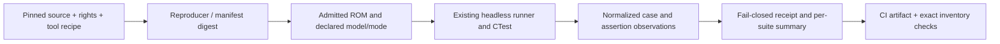

# Phase 14: CGB-E Model Qualification and Corpus — Research

**Researched:** 2026-10-15  
**Domain:** CGB-CPU-E model behavior, test-ROM qualification, fixture provenance, corpus accounting  
**Confidence:** HIGH for source inventory/build/report seams; MEDIUM for hardware behavior (no CGB-E hardware was exercised)

<user_constraints>
## User Constraints (from CONTEXT.md)

### Locked Decisions
## Implementation Decisions

### A. Scope, model axes and dependencies

- **D-01: Preserve the established machine and consumer contracts.** Portable C17, instance-owned state, the master half-dot timeline, whole-instruction bounded public stepping, explicit model gates, output/headroom checks and failed-load preservation remain constraints. Use the existing C API; no public PCM-register getter, report ABI, peripheral callback or new execution model is required.
- **D-02: Prefer small original local helpers over another dependency.** Reaffirm owner preference and global D-096: another copy and paste can be better than another dependency when the code is small, inspectable and original. Reuse helpers whose semantics match. A necessary dependency needs demonstrated capability and transitive/security/licensing/maintenance justification; this preference does not permit unaudited copying or duplicating complex algorithms. No new production dependency or reporting framework is justified here.
- **D-03: Keep silicon, execution mode, speed, boot path and evidence class separate.** Test DMG-CPU-B/DMG, CGB-CPU-E/CGB and CGB-CPU-E/DMG compatibility explicitly, with normal/double-speed variants only where applicable. CGB silicon does not imply every CGB-mode register is decoded in compatibility mode. Author-attested CGB-C behavior, policy boot values and emulator agreement must not acquire CGB-E hardware status through a shared profile name.

### B. APU and register qualification

- **D-04: Qualify existing FF72–FF75 behavior before changing it.** These ports are already represented in `io_visibility[]` and the post-boot/mask tables. Preserve the current compatibility-mode distinction (FF72/73/75 stored/masked, FF74 absent) unless a specific contrary source and discriminator justify an amendment. Pan Docs' broad CGB-mode wording and the project's older-revision compatibility test ancestry do not by themselves settle CGB-E. Update the code, visibility expectations, provenance and docs together; guest reads must cover every claimed port/mode cell.
- **D-05: PCM12/PCM34 expose timestamped channel-generator values before mixing.** Use independent 0–15 digital outputs for the four channel nibbles, with researched packing, power/DAC/enable/read-only semantics. `audio_current_mix()` applies routing, volume and signed host mixing and cannot supply this contract. Reads use the existing timed bus path. NR50/NR51, host sample production, HPF, mute, output capacity and whether the host drains audio must not alter these digital observations. Research native/compat visibility independently instead of inferring it from FF72–FF75.
- **D-06: Research and test CGB APU state transitions as guest behavior.** Required discriminators cover APU masks, NR52 power transitions and off-state writes, channel triggers/sweep/length interactions, active wave-RAM reads/writes and the channel-3 sample buffer. Resolve GATE-15/18/19/34/35/36 to implemented behavior or exact case-specific limitations. A small CGB-profile sample latch is a candidate if the actual fetch/trigger semantics require it; do not lock a state layout before the discriminating prototype. Preserve the existing DMG path and host PCM format.
- **D-07: Implement a deterministic disconnected IR stub.** Research FF56 read masks, enable and LED storage, receive/no-signal value, write behavior and native/compat decode. Exercise disabled/enabled, reset/load and both execution modes through real guest accesses. There is no host signal, network, physical IR or peer-link path. A stub test proves only the declared disconnected register model.
- **D-08: Preserve independent expectations for APU quirks.** The pinned SameSuite APU README author-reports CGB-E success, including cases such as `channel_4_freq_change`; SameBoy disagreement is differential evidence, not a reason to rewrite that expectation. Include `channel_1_sweep_restart_2` and relevant trigger/DIV cases in applicability research. A researched mismatch may retain a named exact-signature expected failure, with the source expectation and software-model observation both visible. Required PCM/I/O contract tests must actually pass; a suite-wide expected-failure mask cannot substitute for implementation.

### C. Inherited timing work and bounded research

- **D-09: Retain Phase 14 ownership of inherited timing targets.** Evaluate AGE single-speed `stat-mode-cgbE`, `stat-mode-window-cgbBCE`, `stat-mode-sprites-dmgC-cgbBCE`, the SCX rows of `spsw-mode0-cgbBCE`, and `m3-bg-{lcdc,scx}-{cgbBCE,nocgb-ncmBCE}`. The latter four include two native-mode and two author-verified CGB-E compatibility-mode targets; `nocgb` does not mean an incompatible silicon model. Compare normal/double-speed siblings to distinguish CGB mode-3/window faults from speed-switch/domain faults, and classify the two `m3-bg-*-ds-cgbBCE` cases separately. These are researched pass targets, not a blanket deferral and not a promise of complete FIFO/PPU timing fidelity.
- **D-10: Fix one demonstrated observable seam at a time.** A timing/APU change needs a model-applicable source, an independent expected result, a matching positive control and a negative control that detects the intended defect. Do not tune a shared delay or the Phase 12 switch constant to improve unrelated ROMs. Keep precise, researched expected failures where an evidenced fix is unavailable; unexplained new failures, changed signatures, hangs and timeouts remain red until diagnosed. A generic scheduler, CPU cursor or PPU rewrite is not a prerequisite created by this discussion.
- **D-11: Triage every inherited `research:14` gate without promising to close every UNKNOWN.** APU/I/O and selected timing cases above get concrete research. Timer/serial/JOYP, STOP wake, bus/lock-edge and post-boot gaps close only when an in-scope applicable case supplies a discriminator; otherwise retain a named limitation with owner/future scope. GATE-01 HPF/analog fidelity remains a product limitation unless an in-scope test proves a required change. Preserve Phase 13's qualified HDMA boundary/cancellation policies and physical UNKNOWNs unless contrary evidence actually reaches them. Mealybug CGB-C/D `m3_*` images remain `unsupported-model` for CGB-E.

### D. Corpus admission and evidence independence

- **D-12: Inventory broadly; freeze the required set independently of observed passes.** Enumerate candidate sources at the exact AGE, SameSuite, MagenTests and Mooneye pins. Every considered source gets a source path, applicability, behavior family, rights/build/oracle status and an explicit inclusion/exclusion reason. Derive a finite required set before qualification from CGB-08/10 scope and those facts. Include applicable, buildable, redistributable cases in the selected families whether they currently pass or fail. A small success-only sample and an indiscriminate all-model upstream suite are both rejected.
- **D-13: Parse author applicability rather than count filenames.** Planning must enumerate Mooneye CGB pass/fail lists from source headers and the pinned README conventions, including unsuffixed `div_write`, `tim00` and `daa`; the CGB-named misc subset is not the complete eligible set. Include source-only `misc/ppu/vblank_stat_intr-C.s` as a candidate requiring admission or a narrow recorded exclusion. AGE filename tags are candidate hints; verify headers, `Verified:` statements, mode and excluded in-progress status. Inventory all 70 pinned SameSuite APU assembly sources; revision suffixes such as `-A`, `-cgb0` and `-cgbB` do not establish automatic exclusions, especially against the README's aggregate E-pass attestation. Assembly-file counts, output ROM counts, variant counts, admitted-byte counts and eligible/executed rows are different quantities. Earlier milestone estimates are provisional and cannot establish the new denominator.
- **D-14: Preserve pins and admit bytes explicitly.** Reuse AGE `1f5bc10e2cb60b86c19f8d0287ff78f410c4f639`, SameSuite `f15645fb049a47ea235f6d2c9a033e72d8087901`, MagenTests `3f9c090f16e5a721db776febb9ba7d773e1c819c` and Mooneye `31510e12eea6286d36eea060a6adde755e1067aa`, unless a concrete defect warrants a recorded narrow amendment. New bytes need notices/asset rights, exact source/tool/build recipe, digest, boot/model/mode/oracle labels, reproducibility and an executable observation. Existing manifest presence outranks an old admission recommendation. Reconcile the stale Magen eligibility sentence saying `hblank_vram_dma` is not vendored against the actual seventh admitted ROM; do not readmit or silently drop it.
- **D-15: Rights, model eligibility and execution are independent gates.** G1 still blocks mgblib-font-derived acid2/Mealybug bytes from required repository/CI admission; no rights outreach is authorized. Preserve the resolved SameSuite G7 in-tree asset basis. Optional authorized local fixtures use digest-pinned opt-in paths and explicit not-run absence records. Keep simultaneous rights and unsupported-model reasons; neither a missing/unadmitted binary nor a model exclusion is an executed expected failure. Missing bytes for an already-required eligible row are an error, not a way to shrink the denominator. Mealybug CGB-C informational results stay outside CGB-E counts.
- **D-16: Separate test-author expected behavior from the current evaluator disposition.** Preserve author hardware attestations, emulator differential results, original independent assertions and regression digests as distinct evidence. SameBoy-assisted Magen predicates retain that ancestry. A regression digest records observed behavior; it cannot establish the expected behavior it was captured from. Expected failures need a precise reason, applicable model/mode, owner, signature and promotion rule, including assertion-level row masks/signatures for mixed-result ROMs. An unexpected pass or altered failure requires a disposition/docs update, not automatic acceptance.

### E. Reports, safety and automation

- **D-17: Use one small original test-side report adapter over existing execution.** Prefer Python standard library and the existing runner/CTest mechanisms; do not add a JSON library to the C core or promise a stable public report API. Produce a concise per-suite terminal summary and a versioned machine-readable receipt from the same normalized rows. Detailed failures/exclusions and evidence classes must remain accessible. Reuse or extract existing observations rather than executing every ROM in a duplicate report lane.
- **D-18: Keep counts explicit and internally consistent at both case and assertion level.** Report discovered candidates, applicable and admitted cases, required eligible cases, attempted, completed, observed pass/fail, matched expected failure and excluded/not-run reasons. Each case has a stable suite@pin/source/variant/model/mode identity. Each guest/assertion row within it has a stable assertion ID, expected disposition and observed result/signature. Account each once; keep `passed/executed` and `completed/eligible` case denominators separate from labeled assertion denominators. A passing SCX row in `spsw-mode0-cgbBCE` cannot turn its other failing LY rows into a passing ROM, and splitting assertions cannot inflate the executed-ROM count. Matched expected failures never enter the actual pass numerator. Attempted includes a timeout; completed requires a terminal observed verdict. The current runner's evaluator `EXIT_PASS` and CTest success do not by themselves mean the ROM observed a pass. Required suite/behavior cohorts must be nonempty and contain real passing contract evidence; fully excluded or all-expected-failure cohorts cannot establish the required behavior.
- **D-19: Bind reports to the inputs and completion boundary.** Record core source revision and any covered dirty-input digest, executable/build/config identity, suite/manifest/ROM/tool hashes, model, mode, speed, boot policy, budgets, expected exact case/assertion membership and terminal completion. Publish an incomplete/failed receipt honestly; never reuse a previous green file after a failed or partial run. Missing/duplicate/unknown cases or assertion IDs, missing named tests, bad hashes, stale inputs, truncation, timeout, wrong model/mode, changed expected-failure signature or unexpected pass fail closed. Report parsing and inventory validation are separate checks. Avoid private paths, host identifiers or unbounded guest output in public receipts.
- **D-20: Shift meaningful discriminators left.** Every deliverable has an automated check and negative control, preserving D-069 and zero routine human UAT. Cover missing/duplicate inventory, narrowed or empty denominator, source-only rows marked executed, wrong mode/model, stale digest/config, partial/truncated/timeout results, expected-failure/signature flips, PCM tied incorrectly to routing/mixer, wrong port masks, omitted APU transition and unchanged-output false positives. Match each mutant to a positive control and intended failure; a crash alone is not sensitivity proof. Verify exact CTest-name membership, not merely a nonempty regex match. Keep runtime-configurable controls economical where their semantics match.
- **D-21: Preserve bounded execution, lifecycle and partition equivalence.** Keep guest budgets, parser/row/diagnostic limits, ROM/load bounds and per-case timeouts. Test tiny/nonmultiple budgets, mute/drain variations, reset/create/successful load, failed-load preservation, independent instances and normal/double-speed partitions around new digital APU/bus events. Compare guest observations and enough hidden state to detect lost sample/fetch remainders. Run the frozen DMG baseline and existing speed/HDMA/consumer seams where shared changes touch them; completed prior UAT workflows remain closed.
- **D-22: Add CI only for recurring value.** Put recurring corpus/inventory/report and mutation checks in the existing native/sanitizer/test inventory paths; extend existing fixture-reproduction jobs only for new admitted sources. Do not create a second full platform matrix, silently skip expensive required cases, require an installed GSD runtime in CI or add a dashboard/service. Measure workload and timeout headroom before changing budgets; build/run once where identities and trust boundaries permit. Preserve exact-head PR-event required checks and downloaded-package proof before a later phase merge.
- **D-23: Change implementation, dispositions and claims together.** Update model gates, visibility expectations, fixture manifests/eligibility, corpus report contracts, native/audio/CGB docs, preview/support limitations and any player claim checks atomically when the behavior changes. Existing source-only AGE `m3` rows need explicit admission/not-run status before promotion; do not relabel absent bytes as a tested failure. Keep software-model, physical hardware, analog/perceptual and game evidence limits clear. Installed C/C++ and player smoke reuse the existing API; no new UI is required.

### F. Research gates and handoff

- **D-24: DEEP planning research must close concrete technical gates.** Establish (Q1) FF56/76/77 per-mode visibility, digital output/packing/power timing and independently derived port expectations; (Q2) wave/APU transition semantics and a minimal discriminating prototype; (Q3) exact source-header applicability, finite admission/required sets and rights/build closure, including source-only candidates and the Magen contradiction; (Q4) inherited AGE normal/double-speed timing observations and narrow fix/failure attribution; (Q5) a bounded report adapter seam with complete accounting and measured execution/reproduction cost. Discussion browsing is reusable evidence, not a replacement for `14-RESEARCH.md`. A failed prototype triggers a narrow evidence-backed amendment, not an owner checkpoint for routine technical work.
- **D-25: Stop after discussion and preserve one route.** Completed stage is **Phase 14 discussion** only. Next is **Phase 14 — CGB-E Model Qualification and Corpus, planning**, `/gsd-plan-phase 14`, including DEEP research. Both auto-advance flags remain false. Phase 15 — CGB Acceptance, Support Ledger and v0.2.0 Release remains unstarted. Do not execute plans, start Phase 15 or reopen Phase 13 UAT here.

### Agent discretion and stop rule

Helper names/layout, compact original fixture organization, test grouping, local report schema details and plan sizing are delegated within these contracts. No UI, distributed-system framework or unrelated language ecosystem adds a requirement. Stop widening the matrix when another source/lens changes no observable behavior, risk, evidence boundary or acceptance discriminator. Reopen settled choices only for a concrete contradiction, failed discriminator/prototype, changed requirement or owner direction; retain earlier provenance and the narrow amendment.
### Deferred Ideas (OUT OF SCOPE)

- Phase 15: rights-clear CGB game acceptance or an explicit absence statement, final support ledger, refreshed release baselines and exact-tag v0.2.0 release.
- Later evidence: physical CGB-E/perceptual output qualification, analog HPF fidelity, additional silicon revisions and real IR/link peers.
- v0.3: transactional snapshots and qualified Playstead integration.
- Future demonstrated need: public report API, dashboard/service, generic bus/CPU/PPU framework or new runtime dependency.
- Unresolved rights: G1 font closure is revisited only on new evidence or owner direction; no external message is authorized.
</user_constraints>

<phase_requirements>
## Phase Requirements

| ID | Description | Research Support |
|----|-------------|------------------|
| CGB-08 | CGB-E specific APU and I/O differences (PCM12/PCM34, FF72-FF75, IR port stub) are implemented with per-test model applicability and named expected failures. | Pan Docs documents the digital PCM nibble and CGB-mode register behavior; current code/visibility definitions, selected source expectations, prototype, and concrete mode matrix are inventoried below. |
| CGB-10 | A headless CGB-E corpus (AGE, SameSuite, MagenTests and the CGB-applicable Mooneye subset; acid2/Mealybug only if font rights clear) reports per-suite denominators with failure and exclusion reasons. | Exact pinned source selection, admission/build gaps, existing Magen conflict, accounting seam, measured selected workload and automated validation are documented below and in the source ledger. |
</phase_requirements>

## Summary

Plan this as a bounded native C17 qualification change using existing model gates, CTest, fixture manifests/reproducers and one small Python-standard-library report adapter. Do not add a dependency or public API. Phase D-24 questions are sufficiently resolved to create executable plan tasks, with one explicit limitation: documentation and an emulator differential cannot establish CGB-E silicon behavior; report results as software-model observations and preserve author expectations independently.

The central behavior contract is digital PCM12/PCM34 sampling before host mixing: FF76 holds CH1 in the low nibble and CH2 in the high nibble; FF77 holds CH3 low and CH4 high. They are read-only and CGB-mode-only. A scratch transition prototype on the actual current core distinguished CH3’s old sample-buffer output at trigger from the next fetched sample; a direct-wave-RAM mutant failed the same assertion. Use existing guest-time bus events, keep the DMG path and public API, and test register visibility independently for native CGB and CGB-CPU-E compatibility mode.

The corpus can be frozen finitely before observed outcomes: 83 unique Mooneye CGB-header candidates (59 CGB-pass and 26 CGB-fail memberships, with two in both; therefore 57 pass-only, 24 fail-only, two both), all 70 pinned SameSuite APU sources, six AGE m3 ROM-producing assembly files and their six references, plus the admitted Magen CGB cohort. The exact Mooneye required set is nine cases. Source candidates, generated outputs, admitted bytes, eligible cases, executed cases and assertion rows are separate counts. See [14-CORPUS-INVENTORY.md](14-CORPUS-INVENTORY.md) for every Mooneye source header, SameSuite APU path, AGE source/reference pair and Magen source/output decision.

**Primary recommendation:** Implement only the documented CGB digital/I/O contract and selected evidenced transitions; qualify a predeclared finite corpus through the current headless runner, with exact source/tool/hash provenance and a fail-closed report adapter. Carry unexplained inherited timing observations as named exact-signature limitations rather than broad PPU work.

## Architectural Responsibility Map

| Capability | Primary Tier | Secondary Tier | Rationale |
|---|---|---|---|
| PCM and I/O behavior | Portable core / guest bus | Native tests | Values are guest-visible machine state and must advance on the master timeline. |
| Source admission and reproducible outputs | Fixture/build scripts | CI | Upstream sources and pinned tools produce bytes; manifests establish rights, digests and model axes. |
| Test execution and qualification | Headless runner / CTest | Python report adapter | Reuse current execution; adapter normalizes existing observations and must not rerun the ROM set. |
| Receipts and denominators | Test tooling | CI artifacts | Per-case and per-assertion accounting is test-side, not a public emulator API. |

## Standard Stack

### Core

| Tool | Existing version/state | Purpose | Recommendation |
|---|---|---|---|
| C17 project core and tests | Existing | APU/I/O model and native guest tests | Reuse; no ABI or dependency change. |
| CMake/CTest | Observed 4.4.3 | Build, named tests, inventory and CI | Extend existing native/sanitizer/fixture-repro workflows. |
| Python standard library | Observed 3.14.4 | Bounded report adapter and manifest/result validation | Use only in test tooling; no package install. |
| Pinned upstream assemblers | RGBDS 1.0.1 for AGE/SameSuite; Mooneye’s pinned WLA-DX 10.7 / wlalink 5.22; Magen RGBDS 0.6.1 | Deterministic fixture reproduction | Keep each source’s pinned recipe. System RGBDS 1.0.4 is not a substitute for the RGBDS 1.0.1 fixture pin. |

No new package is required. Existing APIs, fixture formats and runner output are the integration surface.

### Package Legitimacy Audit

Not applicable: this phase requires no new external package or production dependency.

## Architecture Patterns

### Data flow



### Recommended project structure

Extend current `src/core`, `tests/`, `tests/external/`, `tests/scripts/`, fixture manifests and existing CTest definitions. Put the report utility in the existing test-script area. Keep research inventory as a planning artifact; it is not itself an admitted-fixture manifest or implementation.

### Pattern 1: Read digital state at the guest-time bus boundary

**What:** Derive four channel outputs from the APU digital generator state at the timestamped read; pack them as independent nibbles before NR50/NR51 routing, host mixing, sample draining, or mute. Keep CGB visibility explicit for each model/mode cell.

**When:** FF76/FF77 reads and reset/power transitions.

**Evidence:** The current core has no explicit CH3 sample buffer: `src/core/gabbaboy.c:62-67` stores wave RAM and position; `557-563` reads the active RAM byte directly for host mixing; `2296-2305` resets timer/position on trigger. A disposable prototype added a latch only under `/tmp`: trigger at position 0 returned prior sample `0x70`, first fetch changed it to `0xA3`; replacing the latch with direct RAM access failed with left output `2048` instead of `-1024`. Each run completed in about 3.1–3.3 ms. This is a transition discriminator, not hardware evidence or a proposed full implementation.

### Pattern 2: Freeze corpus selection before execution

**What:** Use exact pinned source headers, README applicability, rights, build reproducibility, current manifest state and phase scope to define the required identities first. Keep candidate, source, output ROM, admitted fixture, eligible case, executed case and assertion totals separately.

**When:** Adding or reporting any upstream ROM.

**Avoid:** deriving cohort membership from green results, or treating a ROM with mixed assertions as a single all-pass result.

### Pattern 3: Adapt one execution stream into a receipt

**What:** Parse the existing runner/CTest evidence once; validate expected membership, identity hashes and terminal completion; emit bounded versioned JSON plus a readable suite summary. Treat matched expected failures as completed but not passes.

**When:** Phase corpus reports and CI artifact generation.

**Existing seam:** `src/runner/acceptance.c:365-382` emits exact expected-failure case status/reason and returns evaluator success; `1297-1331` reports eligible/executed/excluded/xfail suite totals. Evaluator exit 0 or CTest green is not equivalent to observed guest pass and must never feed the pass numerator.

## Concrete gates and findings

### Q1 — Register visibility and independent expectation

Pan Docs’ pinned CGB register reference says FF56 is CGB-mode-only; bits 7–6 enable reception, disabled reads bit 1 as 1, enabled disconnected reception reads normal/no-signal, and bit 0 controls the IR LED. Bits 5–2 are not specified there, so choose and label a deterministic software policy; do not claim silicon truth for them. The stub has no peer, physical IR or network path. [CITED: https://github.com/gbdev/pandocs/blob/0191af06ac49661587dcde3d57a241a626b8df75/src/CGB_Registers.md]

The same source marks FF72/73 native CGB-mode read/write with zero initialization, FF74 native CGB-mode read/write (compatibility read-only FF), and FF75 bits 4–6 writable with other bits masked. Preserve the locked D-04 compat policy unless a contrary source plus a discriminator demonstrates reason to amend it. The current code already encodes FF72/73/75 as stored/masked in compat and FF74 absent; quote and line evidence is in the inventory. FF56 must be tested as native CGB-mode-only and compatibility-inaccessible. [CITED: same pinned CGB_Registers.md; VERIFIED: src/core/gabbaboy.c:1265,1293-1298; quote: `[0x56] = { IOC(DMG_STOP), IOC_DEF(DEFERRED_RW, 14), IOC(CONST_FF), IOS_PANDOCS }`; `[0x72] = { IOC(DMG_STOP), IOC_ST(0x00, 0xFF), IOC_ST(0x00, 0xFF), IOS_SAMEBOY }`; `[0x73] = { IOC(DMG_STOP), IOC_ST(0x00, 0xFF), IOC_ST(0x00, 0xFF), IOS_SAMEBOY }`; `[0x74] = { IOC(DMG_STOP), IOC_ST(0x00, 0xFF), IOC(CONST_FF), IOS_SAMEBOY }`; `[0x75] = { IOC(DMG_STOP), IOC_ST(0x8F, 0x70), IOC_ST(0x8F, 0x70), IOS_PANDOCS }`; `[0x76] = { IOC(DMG_STOP), IOC_DEF(DEFERRED_RW, 14), IOC_DEF(DEFERRED_RW, 14), IOS_PANDOCS }`; `[0x77] = { IOC(DMG_STOP), IOC_DEF(DEFERRED_RW, 14), IOC_DEF(DEFERRED_RW, 14), IOS_PANDOCS }`]

FF76/77 are read-only digital values in CGB mode, with high/low channel nibble ordering above; they are not host audio samples. Test each as DMG-native inaccessible, CGB-native visible, and CGB-silicon/DMG-compat inaccessible. Pan Docs describes CH1–4 mapping directly. [CITED: https://github.com/gbdev/pandocs/blob/0191af06ac49661587dcde3d57a241a626b8df75/src/Audio_details.md]

Independent expectations must come from the pinned SameSuite author source plus Pan Docs for specified register semantics; SameBoy disagreement is differential context only. SameSuite’s pinned APU README reports CGB-E passing its APU tests and specifically documents differences for `channel_4_freq_change` and `channel_1_sweep_restart_2`. Do not use SameBoy as the expected oracle. [CITED: https://github.com/LIJI32/SameSuite/blob/f15645fb049a47ea235f6d2c9a033e72d8087901/apu/README.md]

### Q2 — Transition semantics and prototype

Pan Docs’ pinned Audio Registers says NR52-off clears most APU registers but leaves Wave RAM and DIV-APU; channel DAC-off disables a channel; CH3 trigger resets its wave index but does not load a new sample, so the last buffered sample is output until fetch. Audio details place DIV-APU frame timing on the falling edge of bit 4 (normal speed) or bit 5 (double speed). [CITED: https://github.com/gbdev/pandocs/blob/0191af06ac49661587dcde3d57a241a626b8df75/src/Audio_Registers.md; https://github.com/gbdev/pandocs/blob/0191af06ac49661587dcde3d57a241a626b8df75/src/Audio_details.md]

The sample-latch prototype provides a meaningful test seam and negative control. Plan a narrow native CGB channel-3 sample buffer tied to actual fetch timing if needed; assert trigger-before-fetch and fetch-after-trigger through guest time. Cover off/reset, DAC gate, active Wave RAM lock/read-write, trigger, length/sweep/DIV frame sequencing, plus partition-equivalence around events. Keep the existing DMG behavior and host PCM format. Pin independent expected values in test-author assertions; report differential software results separately.

### Q3 — Finite source selection, rights and build closure

The source ledger contains exact per-header inclusion/exclusion decisions. Required Mooneye subset (nine): already-admitted `misc/boot_regs-cgb.s`, `misc/boot_div-cgbABCDE.s`, `misc/boot_hwio-C.s`, `misc/bits/unused_hwio-C.s`; add `acceptance/instr/daa.s`, `acceptance/timer/div_write.s`, `acceptance/timer/tim00.s`, `acceptance/timer/tim00_div_trigger.s`, and source-only `misc/ppu/vblank_stat_intr-C.s`. The five additional outputs built from the exact pinned tree with the existing source/WLA-DX/zero-font flow: five 32,768-byte ROMs, 4.83 s including building pinned WLA-DX; none is admitted yet. The Mooneye header population and all remaining per-source exclusions are recorded in the linked inventory.

All 70 SameSuite APU ASM sources are selected under the pinned aggregate CGB-E author attestation; revision suffixes do not automatically exclude them. A scratch build produced 70 APU ROMs (78 Makefile targets total) in 4.23 s with pinned RGBDS 1.0.1; admitted APU outputs are currently zero. Four existing SameSuite admissions are DMA outputs, not APU outputs. Existing reproducible SameSuite outputs took 1.10 s.

Pinned AGE has six ROM-producing m3 ASM programs and six CGB-E PNG references. All six assembled with pinned RGBDS 1.0.1 in 0.40 s. Four normal-speed cases are author-verified CGB-E targets: native LCDC and SCX, plus their CGB-E/DMG-compatibility variants; the two double-speed siblings are separate observations. These are executable-source candidates, not PNG-only or already-admitted fixtures. The six exact source/image pairs are in the inventory. No new AGE bytes are admitted.

MagenTests currently has seven admitted ROM outputs. Five CGB-profile cases are in scope (disabled-state native and compat, color BG/OAM priority, OAM internal priority, and already-admitted HBlank DMA); three MBC outputs are DMG-only and excluded. `key0_lock_after_boot` is source-only and outside Phase 14. Correct the stale `ELIGIBILITY.md` claim that HBlank is not vendored; the manifest contains its seventh output and existing row. Do not readmit or remove it.

G1 remains a hard admission block for mgblib-font-derived acid2/Mealybug bytes. They are neither eligible nor xfail rows while bytes are unadmitted. Mealybug CGB-C/D m3 outputs are also unsupported for CGB-E; do not count them as CGB-E observations. Exact source pins, rights and reasons are linked in the inventory and existing fixture documentation.

### Q4 — Existing AGE observations and narrow attribution

Current executed model observations are preserved in `tests/external/cgb-speed-dispositions.json`: `spsw-mode0-cgbBCE` 3/15 passing rows, with LY failures attributed `ds-lcd-cpu-alignment` and SCX/STAT failures `cgb-mode3-length`; `spsw-ch2-lc-delay-cgbBCE` 3/8 with five `apu-lc-delay-after-switch` failures; `stat-mode-cgbE` 5/14; `stat-mode-ds-cgbBCE` 0/14; sprite normal and DS siblings 3/10 and 2/16; window normal and DS siblings 0/16 each. These are software model outputs, not physical measurements.

The shared normal/double window failure and near-identical sprite modes support narrow mode-3/window or STAT diagnosis; they do not establish a speed-only fault or justify a broad PPU rewrite. Keep the named signatures and existing passing controls. The two `spsw-mode0` failure families must remain separately attributable. The six newly built m3 sources provide independent CGB-E author-attested reference targets; adding their pixel checks and images is a separate admission/implementation task. Do not claim that the emulator currently passes them.

### Q5 — Reporting seam and measured cost

Use the existing acceptance runner’s case and suite event stream as the sole execution source. Normalize each case as `suite@pin/source/variant/model/mode`, then assertion rows with stable assertion IDs, expected result/signature and observed disposition. Produce a versioned receipt plus terminal suite summary. Count attempted, completed, observed pass/fail, matched xfail and each exclusion/not-run reason; expected failures never count as passes. Reconcile case-level and assertion-level denominators. A timeout is attempted but incomplete; missing/duplicate/unknown cases or assertions, wrong model/mode, stale hashes/config, partial/truncated output, changed xfail signatures, unexpected pass and empty required cohorts fail closed.

Measured planning envelope (this turn, scratch/test workloads; machine time is indicative rather than a CI promise): six AGE m3 source outputs 0.40 s; five Mooneye additions 4.83 s including building WLA-DX; all 70 SameSuite APU outputs 4.23 s; 4 existing SameSuite fixture reproductions 1.10 s; current eight AGE disposition CTests 2.89 s; 33 relevant selected CTests 2.09 s. Full registered CTest inventory is 994 tests. Build-only scratch ROMs are not admitted or executed as corpus cases. Budget report/test logic separately, but re-use one test run and do not run a duplicate per-suite lane.

## Don't Hand-Roll

| Problem | Use | Why |
|---|---|---|
| Core behavior, bus timing and bounded state | Existing core, model gates and master timeline | Preserves public contract and avoids a parallel execution model. |
| Fixture provenance / build identity | Existing manifests, pinned source archives and reproduction scripts | Existing records bind rights, source/tool digests and bytes. |
| Test execution and names | Existing CTest and headless runner | Avoids an independent runner and duplicate work. |
| Machine-readable report | Small Python standard-library adapter | D-17 explicitly rejects a reporting framework or core dependency; this adapter is not a public API. |

## Common Pitfalls

1. **Mixing digital PCM with host output.** NR50/NR51, filters, mute, host buffer capacity or drain calls must not change FF76/77. Add tests that vary these inputs while guest digital readings stay fixed.
2. **Reading Wave RAM as CH3 output at the wrong event.** Trigger emits buffered prior sample until the next fetch. The prototype’s direct-RAM negative control catches this exact regression.
3. **Mode-axis leakage.** CGB silicon in compatibility mode is not CGB mode. Include per-mode guest reads for FF56/76/77 and each FF72–75 port.
4. **Shrinking eligibility from results.** Preserve source, rights, output, admission, eligibility, execution and assertion counts separately; missing required bytes are errors.
5. **Counting expected failure as pass.** Runner evaluator EXIT_PASS records an accepted disposition, not a guest pass. Pass numerator only includes observed passing assertions/cases.
6. **Attributing timing too broadly.** Keep AGE SCX/STAT and LY signatures separate; normal/double pairs are controls, not proof of hardware cause.
7. **Confusing file type with executability.** AGE m3 entries have both ASM ROM source and PNG oracle. Build the ROM and bind it to the reference image.
8. **Evidence inflation.** Do not call software output a physical result, an aggregate SameSuite README an individual CGB-E hardware test for every silicon revision, or an unadmitted rights-blocked ROM an expected failure.

## Code Examples

Existing implementation values (verbatim from source, opened this session):
```c
[0x76] = { IOC(DMG_STOP), IOC_DEF(DEFERRED_RW, 14), IOC_DEF(DEFERRED_RW, 14), IOS_PANDOCS }, /* PCM12 channel output: hi=ch2, lo=ch1; CGB-only */
[0x77] = { IOC(DMG_STOP), IOC_DEF(DEFERRED_RW, 14), IOC_DEF(DEFERRED_RW, 14), IOS_PANDOCS }, /* PCM34 channel output: hi=ch4, lo=ch3; CGB-only */
```
Source: `src/core/gabbaboy.c:1297-1298`. Replace deferred reads only for the intended model/mode cells and keep expectations independent from implementation.

Pinned author applicability example, verbatim from source inventory: `acceptance/timer/div_write.s` has header `pass: DMG, MGB, SGB, SGB2, CGB, AGB, AGS`; include it even though its filename has no CGB suffix. Full source header quote table is in the inventory.

## State of the Art

| Existing pattern | Phase 14 application | Impact |
|---|---|---|
| CGB-only register placeholders | Per-mode visibility plus independent guest observations | Deferred FF56/76/77 behavior becomes testable with explicit limits. |
| Fixture manifests count bytes | Separate fixture/source/case/assertion ledgers | A ROM output is not an eligible/executed case. |
| CTest pass status | Structured case disposition and observed result | Matched expected failures cannot inflate pass totals. |

No external framework or new package is indicated.

## Project Constraints (from AGENTS.md)

- GabbaBoy targets Game Boy and Game Boy Color; never state that an unimplemented emulator works.
- Preserve portable C core, explicit ownership/error behavior, bounded operations, existing model/timing contract and consumer API.
- Require evidence for performance claims; distinguish hardware tests, independent oracle, differential result, metamorphic check, fixture and private observation.
- Every fixture needs digest and redistribution rights; no boot ROMs, commercial images, unlicensed homebrew or private data.
- Automate each deliverable with a negative control; routine human UAT defaults to zero checkpoints. Do not invent a hardware/perceptual checkpoint.
- Keep source, API docs, examples, tests and limitation notes together; phase handoff pauses before next phase. This research authorizes no phase execution.

## Assumptions Log

| # | Claim | Section | Risk if wrong |
|---|---|---|---|
| A1 | Deterministic values for undocumented FF56 bits 5–2 are a project policy choice, not a claim of CGB-E hardware behavior. | Q1 | Overstating compatibility evidence. |
| A2 | The selected Mooneye nine-case finite subset is a planning corpus boundary; further exclusions require source-backed reason and a recorded amendment. | Q3 | Required denominator could be too narrow or broad. |
| A3 | Test receipt schema details can be chosen by implementation while preserving D-17–D-20 accounting and fail-closed requirements. | Q5 | Interoperability and reproducibility. |

## Open Questions — Resolved for Planning

These resolutions close planning choices and scope questions only. They do not verify unimplemented behavior, admit new fixture bytes or upgrade source/differential evidence to physical measurements. Execution must produce the checks and observations required by the linked tasks.

1. **RESOLVED — Physical CGB-E evidence: explicit out-of-scope limitation.** No physical CGB-E measurement exists here. Per D-03/D-11/D-23 and the context phase boundary, retain physical behavior as UNKNOWN/POLICY and preserve author attestations, emulator differentials and software-model observations separately. [14-10 Task 2](14-10-PLAN.md) records owned gate limitations and revisit conditions; [14-13 Tasks 1–2](14-13-PLAN.md) check that public claims retain the physical/analog limits. This limitation does not block software-model implementation or create human UAT; hardware/perceptual qualification remains outside Phase 14.
2. **RESOLVED — FF56 reserved-bit policy selected.** [14-02 Task 1](14-02-PLAN.md) selects native-CGB-only FF56 with stored write bits C1 and read value `(stored & C1) | 3E`: disconnected receive bit 1 is high and reserved bits 5–2 are high under project policy. Enabled and disabled reception both report no signal; compatibility reads FF and ignores writes, with existing DMG access policy preserved. Source-backed LED/enable semantics remain labeled separately from unmeasured reserved-bit policy. Task 1 specifies mask/mode-leak controls and Task 2 covers reset/load and every claimed mode cell. This resolves the deterministic choice without asserting silicon verification.
3. **RESOLVED — SameSuite admission uses per-output execution gates.** The source-tree/license/build basis and exact seventy-source selection are recorded in [14-CORPUS-INVENTORY.md](14-CORPUS-INVENTORY.md); G7 remains resolved on that basis. [14-07 Task 1](14-07-PLAN.md) carries one CH3 source through the pinned recipe, rights/assets and independent author sentinel. Task 2 applies the exact rights/assets, source/tool/build recipe, byte counts and output digests, model/mode and executable assertion protocol to all seventy outputs before admission; Task 3 checks exact membership and cohort sensitivity. These are mandatory execution admission checks, not a claim that the new outputs are already admitted or passing. Author CGB-E expectations remain independent of current observations, including SameBoy disagreements.
4. **RESOLVED — AGE m3 uses a bounded full-pixel source oracle.** [14-08 Tasks 1–2](14-08-PLAN.md) bind each of six ROMs to its own pinned upstream PNG and rights/source/tool/digest record. [14-09 Task 1](14-09-PLAN.md) runs a real guest to the source-defined completed-frame boundary, emits bounded little-endian RGB555 and terminal metadata, and compares all required pixels against the PNG using source-derived palette/shade mapping. Only source-defined exclusions are allowed; there is no fitted tolerance or emulator-captured expected image. The standard-library decoder checks format, lengths, CRC, decompression, filters, palette/alpha and dimensions under finite limits. Pixel-bitflip, wrong-frame and malformed-image controls test the intended mismatch. Task 2 expands native/compat and DS identities with exact assertion signatures and blank/unchanged-output controls. No new target is claimed executed or passing by this planning resolution.
5. **RESOLVED — Report capture uses existing executions plus narrow stable adapters.** [14-11 Task 1](14-11-PLAN.md) normalizes one real runner case into a bounded identity-bound receipt. Task 2 adds private adapters to the existing runner/AGE/SameSuite observations only where stable case/assertion IDs or observed verdicts are absent; m3 IDs come from the comparator, and existing Magen/DMA predicates preserve their ancestry. One CTest stream is captured through Test.xml/verbose events and joined by exact CTest/case/assertion identities, with `--from-ctest` reusing completed execution rather than rerunning the corpus. Mixed LY/SCX rows retain separate assertions and one failing ROM identity. Task 3 checks missing/duplicate/unknown, stale/partial streams and xfail/pass separation. [14-12 Task 1](14-12-PLAN.md) binds begin-run identity and completion in CI. Stable IDs, bounds and capture strategy are selected; parser implementation and fresh receipt evidence remain execution work.

## Environment Availability

| Dependency | Required by | Available | Version | Fallback |
|---|---|---|---|---|
| CMake / CTest | Native build and test inventory | Yes | 4.4.3 | Existing presets. |
| C compiler | Native tests | Yes | clang 21 | CI’s supported compilers. |
| Python | Report, manifest and inventory checks | Yes | 3.14.4 | Use project supported Python runner environment; no package required. |
| RGBDS | AGE/SameSuite source builds | System 1.0.4 | Pinned 1.0.1 archive also available and used | Use fixture-pinned archive. |
| WLA-DX | Mooneye source build | Not installed on PATH | Pinned source builds WLA-DX 10.7 / wlalink 5.22 | Existing reproducer builds the pinned source; verified working. |

## Validation Architecture

### Test framework

| Property | Value |
|---|---|
| Framework | C17 native tests, CTest, existing Python test scripts |
| Config | `CMakeLists.txt`, `tests/CMakeLists.txt`, CMake presets and CI workflows |
| Quick command | `ctest --test-dir build -R 'apu_|cgb_visibility_' --output-on-failure` (use exact registered names in plan) |
| Full command | `cmake --preset phase1 && cmake --build --preset phase1 && ctest --preset phase1 --output-on-failure --no-tests=error` |

### Requirement-to-test map

| Requirement / seam | Automated checks | Negative controls |
|---|---|---|
| CGB-08 PCM/visibility | Guest bus tests in each DMG-native, CGB-native, CGB-silicon compatibility cell; PCM channel packing, read-only, NR52 off, DAC, trigger/fetch, DIV frame sequencing; vary routing/mixer/mute/drain | Direct Wave RAM read instead of latch; wrong nibble/order; writable PCM; compat visibility leak; PCM coupled to NR50/NR51 |
| CGB-08 FF56 and FF72–75 | Reset/read/write/mask tests for native and compatibility modes; IR disabled/enabled/no-signal and LED bit; FF75 mask; unchanged D-04 compat behavior | wrong reserved-bit policy, IR mode leak, FF74/72 mask mutant |
| CGB-10 inventory/admission | Pinned source-header parser + finite selection validator; manifest rights/build/digest reproduction; Magen stale-text assertion | missing/duplicate candidate, changed pin/header, accidentally filtered source-only candidate, empty/narrow denominator, stale HBlank sentence |
| CGB-10 execution/report | One CTest/runner execution to receipt; exact expected membership, case and assertion reconciliation, expected xfails, incomplete status | duplicate/unknown/missing rows, source-only marked run, wrong mode/model, stale digest/config, timeout/truncation, xfail counted pass, signature flip, empty/all-xfail required cohort |
| Inherited AGE timing | Existing eight dispositions plus newly admitted AGE m3 reference tests and normal/DS siblings; compare exact row masks | remove/change signature, wrong mode tag, failure merging LY and SCX/STAT families |

### Sampling and CI reuse

Run focused affected CTests per implementation task; run existing native full CTest, DMG baseline, speed and consumer checks at phase gate. Add report/inventory/mutation checks to existing native, sanitizer and test-inventory paths. Extend the fixture reproduction job only for newly admitted sources. Reuse the same runner output for summary and receipt; no duplicate full-corpus execution.

Measured costs above show source reproduction is small (five Mooneye additions 4.83 s including WLA build; all 70 SameSuite APU ROMs 4.23 s; six AGE m3 outputs 0.40 s). Existing full registered CTest size is 994, and a 33-test relevant selection took 2.09 s. These are local measurements, not CI SLA or emulator hardware measurements.

### Wave 0 gaps

- Add native guest tests for CGB PCM, channel-3 transition and FF56; current PCM/IR entries are deferred.
- Add exact fixture source/build/license/digest entries for the selected new Mooneye, AGE and SameSuite outputs before calling them admitted.
- Add the finite inventory/header validator and fail-closed receipt parser with mutation controls.
- Add automated AGE PNG/pixel comparison from headless output.
- Correct the Magen HBlank stale eligibility sentence and assert manifest/docs consistency.

## Security Domain

Security enforcement is enabled. This is a native offline emulator/test tooling phase without accounts, sessions, network service or authentication. Applicable concerns are bounded untrusted ROM/result parsing, path handling, manifest validation, integer/size bounds, log/receipt sanitization and deterministic errors. Keep output and diagnostic size bounded and omit personal paths/host identifiers. Reuse existing validation and no new dependency; ASVS web authentication/session categories do not apply to this scope. [CITED: https://owasp.org/www-project-application-security-verification-standard/]

## Sources

### Primary / pinned local evidence
- `.planning/phases/GB-14-cgb-e-model-qualification-and-corpus/14-CONTEXT.md` — locked D-01–D-25 constraints.
- `.planning/phases/GB-14-cgb-e-model-qualification-and-corpus/14-CORPUS-INVENTORY.md` — exact candidate/header/source/output/admission ledger and selection reasons.
- `src/core/gabbaboy.c`, `src/runner/acceptance.c`, fixture manifests/reproducers, CMake tests and CI workflows — current behavior and execution seams (line-cited above).
- [Pan Docs CGB Registers, pinned](https://github.com/gbdev/pandocs/blob/0191af06ac49661587dcde3d57a241a626b8df75/src/CGB_Registers.md) — FF56, FF72–75 behavior.
- [Pan Docs Audio details, pinned](https://github.com/gbdev/pandocs/blob/0191af06ac49661587dcde3d57a241a626b8df75/src/Audio_details.md) — FF76/77 mapping and DIV-APU.
- [Pan Docs Audio Registers, pinned](https://github.com/gbdev/pandocs/blob/0191af06ac49661587dcde3d57a241a626b8df75/src/Audio_Registers.md) — APU power and CH3 sample-buffer transitions.
- [SameSuite APU README, pinned](https://github.com/LIJI32/SameSuite/blob/f15645fb049a47ea235f6d2c9a033e72d8087901/apu/README.md) — author applicability and independent CGB-E test claim.
- [Mooneye README, pinned](https://github.com/Gekkio/mooneye-test-suite/blob/31510e12eea6286d36eea060a6adde755e1067aa/README.markdown) — source-header model conventions.
- [AGE tree, pinned](https://github.com/c-sp/age-test-roms/tree/1f5bc10e2cb60b86c19f8d0287ff78f410c4f639) — m3 ROM sources and reference images.
- [OWASP ASVS](https://owasp.org/www-project-application-security-verification-standard/) — security verification categories; only native input/result handling applies here.

## Metadata

**Confidence breakdown:**  
- Corpus/build/report seams: HIGH — exact pinned inventories, manifests, runner output and local measurements inspected.  
- Register/audio documentation: HIGH for documented semantics; no physical CGB-E run.  
- Inherited timing attribution: MEDIUM — based on current software row masks and normal/double siblings, not silicon diagnosis.  
- Research date: 2026-10-15.  
- Valid until: Recheck upstream pins, tool binaries and CI measurements only if any source pin or workflow changes.

