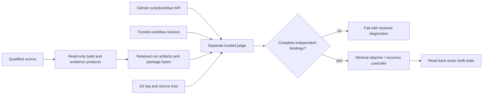

# Phase 15.1: Release Hardening and Milestone Debt Closure — Research

**Researched:** 2026-10-20
**Domain:** Release evidence, CI privilege separation, bounded native acceptance and planning-artifact compatibility
**Confidence:** MEDIUM overall; directly inspected source findings are distinguished from recommendations and execution evidence.

## User Constraints

There is no discussion CONTEXT for this phase. The owner explicitly chose to continue from the approved scope with research first. The scope is planning input, not proof of implementation or debt acceptance. Preserve the shipped release, historical receipts and independent expectations; keep both automatic advance flags false; stop after this phase and re-audit. [VERIFIED: 15.1-SCOPE.md:3-18; owner conversation]

Use the resolve-first inventory without silently deleting or accepting a finding. Its closure contract requires actual-entry-point adversarial checks, immutable boundary facts, strict SUMMARY coverage, canonical UAT, independent review/security and exact reviewed-head remote checks before merge. Missing historical RED/M7 diagnostics and unavailable hosted evidence remain explicit limitations. No runtime upgrade or new dependency is implied. [VERIFIED: 15.1-SCOPE.md:9-22]

## Project Constraints (from AGENTS.md)

- Target Game Boy/Game Boy Color; use the original portable C core, explicit ownership/errors, bounded operations and no hidden globals. Keep host timing, filesystem, UI/audio devices and environment configuration in adapters. Read current STATE, PROJECT and research SUMMARY before substantial work. [VERIFIED: AGENTS.md:3-7,22-25]
- Use installed OpenGSD with identity verification. Permit independent research/parallel ownership; use phase branches and PRs with exact-head required checks, never bypass protection. Stop after each phase, persist the exact next route, and keep both auto flags false. [VERIFIED: AGENTS.md:9-18]
- Every deliverable needs an automated check and meaningful negative control. SUMMARY coverage uses block mappings, with `id`, `description`, `human_judgment`, `verification`, `kind`, `ref` and `status`; canonical closure is generated/checked with the shared UAT tool. Boundary checks use boundary-commit facts. [VERIFIED: AGENTS.md:15]
- Keep main releasable; update docs/examples/tests/limitations together and triage issues/PRs at boundaries. Verify completion evidence, consumer/release evidence and requirements rather than trusting prior completion claims. [VERIFIED: AGENTS.md:17-19]
- Preserve input bounds, overflow/truncation/partial-mutation defenses and explicit portable serialization. Performance complexity needs measured revision/build/hardware/workload/digest/warmup/sample/uncertainty evidence. Distinguish hardware, differential, metamorphic, regression and private-game evidence. [VERIFIED: AGENTS.md:24-28]
- Admit only rights-documented, digest-bound fixtures; no commercial/boot ROMs/private data/telemetry. Keep secrets ignored or in Actions and use privacy-safe public evidence/authorship. Keep research INDEX, decisions, roadmap, future direction and concrete lessons consistent. [VERIFIED: AGENTS.md:29-35]

<phase_requirements>
## Phase Requirements

The roadmap assigns follow-up work to the following already historically satisfied requirements; do not erase their original completion evidence. [VERIFIED: .planning/ROADMAP.md:525-535]

| ID | Original description (verbatim) | Research support |
|---|---|---|
| SHIP-09 | The v0.2 support ledger names DMG-CPU-B and CGB-CPU-E, the mapper matrix, evidence class, corpus revisions, denominators, failures, exclusions and known issues. | Separate source/build verification scopes and disclose known slowdown. [VERIFIED: .planning/REQUIREMENTS.md:50] |
| SHIP-10 | Installed C and C++ consumers exercise the new public API (profile selection, ROM probe, RGB555 frames, RTC catch-up), and API, cartridge/save, integration and third-party-notice documentation is current. | Bind consumers to exact archive and extracted tree independently. [VERIFIED: .planning/REQUIREMENTS.md:51] |
| SHIP-11 | A qualified exact-tag v0.2.0 release ships with refreshed fuzzing and performance baselines, including a measured DMG performance comparison against v0.1. | Harden producer privilege, hosted campaign identity, performance disposition and trusted judges without republishing. [VERIFIED: .planning/REQUIREMENTS.md:52] |
| EVID-02 | A frozen DMG regression baseline (executed CTest inventory, Mooneye closures, acceptance frame/audio digests, benchmark baseline) is recorded, and every later v0.2 phase proves DMG-CPU-B output byte-identical to it or documents an approved, evidence-backed change. | Queue/fuzz/build changes require fresh relevant DMG controls and frozen comparison. [VERIFIED: .planning/REQUIREMENTS.md:17] |
</phase_requirements>

## Summary

Plan this as a series of small evidence-boundary repairs, followed by integrated unprivileged rehearsal and independent review. The dangerous coupling is that code under qualification also supplies validators, run labels and package-reported identity. Establish a trusted judge checkout separately from the tagged producer checkout; validate externally obtained workflow/job/artifact facts and independently recomputed package/tree identities before any privileged attachment or publication decision. The current delivery owner executes validators from its supplied root and can deliberately check historical receipts with historical producer validators; that compatibility path must preserve historical provenance without allowing a weaker old judge to approve new evidence. [VERIFIED: tests/scripts/verify-v02-delivery.py:105-164,224-233]

Three review statements need qualification before implementation: the consumer package digest is an installed-tree digest, not an archive digest; fallback fuzz seeds already check scenario, mode/profile and nonzero STOP/run observations; curl has bounded unknown-length transfers since 8.4.0. Fix actual gaps rather than implementing those advisories literally. The legacy SUMMARY gate currently expects Phase 10 to fail, so migrating coverage also requires replacing that live-tree negative assertion. [VERIFIED: tests/scripts/verify-v02-consumers.py:155-170,350-373; tests/test_fuzz_core.c:140-186; tests/CMakeLists.txt:2609-2612] [CITED: https://curl.se/docs/manpage.html#--max-filesize]

**Primary recommendation:** Lead with a real CLI tracer that rejects a forged/unbound source receipt, then expand trust separation/provenance, native queue/fuzz controls, workflow recovery and historical-artifact normalization. Keep one owner for shared workflow/CMake integration and one explicit disposition per scope ID. This is a planning recommendation derived from the inspected coupling above.

## Architectural Responsibility Map

| Capability | Primary tier | Secondary tier | Basis |
|---|---|---|---|
| Input back-pressure and deterministic scheduling | Acceptance adapter | Bounded core event API | Adapter batches ahead of logical deadlines; core capacity remains bounded. [VERIFIED: src/accept/stepper.c:56-129] |
| Source/archive/package identity | Trusted validation process | Git object database and downloaded bytes | Archive tree binding and consumer installed-tree hashing are separate mechanisms. [VERIFIED: tests/scripts/verify-v02-source-archive.py:297-318; tests/scripts/verify-v02-consumers.py:155-194] |
| Campaign/run provenance | GitHub control plane readback | Receipt validator | Existing hosted verifier cross-checks run, job and downloaded artifact identities. [VERIFIED: tests/scripts/verify-v02-fuzz.py:713-785] |
| Attach/publish/recovery authority | Minimal release-control job | Trusted judge and immutable expected inventory | Existing recovery reads release state before deciding but its active-run filter is too broad. [VERIFIED: .github/scripts/verify-release-gates.sh:477-494] |
| Performance decisions and limitation claims | Measurement/qualification adapter | Release/support documentation | Current nonempty review note changes a triggered result into acceptance. [VERIFIED: tests/scripts/measure-release-baseline.sh:473-495] |
| Coverage/UAT/scanner classification | Planning compatibility tooling | Canonical runtime and immutable evidence | Shared UAT derives coverage while runtime scanner matches a broader filename set. [VERIFIED: tests/scripts/verify-uat-closure.py:1-13; installed OpenGSD bin/lib/audit.cjs:820-854] |

## Standard Stack

Use the existing C17/CMake/CTest, Python standard-library validators, Bash, Git and pinned GitHub Actions. No new runtime/library dependency is recommended. The build floor is quoted verbatim as `cmake_minimum_required(VERSION 3.25)` and the core uses `c_std_17` with `C_EXTENSIONS OFF`. [VERIFIED: CMakeLists.txt:1,23-29]

The installed runtime identified itself as `@opengsd/gsd-core`, version `1.18.0` in this session. Its graph status reports disabled; configured researcher skills are empty. Keep runtime changes outside this phase unless a separately reviewed compatible upstream repair is actually necessary. [VERIFIED: current runtime-identity, graphify status and agent-skills queries; .planning/config.json:64]

### Package Legitimacy Audit

No new package is proposed or installed by this research. Replaying the existing Libbet reproduction invokes its already hash-pinned Pillow environment and RGBDS tool download; do not substitute the local assembler or float those pins. If execution changes or adds a package, perform the required authoritative-source/registry/legitimacy audit then. Existing script values are quoted verbatim: `RGBDS 0.7.0 and Pillow 12.3.0`; installation uses `--require-hashes --no-deps`. [VERIFIED: tests/scripts/reproduce-libbet.sh:2,13-19,87-89]

## Architecture Patterns



This is the recommended architecture, not an assertion of existing complete wiring. The current owner invocation and source-identity self-report demonstrate why producer and judge roots must be separate. [VERIFIED: tests/scripts/verify-v02-delivery.py:105-116; tests/scripts/verify-v02-consumers.py:306-319]

### Implementation contracts

1. **Carry two roots deliberately.** Keep producer source/tree lookup separate from trusted validator code. Every delegated owner/import/tool must come from the trusted root; arguments point at qualified source and supplied evidence. Record both revisions. Do not overlay a partial script list into a built checkout and call the result one source. Recommendation grounded in current owner dispatch. [VERIFIED: tests/scripts/verify-v02-delivery.py:105-116,224-233]
2. **Distinguish byte identities.** Archive compressed-byte digest, normalized source-tree digest, installed-prefix digest and binary/source identity have different domains. Introduce separately named fields rather than changing the meaning of the existing field in old receipts. Bind new evidence to independently read build/package manifests and hosted artifacts. The existing prefix hash encodes relative path plus content hash, and the receipt uses `"package_sha256": package_hash`. [VERIFIED: tests/scripts/verify-v02-consumers.py:155-170,361-373]
3. **Preserve compression freedom while checking the Git tree.** Freshly compare exact members, blob bytes, link targets and executable modes to the frozen commit. Treat the observed compressed digest as provenance of a download, not a promise that another GitHub download is byte-identical. GitHub states compression settings can change without changing extracted contents. [VERIFIED: tests/scripts/verify-v02-source-archive.py:297-318,377-434] [CITED: https://docs.github.com/en/repositories/working-with-files/using-files/downloading-source-code-archives#stability-of-source-code-archives]
4. **Run substantive controls through the real CLI.** Existing archive controls use subprocess CLI invocation; extend this pattern so a mutation fails the production path before the check is repaired, then the repaired path rejects it for the intended reason. Do not test only a copied predicate or mock owner. [VERIFIED: tests/scripts/verify-v02-source-archive.py:531-585]
5. **Keep resource scope explicit.** Downloaded-only validation cannot prove nonexistent build bytes. Require either independently retained/recomputed artifacts or an explicit validated scope describing which identities are observed versus unavailable. Adding a skipped counter alone is insufficient. Current missing build paths execute `continue`. [VERIFIED: tests/scripts/verify-support-ledger.py:912-937]

## Scope-to-Remedy Map

This table covers every scope ID. Remedies and controls are recommendations; cited observations are current-source facts. Preserve the inventory's original descriptions and give each a final evidence-backed disposition rather than replacing the original audit.

| ID | Owning source / observation | Bounded remedy and discriminating control |
|---|---|---|
| P7-01 | Shared drive batches to a shortened deadline but may enqueue before previously queued events were consumed. [VERIFIED: src/accept/stepper.c:95-129] | Reproduce more than one queue of dense/subinstruction and equal-timestamp events through runner plus direct adapter tests. Define valid script behavior before fixing; advance/drain without dropping/reordering transitions or unbounded retries. Test exact-limit, over-limit, same-time and deadline-remainder cases; mutant removes back-pressure and must fail. Keep the core queue bound. |
| P7-02 | Reproduction workflow is manual, read-only, Ubuntu-hosted, invoking the pinned comparison. [VERIFIED: .github/workflows/libbet-repro.yml:1-21] | Dispatch or obtain an actual eligible exact-revision run, retain URL/attempt/output/digest and a wrong-ROM/pin negative control. If inaccessible, record external limitation and smallest action; do not infer Linux success from local reproduction. |
| P7-03 | Decision D-043 preserves that the original test was not shown red. [VERIFIED: .planning/context/DECISIONS.md:51] | Add fresh fail-first saturation mutant/control if useful, retain old claim unchanged and label new evidence as sensitivity evidence, not recovered pre-fix RED. |
| P12-01 | Prior follow-up explicitly leaves missing M7 diagnostic/cause unknown. [VERIFIED: GB-12-cgb-double-speed/12-REVIEW-FOLLOWUP.md:53; 12-REVIEW-FIX.md:46,58] | Preserve unknown; capture fresh repeated control output and arrange failure-retention plumbing; provoke a diagnostic failure fixture to prove retention. Repetition cannot establish the old cause. |
| P15-01 | Review identifies writable producer jobs. [VERIFIED: GB-15-cgb-acceptance-support-ledger-and-v0-2-0-release/15-REVIEW.md:Warnings WR-01] | Split read-only producers from minimal attachers; disable persisted checkout credentials and expose tokens only where needed. Negative workflow controls reintroduce write/token/persisted credentials into a producer and must reject. Removing an explicit env token alone does not remove job-token authority. [CITED: https://docs.github.com/en/actions/reference/security/secure-use] |
| P15-02 | `check_receipt` does not require Git binding and regenerates with `repo=None`; receipt merely records `"tree_bound_to_git": repo is not None`. [VERIFIED: tests/scripts/verify-v02-source-archive.py:384-434] | Require real Git-tree verification at the final entry point, not only a forgeable true boolean. Control: unbound receipt, flipped boolean, archive whose claimed commit matches but contents differ. Coordinate with P15-05/12. |
| P15-03 | Final evidence calls fuzz `--verify`, while hosted verifier independently selects a run/job/artifact. [VERIFIED: tests/scripts/verify-v02-delivery.py:224-233; tests/scripts/verify-v02-fuzz.py:713-785] | Extract/reuse bounded hosted verification for the recorded run/attempt and expected allowed workflow/job/event/source, including artifact-byte match to supplied receipt. Do not merely invoke existing push-CI discovery for a release-job receipt; its current eligible workflow/job differs. Wrong workflow, stale attempt, wrong source/job, expired/missing artifact and forged receipt all reject. |
| P15-04 | Any nonempty review note accepts a triggered comparison. [VERIFIED: tests/scripts/measure-release-baseline.sh:473-495] | Remove standing acceptance. Measure first and bind any exceptional disposition to exact receipt/source/workload/numbers and a separately recorded reviewed decision. Preserve the existing trigger. A future arbitrary hard ceiling is a new policy requiring justification, not a research fact. Huge regression plus copied prose must fail through qualification CLI. |
| P15-05 | Receipt equality includes compressed archive bytes. [VERIFIED: tests/scripts/verify-v02-source-archive.py:425-434] | Use normalized, mode-aware tree binding and stable identity for re-downloads; keep original compressed digest informational or retain exact bytes. Accept different gzip encoding of identical tree; reject same labelled commit with changed file/mode/link. |
| P15-06 | Owner scripts are loaded from passed root; historical path can load old validators. [VERIFIED: tests/scripts/verify-v02-delivery.py:105-164,224-233] | Separate trusted code checkout and subject checkout throughout all delegation. Real gate control plants lenient owner in subject checkout; judge must ignore it and reject forged evidence. Preserve explicit old-receipt compatibility without silently inheriting weak validation. |
| P15-07 | DMG scenario 3 bypasses fallback and emits KEY1; existing fallback seeds already check scenario/profile/mode and STOP/run calls. [VERIFIED: tests/fuzz_core.c:535-539,561-578; tests/test_fuzz_core.c:140-186] | Add missing held-button DMG input, route it to a valid DMG STOP/wake test or explicitly validate intended stop outcome. Strengthen exact absence/presence and held-input observations, not duplicate existing assertions. Mutation breaks routing or removes exercised wake behavior and must fail. |
| P15-08 | `source_identity` parses packaged runner output; `package_sha256` is a prefix hash. [VERIFIED: tests/scripts/verify-v02-consumers.py:155-170,306-319,361-373] | Add separate compressed archive identity and bind to independent candidate/build manifest; recompute installed-tree identity from safe extraction of that archive. Keep self-reported source informational. Forged source string and a changed archive with unchanged consumer receipt must reject. Never compare prefix digest directly to tarball digest. |
| P15-09 | Recovery queries all source-SHA runs, projects no workflow identity, and cleanup occurs after a possibly failing Python command. [VERIFIED: .github/scripts/verify-release-gates.sh:480-494] | Wire real retry route before writes; filter expected release workflow/source/attempt; use scoped trap cleanup. Unrelated active CI must not block; concurrent release, changed asset, newer attempt and partial/complete/published states discriminate. Never replace published bytes. |
| P15-10 | Current validators count text and mutate deletions. [VERIFIED: .github/scripts/verify-release-gates.sh:98-103,197-216] | Validate actual job/step structure and executable command intent. A YAML parser alone does not distinguish `echo` from execution. Choose existing available parser or fail-closed bounded reader, and shell-aware command inspection; comments, echo, dead branch, wrong job, continue-on-error and missing dependency must fail intended controls. Avoid a new general YAML/shell parser framework. |
| P15-11 | Absent evidence-only build paths are silently skipped. [VERIFIED: tests/scripts/verify-support-ledger.py:912-937] | Explicit validation scope, observed/skipped counts and independent retained build binding where the claim requires it. No blank all-skipped pass; deleting every required build artifact must reject or produce a scoped nonqualification result. Preserve valid downloaded receipt use without pretending producer tree exists. |
| P15-12 | Tree check compares symlink-ness/OID, not executable bit; link depth assumes wrapper. [VERIFIED: tests/scripts/verify-v02-source-archive.py:174-183,315-318] | Normalize Git executable/link modes and include them in tree digest; use wrapped/unwrapped depth correctly. Tests for chmod-only tamper, in-root nested link and root escape; product link policy remains independently enforced. |
| P15-13 | Download uses max-filesize without timeout. [VERIFIED: .github/scripts/verify-release-gates.sh:471-474] | Qualify the advisory: unknown-length limit is enforced starting curl 8.4.0. Add total/connection timeout plus verified tool-floor or a bounded standard-library streaming helper for older hosts. Exercise real no-length/chunked over-limit response and stalled response, cleanup/truncation behavior, and credential-safe redirect. Do not claim all modern curl is unbounded. [CITED: https://curl.se/docs/manpage.html#--max-filesize] |
| P15-14 | Run checks require source/status/success but omit workflow. [VERIFIED: tests/scripts/verify-v02-delivery.py:306-321] | Read expected workflow identity from trusted policy and compare returned path/ID/repository/event as appropriate, latest attempt and exact SHA; mocked same-SHA unrelated successful workflow must reject through CLI. [CITED: https://docs.github.com/en/rest/actions/workflow-runs] |
| P15-15 | Rehearsal has repeated local-tag setup and producer sequences. [VERIFIED: .github/workflows/release-rehearsal.yml:35-43,146-154] | Deduplicate only stable unprivileged producer steps after trust split. Prefer narrow shared scripts/composite action with explicit inputs; never make writable attacher execute a composite from the subject tag. Positive rehearsal and argument/identity negative controls prove shared behavior. |
| P15-16 | Broad notice globs and exact case count exist. [VERIFIED: .gitattributes:24-26; tests/CMakeLists.txt:1394-1396] | Narrow license/notice attributes to admitted exact files while retaining required cross-platform digest stability. Remove count from wrapper regex and retain exact inventory equality inside owner. Negative control changes corpus membership/count and owner rejects; attribute fixture preserves unrelated bytes. |
| P15-17 | Original audit records +14.86% and 1.62% margin, with disclosure deferred in release notes/ledger prose. [VERIFIED: .planning/v0.2-MILESTONE-AUDIT.md:61] | Add visible, source-bound historical limitation to current release/support documentation; keep current numbers tied to original receipt, distinguish fresh measures. Semantic docs control removes/changes qualification and must fail. Do not mutate published assets to claim repair. |
| SCAN-UAT | Installed scanner admits any scoped filename containing `-UAT`; review status is `clean` with zero findings. [VERIFIED: installed OpenGSD bin/lib/audit.cjs:820-854; GB-14-cgb-e-model-qualification-and-corpus/14-UAT-REVIEW.md:16-21] | Prefer bounded upstream canonical-filename classifier repair, tested in an isolated installed-runtime copy. If no authorized upstream fix is available, repository compatibility wrapper must independently classify raw findings, preserve raw scan and explicitly document runtime limitation. No rename/status rewrite or debt acknowledgement to hide the false positive. Genuine incomplete canonical UAT still blocks. |
| SCAN-LINK | Deferred warning corresponds to explicit normal core plus transitive core in acceptance library. Mutant targets also link acceptance's normal core. [VERIFIED: CMakeLists.txt:33-40; tests/CMakeLists.txt:3730-3740,4195-4198,4262-4268] | Reproduce generated link lines and fresh verbose links; remove redundant direct dependency for normal targets. Audit mutant targets separately so selected mutant core is actually used, without accidental normal symbols. Link duplicate and wrong-core substitution negative controls; no indiscriminate linker flags suppressing warnings. |
| SUMMARY-SCHEMA | Fresh command reports `summary-coverage FAIL files=107 problems=47`; CTest intentionally rejects Phase 10 live tree. [VERIFIED: current `python3 tests/scripts/verify-summary-coverage.py --since 9` output; tests/CMakeLists.txt:2609-2612] | Normalize coverage metadata in Phase 9/10 summaries, preserving claims/producers/body. Map test kinds semantically and retain historical references; freshly verify mapped behaviors before pass status. Replace live expected-failure with immutable malformed fixture; expand strict coverage to Phase 9 onward. Negative schema control and canonical closures prove auto-pass without inventing historical execution. |

## Safe Ordering and File Ownership

Recommended plan boundaries, not implementation already performed:

1. **Tracer/archive contract:** one owner repairs archive CLI, stable mode-aware identity and tests. Own the source-archive validator and its focused fixtures; coordinate schema changes with delivery owner.
2. **Provenance contracts:** one owner for delivery/fuzz/consumer/ledger validator interfaces and their independent reader fixtures. First establish trusted-root and exact-artifact contracts, then wire workflows. Shared schemas require sequential integration.
3. **Native acceptance/fuzz:** independent owner for shared stepper, runner replay if needed, fuzz harness and native tests. Reserve CMake/expected inventory edits for the integration owner to avoid collisions.
4. **Workflow integration:** one owner for release/rehearsal/CI control scripts, bounded downloader, recovery, read-only producer factoring and structured wiring tests. Consume the completed validator interfaces; do not parallel-edit the same workflow or release gate.
5. **Metadata compatibility/disclosure:** independent owner for Phase 9/10 SUMMARY migration, scanner compatibility tests, docs and per-ID dispositions. Coordinate CMake gate changes and digest-bound doc changes before fresh producer evidence.
6. **Integrated qualification:** one owner reconciles all interfaces, CMake/expected inventory, actual exact-head hosted receipts, relevant full local suites/DMG baseline, review/security and canonical UAT. Retain all historical unknowns and stop with re-audit route.

These boundaries follow the observed shared files and delegation coupling. [VERIFIED: CMakeLists.txt:33-49; tests/CMakeLists.txt:1367-1414,2597-2612; tests/scripts/verify-v02-delivery.py:224-233]

## Don't Hand-Roll

| Problem | Use instead | Reason / basis |
|---|---|---|
| UAT generation and SUMMARY parsing | Shared canonical closure and coverage checker | Already validates auto-pass schema and immutable closure. [VERIFIED: tests/scripts/verify-uat-closure.py:1-13,26-30] |
| Hosted campaign evidence lookup | Reuse/extract existing bounded API/artifact reader | Already strips redirect credentials, bounds responses and checks receipt against hosted job. [VERIFIED: tests/scripts/verify-v02-fuzz.py:623-641,686-705,713-785] |
| Archive unpacking trust | Existing bounded nonextracting inspector / safe product extractor | Current member/link/tree checks are the repair seam; no generic tar shell extraction for untrusted data. [VERIFIED: tests/scripts/verify-v02-source-archive.py:148-188,297-318] |
| Proof a published release is untouched | Existing inventory/recovery reader, hardened at entry | Existing decision rejects changed/unexpected bytes and never re-drafts a published release. [VERIFIED: .github/scripts/verify-published-release-assets.py:78-108] |

## Runtime State Inventory

This is a validator/workflow refactor, not a product rename. Do not migrate saves, public ABI or published release identities. [VERIFIED: 15.1-SCOPE.md:5,9-18]

| Category | Observed scope | Action |
|---|---|---|
| Stored data | Historical receipts, coverage summaries and existing release assets are evidence under preservation. [VERIFIED: 15.1-SCOPE.md:5,15-18] | Schema compatibility or additive new receipts, never rewrite old producer facts. |
| Live service config | Required checks/protection and hosted run/attempt/artifact identities require actual readback; no live config change was performed in research. [VERIFIED: AGENTS.md:17; research activity] | Read exact state during execution; no policy bypass. |
| OS registrations | No rename/install-registration work is in the approved closure scope. [VERIFIED: 15.1-SCOPE.md:11-18] | No OS migration proposed; this is a scope observation, not an exhaustive host inventory. |
| Secrets/environment | Release producers must lose write authority, not just explicit token environment variables. [CITED: https://docs.github.com/en/actions/reference/security/secure-use] | Job privilege split, checkout credential persistence disabled, step-limited tokens. Never print credentials. |
| Build artifacts/packages | Local build outputs and receipts do not auto-refresh when covered inputs change. [VERIFIED: tests/scripts/verify-v02-delivery.py:133-140] | Rebuild affected binaries, regenerate new evidence after final source, preserve old receipts separately. |

## Common Pitfalls

- **An attested boolean is not independent proof.** Requiring a true Git-bound field is necessary schema hardening but a forged field still passes without fresh tree comparison. Existing archive check reuses `repo=None`. [VERIFIED: tests/scripts/verify-v02-source-archive.py:407,430]
- **Do not wait for the current workflow to finish from inside itself.** Existing hosted fuzz verifier is specialized to completed push CI, whereas release evidence has another job/event identity. Reuse its API machinery with an explicit eligible producer contract, not a circular completion dependency. [VERIFIED: tests/scripts/verify-v02-fuzz.py:728-754]
- **Do not add a magic performance ceiling.** Source contains an existing trigger and note-based acceptance; no new numerical maximum is owner-approved. Make new dispositions measurement-bound and fail closed without a valid decision. [VERIFIED: tests/scripts/measure-release-baseline.sh:473-495]
- **Do not convert the clean review to UAT.** Canonical filename/type repair must preserve clean review semantics and real pending UAT detection. [VERIFIED: installed OpenGSD bin/lib/audit.cjs:823-854; GB-14-cgb-e-model-qualification-and-corpus/14-UAT-REVIEW.md:16-21]
- **Do not normalize summaries into invented historical success.** Current schema errors concern representation, but fresh verification and retained producer references must support each mapped pass. [VERIFIED: tests/scripts/verify-summary-coverage.py:148-182; 15.1-SCOPE.md:15-17]
- **Do not remove both normal and mutant link paths indiscriminately.** Acceptance publicly links the normal core while mutant tests provide their own core; preserve which implementation is exercised and prove it. [VERIFIED: CMakeLists.txt:40; tests/CMakeLists.txt:4262-4268]

## Code Examples

Existing subprocess-control pattern to extend: source-archive `run_cli` plus positive/reject helpers run the actual script. Use an isolated fixture Git repository and mutated archive/receipt; assert nonzero status and intended rejection, not merely exception shape. [VERIFIED: tests/scripts/verify-v02-source-archive.py:531-585]

Existing installed-prefix digest algorithm, verbatim source fragment, illustrates why this value cannot be compared to compressed package bytes:

```python
# DATA_R8vT2mQ4_START — tests/scripts/verify-v02-consumers.py:165-167
relative = path.relative_to(prefix).as_posix().encode("utf-8")
content_hash = bytes.fromhex(hash_file(path))
digest.update(relative + b"\0" + content_hash + b"\n")
# DATA_R8vT2mQ4_END
```

[VERIFIED: tests/scripts/verify-v02-consumers.py:155-170]

Canonical schema example should be derived from the checker's existing good fixture rather than flow YAML: its allowed implementation-facing strings include `"unit", "integration", "e2e", "automated_ui", "manual_procedural", "other"` and `"pass", "fail", "unknown"`. For this phase's machine-verifiable deliverables use the AGENTS subset with `human_judgment: false` and evidence that genuinely passes. [VERIFIED: tests/scripts/verify-summary-coverage.py:23-24,148-182,222-238; AGENTS.md:15]

## State of the Art

| Historical approach | Planning correction | Evidence |
|---|---|---|
| Treat compressed automatic archives as indefinitely byte-stable | Compare immutable source-tree semantics and retain each download's byte provenance | GitHub documents changeable compression. [CITED: https://docs.github.com/en/repositories/working-with-files/using-files/downloading-source-code-archives#stability-of-source-code-archives] |
| Assert curl cannot limit an unknown-length transfer | Pin/verify capability or stream with a hard byte bound, and test actual response behavior | Current curl documents transfer-time enforcement starting 8.4.0. [CITED: https://curl.se/docs/manpage.html#--max-filesize] |
| Hand-write phase-local UAT closure | Use shared canonical tool and strict coverage | Current repository closure contract. [VERIFIED: AGENTS.md:15; tests/scripts/verify-uat-closure.py:1-13] |

## Environment Availability

Read-only version probes in this session returned the following. Availability is not proof of Linux, sanitizer, hosted or hardware qualification. [VERIFIED: current tool probe output]

| Dependency | Observed version / state | Execution use / fallback |
|---|---|---|
| Python | 3.14.4 | Existing standard-library validator self-tests; check supported CI interpreters with actual runs. |
| Node | 26.10.0 | Installed OpenGSD CLI. |
| CMake / CTest | 4.4.3 / 4.4.3 | Local configure/build/test; retain hosted floor checks. |
| Apple Clang | 21.0.0 | macOS native builds; not interchangeable with pinned hosted Clang campaign. |
| gh | 2.101.0 | Read/dispatch exact run evidence during execution; authentication/protection state not probed here. |
| curl | 8.7.1 | Current unknown-length cap supported by official documented version boundary; still test time/byte limits. |
| RGBDS | 1.0.4 | Do not use for pinned Libbet or old fixture reproduction; existing scripts download their own verified pin. |
| Graph / additional research providers | Graph disabled; no Context7 tools discovered | Direct source reads and primary official pages; do not install tooling merely for research. |

**Missing execution evidence:** exact-head hosted runs, Libbet Linux reproduction, actual newly hardened release rehearsal and downloaded package qualification were not run by this researcher. This is an evidence gap, not a claim those tools/services are unavailable. [VERIFIED: research activity]

## Validation Architecture

Validation and security are enabled: configuration contains `"nyquist_validation": true`, `"security_enforcement": true`, `"auto_advance": false`, and `"_auto_chain_active": false`. [VERIFIED: .planning/config.json:24-25,48,53]

### Test Framework

| Property | Value |
|---|---|
| Framework | Existing CTest plus script/native self-tests; local CTest 4.4.3, project floor 3.25. [VERIFIED: current probe; CMakeLists.txt:1] |
| Test registration | Existing v0.2 wrapper and coverage registrations. [VERIFIED: tests/CMakeLists.txt:1367-1414,2597-2612] |
| Quick commands | Run affected validator's self-test or one new native control; measure duration and keep individual task checks short. Existing broad consumer self-test has a larger timeout, so do not pretend all controls run under 30 seconds. [VERIFIED: tests/CMakeLists.txt:1400-1414] |
| Full command | `cmake --preset phase1 && cmake --build --preset phase1 && ctest --preset phase1 --output-on-failure --no-tests=error` [VERIFIED: .planning/config.json:54] |

### Phase Requirements → Test Map

Commands below are recommended existing entry points; new controls belong inside the owning script/native suite, not copied phase-local validators.

| Requirement / IDs | Observable behavior | Automated check / planned additions |
|---|---|---|
| SHIP-09; P15-11/16/17 | Ledger scope, exact inventory, visible bounded limitations | `python3 -I tests/scripts/verify-support-ledger.py --self-test`; adoption docs self-test; missing-artifact/scope/count/disclosure mutants. |
| SHIP-10; P15-08 | Downloaded archive → safe extraction → installed C/C++ results | Consumer self-test plus delivery real-owner controls; add distinct archive vs prefix identity and forged self-report checks. |
| SHIP-11; P15-02/05/12/13 | Git-bound stable safe source content and bounded transport | `python3 -I tests/scripts/verify-v02-source-archive.py --self-test`; new real downloader chunked/stall tests. |
| SHIP-11; P15-01/03/06/09/10/14/15 | Privilege, judge, workflow/run/artifact and recovery contracts | `bash .github/scripts/verify-release-gates.sh --self-test`; `python3 -I tests/scripts/verify-v02-delivery.py --self-test`; bounded API fixtures plus actual hosted exact-head run. |
| SHIP-11; P15-04 | Triggered performance cannot qualify on copied generic note | `python3 -I tests/scripts/verify-v02-performance.py --self-test`; real qualification CLI mutation with copied old acceptance. |
| EVID-02; P7-01/P15-07/SCAN-LINK | Dense input order, DMG fallback semantics and correct linked core | Focused native/runner controls followed by relevant frozen baseline and full regression; add generated-link and wrong-core negative controls. |
| All; SUMMARY-SCHEMA/SCAN-UAT | Normalized summaries, genuine UAT gaps and clean reviews distinguished | `python3 tests/scripts/verify-summary-coverage.py --since 9`; canonical UAT self-tests; isolated scanner fixture with real pending UAT. |
| Evidence limitations; P7-02/03/P12-01 | Real provenance or explicit unchanged historical uncertainty | Actual hosted Libbet evidence; fresh saturation sensitivity and M7 diagnostic-retention negative control; per-ID disposition checker refuses fabricated historical producer claims. |

### Sampling Rate

- Per task: positive and intended-defect negative control at its actual production entry point; retain command, revision, exit status and diagnostic.
- Per wave: affected CTest group and shared schema/workflow controls; rerun impacted package/DMG checks when source/build inputs change.
- Phase gate: full configured local suites, affected DMG baseline, exact reviewed-head eligible hosted checks, independent review/security, strict coverage and canonical UAT. Stop and route to milestone re-audit; do not archive or release automatically. These are the project contract, not evidence already produced. [VERIFIED: AGENTS.md:15-19; .planning/ROADMAP.md:531-535]

### Wave 0 Gaps

- Add real-entry forged-source/hosted-artifact/package-binding controls before accepting validator refactors.
- Add runtime-compatible scanner fixtures and immutable malformed-summary fixture before changing legacy summaries/live rejection test.
- Add dense-event scheduling/control and correct-core link assertions before CMake edits.
- Add actual bounded downloader fixture, structured workflow/command controls and isolated trusted-vs-subject checkout test.

These are proposed new test seams based on the observed omissions above, not claims that similarly named files already exist.

## Security Domain

Use the existing ASVS-level policy as a review lens adapted to native tooling/CI; this research does not claim formal ASVS certification. Configured level is `"security_asvs_level": 1` and blocking severity is `"security_block_on": "high"`. [VERIFIED: .planning/config.json:48-50]

| Category | Applicability | Standard control / phase focus |
|---|---|---|
| Authentication | GitHub token/API trust | Least-privilege platform credentials, no custom auth. [CITED: https://docs.github.com/en/actions/reference/security/secure-use] |
| Session management | No web session introduced by approved scope | Keep GitHub credential lifetime/job scope explicit; do not invent web controls. [VERIFIED: 15.1-SCOPE.md:11-18] |
| Access control | Producer vs attacher/judge boundary | Read-only build/fuzz, trusted checkout and minimal privileged job. [CITED: https://docs.github.com/en/actions/reference/security/secure-use] |
| Input validation | Archives, receipts, API payloads, run IDs and scripts | Existing bounded parsing with fail-closed real-entry mutants. [VERIFIED: tests/scripts/verify-v02-source-archive.py:148-188; tests/scripts/verify-v02-delivery.py:306-321] |
| Cryptography | Integrity digests and GitHub HTTPS | Reuse standard digest/TLS implementations; digest alone is not origin attestation. [VERIFIED: tests/scripts/verify-v02-source-archive.py:266-272,377-434] |

| Threat | STRIDE | Required discriminator |
|---|---|---|
| Forged receipt or self-reported revision | Spoofing / tampering | Independent run/artifact/tree/package identity comparison. |
| Tag-supplied lenient judge | Elevation / tampering | Separate trusted checker root; malicious subject-owner fixture must be ignored. |
| Writable producer compromise | Elevation / information disclosure | No write authority or persisted token in producer; credential-safe artifact redirects. |
| Oversized/stalled source stream or archive bomb | Denial of service | Byte/member/time/work bounds enforced before allocation/extraction; real stream controls. |
| False completion or missing diagnostics | Repudiation | Per-ID revision-bound evidence and explicit historical unknowns. |

The threat rows are research recommendations grounded in the inspected trust paths, not exploit demonstrations.

## Assumptions Log

No new owner policy, performance ceiling, package or runtime upgrade is assumed as locked. Recommendations above are implementation guidance subject to source-grounded plan checks. Remaining external outcomes are unverified and must be obtained during execution; no assumed hardware/hosted pass is permitted. [VERIFIED: 15.1-SCOPE.md:9-18]

## Resolved Execution Contracts

No research question remains open. The contracts below decide implementation boundaries; they do not assert implementation success or external availability.

### Dense-event delivery

Adapter-only deadline draining is insufficient for arbitrary parser-admitted density. The parser admits 16384 ordered events, including equal timestamps. The core retains only 64 events; it applies current events on a nonzero run and at half-dot advancement. A run may refuse a too-short instruction budget, so logically reaching a deadline does not free capacity. Advancing to free a full queue can cross the timestamp of an event not yet enqueued. [VERIFIED: src/accept/gbb_accept.h:43; src/accept/input_script.c:91-111; src/core/gabbaboy.c:2537-2556,3321-3346,4493-4515; src/accept/stepper.c:25-37,95-129]

Use a private borrowed event-span seam for acceptance runs, declared in src/core/gbb_accept_input.h and implemented in the core. It supplies a validated immutable span plus an explicit caller-owned cursor, not a callback that performs host work. The core drains equal-time events in original order, refilling its existing 64-entry queue with due-at-current-time events only before the next guest tick. Future events remain in the borrowed span: consult its next timestamp for STOP/idle deadlines, never pre-enqueue them beyond the run boundary. Advance the caller cursor only for applied transitions; leave no private pending queue entries at return. For later timestamps drain before advancing past the next pending event, including STOP/idle paths. Work is bounded by the admitted 16384-event span and run budget; each loop consumes an event or advances guest time. Reject malformed spans, cursor bounds, past/out-of-order timestamps or mixing with an already queued public stream before mutation. No transition coalescing, dropping, shifted timestamp or enlarged queue is permitted.

Borrowing lasts only for a run call. Factor private audio/diagnostic run entry points around existing checks; clear transient references on every exit. The instance must retain no event pointer/cursor after return. No hidden globals, host services, public ABI/header change, save-format change or pointer serialization. Save states/clone are future work and remain outside this phase; private borrowing must not become persistent/serialized state or claim a new save/clone feature. The adapter owns remaining script/cursor and resumes explicitly. Public gbb_queue_events, zero-budget behavior, audio capacity, diagnostics and ordinary run semantics remain unchanged. The shared drive and diagnostic replay both use this seam. Tests must compare trace/event order, frame/PCM digests and deadlines against a bounded reference and frozen DMG baseline, with no-refill, equal-time reorder and stale-borrow controls. This is a source-grounded private implementation choice, not a claim of preexisting arbitrary-event compatibility.

### Trusted fuzz producer eligibility

For **new qualifying evidence**, retain the existing concrete producer: repository from independently verified origin/control-plane identity; workflow path .github/workflows/ci.yml; event push; source SHA exactly the qualified source; expected branch supplied by the trusted caller; job key linux-sanitizers and API job display name linux-asan-ubsan. Require the newest run/latest attempt selected for that exact workflow/source/branch, a completed successful producer job, and its nonexpired artifact v02-fuzz-{run_id}-{attempt}. Independently download and compare the receipt and minimized-artifact bytes; the receipt's event/job/run/attempt/job_id must equal API facts. Existing source already implements these identities, including artifact upload. [VERIFIED: .github/workflows/ci.yml:linux-sanitizers; tests/scripts/verify-v02-fuzz.py:28,728-798]

Do not widen qualification to current release/rehearsal receipts. Current release.yml candidate-fuzz and release-rehearsal.yml fuzz/aggregate execute campaigns but do not retain the independently verifiable campaign artifact contract used by CI; the receipt writer also hardcodes ci.yml. Release/rehearsal judges will consume the completed exact-source CI campaign artifact through the trusted reader. Rehearsal branches already trigger ci.yml push as well as the rehearsal workflow. Do not poll the currently executing judging workflow for completion. A branch/source mismatch, inaccessible/expired artifact or absent eligible CI producer is a blocking external limitation, never shape-only fallback. [VERIFIED: .github/workflows/release.yml:971-1051; .github/workflows/release-rehearsal.yml:12,81-112,225-237; tests/scripts/verify-v02-fuzz.py:330-352]

Historical release/rehearsal receipt identity is retained verbatim as historical evidence only. It is not upgraded to independently qualified provenance or admitted to new qualification. Historical compatibility checks may check format and immutable original bytes under a separately labelled historical scope, but cannot authorize attachment/publication or satisfy the new hosted gate. This preserves historical assets without guessing unverified workflow/job identities.

### Scanner compatibility

Choose the repository-owned read-only compatibility wrapper in Plan15, not an installed runtime patch/upgrade. Preserve raw audit-open output and package identity; classify canonical UAT separately from exact review artifacts and require clean verdict/zero findings for clean-review classification. Ambiguous/dirty artifacts remain visible. Stock scanner limitations stay disclosed. [VERIFIED: 15.1-15-PLAN.md Tasks1–2; installed OpenGSD bin/lib/audit.cjs:823-854]

### Hosted availability

Availability is an execution precondition, not an unanswered design choice. Plan16 must obtain actual exact-source CI artifacts and the manual Ubuntu Libbet comparison from .github/workflows/libbet-repro.yml job libbet-repro, workflow_dispatch, at the chosen source revision. Record repository, workflow, event, SHA, run/attempt/job, completion status and retained digest/output. Authentication/approval denial, timeout, expired artifacts, disabled workflow or missing eligible run produce a retained external-limitation result and block the affected qualification/phase completion. Use the smallest actual owner action only after the failing probe; fixtures or local runs never substitute for hosted success. Published v0.2.0 remains unchanged, with no new release qualification claimed. [VERIFIED: .github/workflows/libbet-repro.yml:1-21; AGENTS.md:15-19]

## Sources and Research Method

Primary repository evidence: actual archive/delivery/fuzz/consumer/ledger validators; release gates/recovery; shared acceptance stepper; CMake linkage and coverage registration; native fuzz observations; pinned Libbet reproduction; original audit/review/disposition; scope and project instructions. Source files were opened in this session; line-specific observations above distinguish actual definitions from grep discovery.

Official pages opened this session:

- GitHub secure use reference: least privilege and job-token authority. https://docs.github.com/en/actions/reference/security/secure-use
- GitHub REST workflow runs: workflow-specific run and attempt readback surfaces. https://docs.github.com/en/rest/actions/workflow-runs
- GitHub source archive stability: extracted content versus compression/root-name properties. https://docs.github.com/en/repositories/working-with-files/using-files/downloading-source-code-archives
- curl manual: version-dependent max-filesize behavior and transfer limits. https://curl.se/docs/manpage.html#--max-filesize

The research-plan seam selected Jina for the four official scrape questions; no Jina/Context7 tools were available, so built-in web access opened the primary pages. The confidence seam returns MEDIUM for `websearch --verified` and LOW for an unrecognized `webfetch` provider; the document therefore uses CITED for official web facts and makes no package-authority claim. No external package was installed and no cache/project configuration/runtime source was mutated. [VERIFIED: current research-plan/classify-confidence and tool-discovery outputs]

## Metadata

**Confidence breakdown:** source architecture and concrete omissions are directly inspected; proposed remedies are prescriptive engineering recommendations, not execution passes. Official platform facts are MEDIUM under the resolver. Historical claims remain historical; unknown diagnostics and hosted outcomes remain unknown.

**Fresh verification produced in research:** strict coverage from Phase 9 reports exactly 47 problems over 107 summary files; this is expected unresolved debt, not a passing phase gate. Tool versions and installed runtime identity were probed. No emulator build, fresh campaign, physical/perceptual qualification, release rehearsal or live release mutation was performed.

**Valid until:** source revision changes require rechecking affected contracts; refresh GitHub/curl facts when execution begins. Planning can proceed without another broad research sweep.
