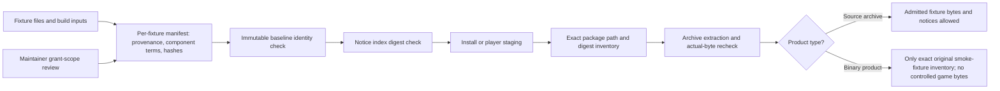

# Phase 20: Fixture Admission Tune-up - Research

**Researched:** 2026-10-31  
**Domain:** Fixture rights records, build-time verification, binary package contents  
**Confidence:** MEDIUM

<user_constraints>
## User Constraints (from CONTEXT.md)

### Locked Decisions

### Component rights evidence

- **D-01: Require positive, source-grounded rights coverage for each distributed or embedded fixture component.** Record applicable terms and evidence for code, art, audio driver, build inputs, and notices, and state whether the permission covers repository and public-CI use. A repository-wide grant can cover a component when the grant's published scope and pinned source provenance support that mapping. Public availability, a digest, repository visibility, or commit history alone does not establish permission. An unresolved or conflicting component is a no-go; record the reason instead of admitting its bytes.
- Record build-only tools separately from fixture content. Pin their source/version and terms for reproducibility, and state whether they are copied, linked, or shipped. A tool not included in the distributed fixture is not described as a redistributed fixture component; copied or embedded tool material needs its own applicable rights record.
- Do not treat hashes as legal evidence. Automated checks can validate required record fields, pinned identities, notices, and byte digests; they cannot decide whether an external grant legally covers a component. Keep that evidence review explicit and fail closed when scope is unclear.
- Preserve the disposition of existing fixtures. Do not turn this tune-up into a retroactive rights re-audit or treat the documented Libbet asset-rights inference as a blanket precedent for new admissions.

### Admission record and verification

- **D-02: Keep fixture provenance and terms with each fixture's existing manifest.** Introduce a consistent, versioned admission record there and retain `THIRD_PARTY_NOTICES.md` as the human-readable index with digest bindings. Use the existing CMake/Python standard-library path; do not add a general central registry, JSON Schema validator, or other dependency without a demonstrated need.
- Bind exact fixture bytes, source/build inputs, component terms, notices, and permitted repository/public-CI use. Missing components must be explicitly marked absent rather than left ambiguous. Independently pin admitted identities to an immutable baseline so changing fixture bytes together with self-declared manifest and notice digests still fails. Include a negative control for that coordinated change. A digest confirms identity, not rights.
- Keep the fixture manifest as the rights/provenance source of truth. A small product-package inventory is allowed where needed to specify exact product paths and identities; it must be checked against fixture manifests and actual package contents so it does not become a conflicting rights registry.

### Product distribution boundary

- **D-03: Enforce package policy against actual staged or extracted bytes and exact identities.** Extend existing install, preview, and release package checks. Product packages may contain only the exact currently approved original smoke fixtures: `tracer`, `visible-demo`, and `mbc1-continuation`, with their component notices and GabbaBoy's root MIT declaration at the established package-specific locations. Reject extra or changed fixture content even inside an allowed directory; path names and ROM suffixes are insufficient.
- Exercise a clean package as the positive control and reject controlled game bytes copied under a renamed path, without a ROM suffix, and inside each otherwise allowed fixture subtree. Check for missing or changed package notices and root MIT bytes as well as fixture leakage.
- Keep source archives distinct from binary products. Source archives may contain admitted game or diagnostic fixture bytes with their verified terms and notices. Binary products must not contain controlled game/diagnostic ROMs. Do not require source-only `THIRD_PARTY_NOTICES.md` inside binary packages: the core release carries `gabbaboy-notices.txt`, and the macOS player uses `share/licenses/GabbaBoy` and `share/licenses/SDL3`.

## the agent's Discretion

- Choose the versioned manifest field names and the smallest checker organization that fits existing CMake and Python patterns.
- Represent the exact product fixture inventory in a small policy file or derive it from existing fixture manifests, provided there is one clear source of truth and the installed and release archive checks reject unknown additions and stale identities.
- Use the existing CTest and CI lanes. Keep new controls local and automated; do not create a duplicated full CI matrix or a new external dependency.
- The owner asked for relevant role-based fanout, primary-source research where useful, an adversarial pass, and automatic adoption of a coherent recommendation. This discussion used those instructions; the recommendations above stay inside the approved Phase 20 scope and three-plan cap.

### Deferred Ideas (OUT OF SCOPE)

None — discussion stayed within Phase 20 scope.
</user_constraints>

<phase_requirements>
## Phase Requirements

| ID | Description | Research Support |
|----|-------------|------------------|
| RIGHTS-01 | An admitted game or diagnostic fixture has verified redistribution permission for repository and public-CI use, with per-component code, art, audio-driver, build-input, and notice terms recorded; game ROMs are excluded from installed and product-release packages, and GabbaBoy's root MIT license remains unchanged. | Versioned per-fixture admission record, independent immutable identity baseline, human-readable notice digest binding, and exact actual-byte inventories for staged/extracted binary products; automated controls can enforce structure and identity but cannot determine whether the cited grant legally covers each component. [VERIFIED: .planning/REQUIREMENTS.md:14-17; exact requirement quoted above] |
</phase_requirements>

## Summary

Phase 20 should connect the existing manifest, notice, install, player, and release checks into a single fail-closed boundary. Put the versioned rights/provenance record in each fixture manifest, keep `THIRD_PARTY_NOTICES.md` as its human index with digest bindings, and anchor approved identities independently to a fixed Git commit or equivalent immutable baseline. Existing checks compare fixture bytes to manifest-declared hashes and notices to their own digest table; coordinated edits can therefore make those values agree again unless a second immutable identity is checked. [VERIFIED: .planning/phases/GB-20-fixture-admission-tune-up/20-CONTEXT.md:26-28; cmake/VerifyFixtureManifest.cmake:8-29; THIRD_PARTY_NOTICES.md:34-38]

For each binary product, compare the complete observed path-to-digest inventory against its exact package contract at the staging boundary and after archive extraction. The current core product checker rejects other fixture directories, ROM-like paths outside the allowed fixture roots, known third-party digests, and source-only notice files, but it permits unrecognized content inside allowed fixture directories. Existing preview smoke checks the extracted install tree and currently tests a renamed payload outside those directories; add the locked in-directory, suffixless/renamed controls, plus missing or altered license and notice controls. Keep source archives separate because their contract permits properly admitted source fixtures and their notices. [VERIFIED: tests/scripts/verify-v02-source-archive.py:484-504,783-824; cmake/PreviewPackageSmoke.cmake:58-90]

**Primary recommendation:** Reuse the CMake/Python standard-library and CTest/CI paths; add a compact versioned admission schema, a pinned immutable identity check with a coordinated-mutation negative control, and exact file/digest comparisons against the real staged and extracted product bytes. Keep machine verification to completeness, identity, and package content. A rights reviewer must still decide whether each positive source grant covers the exact component, use, and audience; neither SPDX expressions nor a matching SHA-256 makes that legal determination. [CITED: https://www.copyright.gov/circs/circ16a.pdf; https://spdx.github.io/spdx-spec/v3.0.1/annexes/spdx-license-expressions/]

## Architectural Responsibility Map

| Capability | Primary Tier | Secondary Tier | Rationale |
|------------|-------------|----------------|-----------|
| Admission-record completeness and immutable identity verification | Build / CI | Repository metadata | CMake and Python checkers can validate the committed manifest, pinned source identities, and fixture bytes before public automation consumes them. [VERIFIED: cmake/VerifyFixtureManifest.cmake:1-29; tests/scripts/verify-libbet-admission.py:1-7] |
| Binary distribution allowlist and notice preservation | Packaging / Release | Build / CI | Install, player, and release stages own the output layout; checkers must inspect the actual staged or extracted bytes at these boundaries. [VERIFIED: CMakeLists.txt:166-196; cmake/PreviewPackageSmoke.cmake:21-64; tests/scripts/verify-phase3-player.sh:522-553; .github/workflows/release.yml:321-328] |
| Determination that grant evidence covers each component and intended use | Maintainer rights review | Admission metadata | The checker can enforce that positive evidence and scope are recorded, but cannot infer permission from a digest, visibility, or history. [VERIFIED: 20-CONTEXT.md:19-22; CITED: https://www.copyright.gov/circs/circ16a.pdf] |

## Standard Stack

### Core

| Library / tool | Version | Purpose | Why Standard |
|----------------|---------|---------|--------------|
| CMake | Project minimum 3.25; research host 4.4.3 | Existing install, manifest digest, and preview/extracted-tree controls. | The project preset declares the minimum as `{"major": 3, "minor": 25, "patch": 0}`. CMake has built-in JSON access through `string(JSON ...)`, so the local manifest checker does not need a JSON dependency. [VERIFIED: CMakePresets.json:1-5; cmake/VerifyFixtureManifest.cmake:8-18] [CITED: https://cmake.org/cmake/help/v3.25/command/string.html] |
| Python standard library | Python 3; research host 3.14.4 | Strict manifest and notice validation, Git object reads, synthetic mutations, and archive inspection. | Existing admission and source-archive tools use Python standard-library modules only; the source-archive checker explicitly states, “The Python standard library is the only dependency.” [VERIFIED: tests/scripts/verify-v02-source-archive.py:1-13; tests/scripts/verify-libbet-admission.py:1-7] |
| Git immutable objects | Installed Git 2.41.0 | Read fixture, manifest, and notice bytes from a fixed commit for the independent baseline. | Existing revision resolution accepts a symbolic input only to resolve it once to a full commit; the boundary reader then retrieves named blobs with `git show`/`git cat-file`. For Phase 20, pin that resolved identity independently of the mutable fixture manifest and notice digest table. [VERIFIED: cmake/ResolveContractRevision.cmake:1-23; tests/scripts/state_boundary.py:1-9,103-115] |

### Supporting

| Tool | Purpose | When to Use |
|------|---------|-------------|
| CTest | Register focused, positive and negative checker controls alongside current project checks. | Add the phase checker self-test and actual package checks to existing test/CI paths; avoid a second CI matrix. [VERIFIED: tests/CMakeLists.txt:1534-1536,1888-1897] |
| SHA-256 via CMake/Python | Compare byte identity for source files and package members. | Use with exact path inventories; a digest is identity evidence only, not redistribution permission. [VERIFIED: cmake/VerifyFixtureManifest.cmake:24-27; 20-CONTEXT.md:21,27] |

### Alternatives Considered

| Instead of | Could Use | Tradeoff |
|------------|-----------|----------|
| Existing CMake/Python checks | New schema framework or central rights registry | The phase decision explicitly avoids a general registry, JSON Schema validator, and dependency absent demonstrated need; a small versioned manifest contract is enough for this scope. [VERIFIED: 20-CONTEXT.md:26-28] |
| A fixed baseline independent of mutable records | Recompute trusted expectations from the current working-tree manifest and notice table | Self-consistency cannot catch coordinated fixture+manifest+notice replacement. A pinned commit or fixed expected identity must be read independently; resolving the current `HEAD` anew at every check is not an independent pin. [VERIFIED: 20-CONTEXT.md:27; cmake/ResolveContractRevision.cmake:1-23] |
| Exact file/digest inventories | Path labels or ROM suffix filters alone | Names and suffixes miss renamed and suffixless payloads, and an allowed directory currently permits extra members. Inventory paths and digest actual staged/extracted members. [VERIFIED: 20-CONTEXT.md:32-33; tests/scripts/verify-v02-source-archive.py:490-503] |

**Installation:** No new package installation is recommended; this phase is constrained to existing CMake and Python standard-library tools. Package legitimacy audit is not applicable.

## Project Constraints (from AGENTS.md)

- Use the installed OpenGSD runtime and preserve the owner pause after the phase; auto-advance stays false. [VERIFIED: AGENTS.md:27-31; .planning/config.json:20-26]
- Every deliverable needs an automated check and meaningful negative control. New reusable checkers belong in `tests/scripts/`, read immutable commit facts where appropriate, and are wired into CTest. Quote: “Checkers live in `tests/scripts/`, read an immutable commit and are wired into CTest when created.” [VERIFIED: AGENTS.md:32-38]
- Keep Phase 20 to its roadmap cap of three plans; it is a tune-up, not a general debt-closure phase. Quote: “Phase 20 is capped at three plans.” [VERIFIED: .planning/ROADMAP.md:27-37,108-111]
- Preserve the accepted v0.3 audit debts and the standalone closeout-helper failure unless a documented trigger applies; do not rewrite a failing status as a pass. [VERIFIED: .planning/ROADMAP.md:37; .planning/STATE.md:53,59-64]
- Do not admit a game/diagnostic candidate, search for candidates, retroactively re-audit existing approvals, change root MIT, repair accepted v0.3 debt, or start later phases. [VERIFIED: 20-CONTEXT.md:9-11,19-22]
- Keep dependencies out unless a concrete need is demonstrated; favor a small direct extension of existing checks. [VERIFIED: AGENTS.md:47-53; 20-CONTEXT.md:26-28]
- Do not include Nintendo boot ROMs, commercial game images, unlicensed homebrew, private data, or mandatory telemetry. Third-party fixture admission requires documented rights and a digest. [VERIFIED: AGENTS.md:52]
- Root project MIT terms and each fixture/component's distinct terms stay intact. Checks must not claim that hashes establish permission. [VERIFIED: 20-CONTEXT.md:19-22,32-34; .planning/REQUIREMENTS.md:17]
- Use current actual package bytes for package conclusions; do not claim package scans prove rendering or game correctness. [VERIFIED: 20-CONTEXT.md:103]

## Architecture Patterns

### System Architecture Diagram



This separates source archive policy from binary-product policy and keeps the human grant-scope decision distinct from byte-level automation. [VERIFIED: 20-CONTEXT.md:19-34; tests/scripts/verify-v02-source-archive.py:1-13]

### Recommended Project Structure

Extend the current `fixtures/<id>/manifest.json` schema, notice digest table, CMake/Python verifiers, and their existing CTest registration. Place any reusable new checker under `tests/scripts/`; keep package-specific path mapping in the existing install/player/release packaging contracts or one small checked inventory. Do not introduce a second rights registry. [VERIFIED: 20-CONTEXT.md:26-28,38-40; AGENTS.md:37]

### Pattern 1: Rights record beside fixture provenance

**What:** Add a small versioned section to each fixture's existing manifest that requires a positive evidence reference, pinned source identity, component applicability/terms, declared presence or explicit absence, and repository/public-CI scope. Record build-only tools separately and indicate whether their material is copied, linked, or shipped. Keep the notice index human-readable and digest-bound to its manifest and local notice. [VERIFIED: 20-CONTEXT.md:19-28]

**When to use:** At the boundary where a fixture's bytes can enter repository automation. Phase 20 defines and checks this contract; it does not approve a new candidate or re-audit historical fixture grants. [VERIFIED: 20-CONTEXT.md:9-11,22]

The Copyright Office guidance supports checking the exact protected material, use, and grant scope; SPDX expressions encode license terms but do not prove who can grant them or that a grant covers a particular component. This is an evidence-design note, not a legal determination. [CITED: https://www.copyright.gov/circs/circ16a.pdf; https://spdx.github.io/spdx-spec/v3.0.1/annexes/spdx-license-expressions/]

### Pattern 2: Independent immutable identity pin

**What:** Capture one full commit identity outside the mutable fixture record. Read fixture, manifest, source/build-input, and notice blobs from that immutable commit, then compare current records and bytes to those baseline facts. Fail closed if the pin cannot resolve or a required blob is missing. The existing CMake resolver and Python boundary reader are local patterns. [VERIFIED: cmake/ResolveContractRevision.cmake:1-23; tests/scripts/state_boundary.py:1-9,103-115]

**When to use:** Any test intended to catch a coordinated edit that changes fixture bytes, manifest digests, and notice digests together. Add a negative control that mutates all three coherently while keeping the original baseline pin; the checker must still reject. [VERIFIED: 20-CONTEXT.md:27]

### Pattern 3: Exact inventory at product boundaries

**What:** Represent each product's allowed fixture files as exact package paths mapped to expected digests derived from the per-fixture source-of-truth records and the independent baseline. Require the observed file set to equal the allowed set, then hash the actual bytes after install/staging and after extraction. Include package-specific notice locations in this inventory. [VERIFIED: 20-CONTEXT.md:28,32-34]

**Known package layouts:** Core Linux/macOS release archives place root MIT at `share/gabbaboy/LICENSE.txt`; the release also publishes a separate `gabbaboy-notices.txt` asset. The macOS player stages its GabbaBoy and SDL notices under `share/licenses/GabbaBoy` and `share/licenses/SDL3`; its concrete copied paths include `share/licenses/GabbaBoy/visible-demo-LICENSE.txt`, `share/licenses/GabbaBoy/mbc1-continuation-LICENSE.txt`, `share/licenses/GabbaBoy/LICENSE.txt`, and `share/licenses/SDL3/LICENSE.txt`. The player also carries fixture bytes/manifests at `share/gabbaboy/fixtures/visible-demo` and `share/gabbaboy/fixtures/mbc1-continuation`; its packaging script does not put the visible-demo notice beside that fixture, so preserve the established central license path. [VERIFIED: .github/workflows/release.yml:321-328,400-408,769-775; tests/scripts/verify-phase3-player.sh:522-553]

The exact original smoke fixture names are quoted in the locked product decision: “`tracer`, `visible-demo`, and `mbc1-continuation`” [VERIFIED: 20-CONTEXT.md:32]. Keep this allowlist and each product's established notice paths; reject unknown or stale entries. [VERIFIED: CMakeLists.txt:173-188; tests/scripts/verify-phase3-player.sh:528-553]

### Anti-Patterns to Avoid

- **Trusting a self-declared hash chain:** Rehashing a modified ROM and editing its manifest and notice table together only proves their new values are mutually consistent. Compare to an independently pinned immutable baseline. [VERIFIED: 20-CONTEXT.md:27]
- **Allowlisting a directory but not its contents:** Current source archive product checks accept files under each product fixture directory based on directory membership; current CMake installed scan compares fixture directory names, not exact members. Add exact path/digest equality. [VERIFIED: tests/scripts/verify-v02-source-archive.py:490-503; cmake/ScanForbiddenFixtures.cmake:164-180]
- **Treating file names or extensions as identity:** A candidate payload can be renamed or omit a ROM suffix. Compare bytes and exact members, including the locked in-directory controls. [VERIFIED: 20-CONTEXT.md:32-33]
- **Using one policy for source archives and binary products:** Source archives retain appropriately admitted fixture material and notices; binary packages follow a tighter fixture allowlist and exclude controlled game/diagnostic ROMs. [VERIFIED: tests/scripts/verify-v02-source-archive.py:4-13; 20-CONTEXT.md:34]
- **Treating a license expression or a digest as proof of a grant:** A machine can check recorded text and hashes, not legal authorship, grant authority, or component coverage. [CITED: https://www.copyright.gov/circs/circ16a.pdf; https://spdx.github.io/spdx-spec/v3.0.1/annexes/spdx-license-expressions/]

## Don't Hand-Roll

| Problem | Don't Build | Use Instead | Why |
|---------|-------------|-------------|-----|
| Rights/provenance store | A new global registry or generic schema service | Versioned admission section in the existing per-fixture manifest; notice digest table remains its human index. | Keeps the fixture manifest as the source of truth and follows the locked scope without a dependency. [VERIFIED: 20-CONTEXT.md:26-28] |
| JSON and digest checks | New JSON or crypto dependency | CMake `string(JSON ...)`, built-in SHA256, Python `json` and `hashlib`. | Existing checks already use these; no package install is required. [VERIFIED: cmake/VerifyFixtureManifest.cmake:8-27; tests/scripts/verify-libbet-admission.py:10-20] |
| Archive parsing | A new general-purpose tar parser/checker | Extend `verify-v02-source-archive.py` for streaming archive inspection, and existing install/preview/player verifiers for actual stage/extract checks. | The checker already separates source archives from product packages and uses only the Python standard library. [VERIFIED: tests/scripts/verify-v02-source-archive.py:1-13,484-504; cmake/PreviewPackageSmoke.cmake:21-64] |
| Grant interpretation | Automated conclusions from repository visibility, history, or hashes | Positive source-grounded evidence and scoped maintainer review, with unresolved/conflicting records rejected. | These signals do not establish permission; automation should enforce the evidence contract, not make a legal conclusion. [VERIFIED: 20-CONTEXT.md:19-22] |

**Key insight:** The critical risk is a coherent self-rewrite of the same values used as both evidence and expected state. An independent baseline plus a byte-level package inventory closes that self-consistency gap without changing the rights source of truth. [VERIFIED: 20-CONTEXT.md:26-28,32-34]

## Common Pitfalls

### Pitfall 1: Fixture, manifest, and notice can be updated together

**What goes wrong:** A changed payload with matching new digest fields passes self-consistency checks.  
**Why it happens:** The current manifest checker hashes files against the manifest in the same tree, and the human notice index binds to mutable manifest/license digests. [VERIFIED: cmake/VerifyFixtureManifest.cmake:8-29; THIRD_PARTY_NOTICES.md:34-38]  
**How to avoid:** Read baseline identities from a fixed Git commit or independent expected identity, and test a coordinated content+manifest+notice mutation against that original pin.  
**Warning signs:** Tests only change a ROM and leave its manifest stale, or only edit notice text.

### Pitfall 2: Unexpected bytes hide inside an allowed product fixture directory

**What goes wrong:** A game payload is copied under an allowed directory using an unfamiliar name or no ROM suffix.  
**Why it happens:** The existing product checker permits all paths below three allowed fixture directories, while the current CMake scan checks only the set of directory names. [VERIFIED: tests/scripts/verify-v02-source-archive.py:490-503; cmake/ScanForbiddenFixtures.cmake:164-180]  
**How to avoid:** Require exact path and digest inventories for every product and inspect actual staged and extracted contents. Seed controls in each allowed subtree, including renamed and suffixless payloads. [VERIFIED: 20-CONTEXT.md:32-33]  
**Warning signs:** Clean package passes, but no test adds an unknown file inside each allowed directory.

### Pitfall 3: A clean source archive is mistaken for a clean binary release

**What goes wrong:** Source archive inclusion rules are applied to binary products, or binary exclusion rules reject lawful source archives.  
**Why it happens:** The source archive deliberately retains admitted fixture material and its notices; binary packages have a narrower allowlist. [VERIFIED: tests/scripts/verify-v02-source-archive.py:4-13]  
**How to avoid:** Keep separate positive fixtures/tests for source archive and each binary package type. Check the package bytes that users actually download.  
**Warning signs:** One shared rule treats `THIRD_PARTY_NOTICES.md` as mandatory in binary products, or allows a game fixture into a binary archive because it is valid in the source archive.

### Pitfall 4: License paths are checked in the wrong package location

**What goes wrong:** A valid notice is present in the repository but missing from a package, or the verifier expects source-only notices in a binary archive.  
**Why it happens:** Core release and macOS player have different established notice layouts; the player places visible-demo licensing under the central GabbaBoy licenses directory. [VERIFIED: .github/workflows/release.yml:323-328,400-408; tests/scripts/verify-phase3-player.sh:536-553]  
**How to avoid:** Give every package type an explicit exact notice path+digest inventory; separately test missing and changed files and preserve root MIT bytes.  
**Warning signs:** A recursive “some license exists” check is treated as sufficient.

### Pitfall 5: Rights automation is described as legal clearance

**What goes wrong:** A complete manifest or matching digest is said to prove a third-party license covers embedded art, audio, code, or build inputs.  
**Why it happens:** Required fields can look like an authoritative permission decision.  
**How to avoid:** Require positive, source-grounded evidence and explicit intended scope; retain a human/source review decision for whether the grant covers each component. Mark unclear or conflicting scope as no-go. [VERIFIED: 20-CONTEXT.md:19-22; CITED: https://www.copyright.gov/circs/circ16a.pdf]  
**Warning signs:** Public repository access, a checksum, a history trail, or an SPDX expression is the only cited evidence.

## Code Examples

Verified local patterns for planning; these are not new implementation code.

### Resolve a revision once, fail closed, and read blobs from that commit

The resolver runs `git rev-parse --verify --quiet "${requested}^{commit}"`, requires a 40-character lowercase hexadecimal result, and emits `unknown` / `unreadable` if resolution fails. [VERIFIED: cmake/ResolveContractRevision.cmake:1-23; exact accepted length/pattern and failure values quoted here]

The Python boundary reader obtains a named blob through `git show`/`git cat-file` at the supplied revision and checks that the object is a blob. Reuse this immutable-object approach for the phase baseline; do not read the mutable manifest and notice as their own sole expectations. [VERIFIED: tests/scripts/state_boundary.py:1-9,103-115]

### Existing CTest contract self-test registration

The current source archive checker is registered as `v02_source_archive_controls` with a 90-second timeout and `--self-test`: [VERIFIED: tests/CMakeLists.txt:1534-1536; the literal test name, timeout, and argument are quoted here]

```cmake
gbb_add_v02_contract(v02_source_archive_controls 90
  [=[PASS: source archive checker accepted [1-9][0-9]* cases and rejected [1-9][0-9]* negative controls]=]
  verify-v02-source-archive.py --self-test)
```

Extend this pattern with a focused Phase 20 synthetic self-test and register the actual installed/release/player package checks in their current lanes. Do not copy the existing Libbet grant interpretation as a rights precedent; its fixture rights limits are explicitly documented in the repository. [VERIFIED: tests/CMakeLists.txt:1534-1536; 20-CONTEXT.md:22,58]

## State of the Art

| Old approach | Current approach | When changed | Impact |
|-------------|------------------|--------------|--------|
| Check that expected ROMs match self-declared manifest hashes and that only approved fixture directories exist. | Pin accepted identities independently and require exact path/digest equality on real staged/extracted bytes. | Phase 20 locked design (2026-10-31). [VERIFIED: 20-CONTEXT.md:26-34] | A coordinated self-rewrite or hidden in-directory file must fail even if path labels, suffix filters, and internal digest tables agree. |
| Treat source and binary products as “fixture-free” or apply one fixture rule to both. | Retain admitted and noticed fixture bytes in source archives; allow only the exact original smoke inventory in binary products, with controlled game/diagnostic bytes excluded. | Existing source archive checker and Phase 20 package decision. [VERIFIED: tests/scripts/verify-v02-source-archive.py:4-13; 20-CONTEXT.md:32-34] | Update package-facing notices to describe the precise distinction; do not change root MIT. |

**Deprecated/outdated:** Path-only or suffix-only package policy is insufficient for the locked in-directory and suffixless controls. [VERIFIED: 20-CONTEXT.md:32-33]

## Assumptions Log

| # | Claim | Section | Risk if Wrong |
|---|-------|---------|---------------|
| A1 | [ASSUMED] A synthetic self-test for schema completeness, coordinated baseline mutation, and package path/digest inventories can be kept below 30 seconds without invoking a build, installer, network, or external package. | Validation Architecture | A longer checker would not serve as a fast task-level check; split the pure synthetic control from actual staged/extracted package validation. |
| A2 | [RESOLVED] Plan 20-01 fixes the legacy base commit in cmake/FixtureAdmissionPolicy.json and uses a separate literal full reviewed admission.commit for each later candidate. | Immutable identity pin | Checks reject missing/unreachable commits or blobs; pins are never refreshed from current HEAD or mutable manifest/notices. This is identity evidence, not legal clearance. |

## Open Questions

1. **RESOLVED — Where should the independent phase-base pin live and how should the checker receive it?**
   - What we know: Existing CMake and Python checks resolve/read immutable commit objects; a current-head-at-check-time lookup alone would not anchor expectations independently. [VERIFIED: cmake/ResolveContractRevision.cmake:1-23; tests/scripts/state_boundary.py:1-9,103-115]
   - Decision (20-01 Tasks 1–2): Pin the legacy original identities to literal full base commit 7cc6495e64f3645caa120e7458f754585b788985 in cmake/FixtureAdmissionPolicy.json. Each later candidate has a separate admission.commit containing one literal full reviewed admission commit outside its mutable manifest/notices. Read immutable blobs and reject missing/unreachable pins or blobs. Pin updates require reviewed exact identity/evidence changes; coordinated byte/manifest/notice rewrites against the unchanged pin fail. These checks establish identity, not legal permission.

2. **RESOLVED — Should the small product inventory be derived or stored?**
   - What we know: The manifest stays the rights/provenance source of truth; the context permits an exact product inventory if checked against manifests and actual bytes. [VERIFIED: 20-CONTEXT.md:26-28]
   - Decision (20-01 Task 3; 20-02/20-03 consumers): Use one cmake/FixtureAdmissionPolicy.json for package destination mappings and the independent baseline pin. Derive fixture hashes from the existing per-fixture manifests plus immutable baseline blobs; do not duplicate rights metadata. Compare exact actual staged/extracted paths/digests, rejecting missing, extra, duplicate or stale members. Temporary full stage inventories verify extraction identity and cannot authorize new allowed fixture content.

3. **RESOLVED — How to phrase the existing notice's product claim?**
   - What we know: `THIRD_PARTY_NOTICES.md` says product packages “remain fixture-free” and then lists the three original project-authored fixtures they carry. [VERIFIED: THIRD_PARTY_NOTICES.md:13-15; exact phrase quoted here]
   - Decision (20-02 Task 2): Update the source notice claim to state that binary products include only the exact original smoke fixtures and their notices, while controlled game/diagnostic fixture bytes stay excluded. Keep source-archive rules distinct and preserve historical digest rows, accepted fixture dispositions and root MIT terms. The wording does not claim that machine validation legally clears any component grant.

## Environment Availability

No new external services or dependencies are required. [VERIFIED: 20-CONTEXT.md:26,40]

| Dependency | Required by | Available | Version | Fallback |
|------------|-------------|-----------|---------|----------|
| CMake | Configure install/package checks and CTest | Yes, research host probe | 4.4.3 | Existing project CMake minimum is 3.25; CI uses current configured CMake lane. [VERIFIED: CMakePresets.json:1-5] |
| Python 3 | Standard-library manifest, archive, and synthetic-control scripts | Yes, research host probe | 3.14.4 | None needed for the existing Python-based checks. |
| Git | Immutable baseline resolution and blob reads | Yes, research host probe | 2.41.0 | No fallback for a missing immutable baseline; fail closed. |
| macOS player packaging lane | Verify the actual player archive and SDL license paths | Available in the repository's release workflow, not executed here | macOS arm64 release lane | Core install/archive checks cover the core product; the player archive check remains in its existing macOS lane. [VERIFIED: .github/workflows/release.yml:787-793,829-838] |

No build or test was run during this research, as directed.

## Validation Architecture

Nyquist validation is enabled: `.planning/config.json` contains `"nyquist_validation": true`. [VERIFIED: .planning/config.json:20-25; exact value quoted here]

### Test Framework

| Property | Value |
|----------|-------|
| Framework | CTest under CMake; Python standard-library self-tests for the admission/archive controls. [VERIFIED: tests/CMakeLists.txt:1534-1536,1888-1897] |
| Config file | `tests/CMakeLists.txt`; CMake test preset `phase1` is defined in `CMakePresets.json`. [VERIFIED: CMakePresets.json:16-20] |
| Quick run command | Wave 0 command to add: `python3 -I tests/scripts/verify-fixture-admission.py --self-test` using only synthetic temporary data; target under 30 seconds. This is a proposed command, not present or executed. [ASSUMED] |
| Full suite command | `cmake --preset phase1 && cmake --build --preset phase1 && ctest --preset phase1 --output-on-failure --no-tests=error`. [VERIFIED: .planning/config.json:54; exact command quoted here] |

### Phase Requirements → Test Map

| Req ID | Behavior | Test type | Automated command | File exists? |
|--------|----------|-----------|-------------------|--------------|
| RIGHTS-01 | Synthetic positive admission record with required component evidence, explicit absent components, exact source/build identities, notice digest, and repository/public-CI scope passes structural validation. The test data must be synthetic; this is not an actual legal-grant finding. | Unit | `python3 -I tests/scripts/verify-fixture-admission.py --self-test` (new focused self-test) | No — Wave 0 |
| RIGHTS-01 | Missing/ambiguous component term, unresolved/conflicting status, changed file hash, stale notice, malformed/duplicate manifest keys, and a fixture+manifest+notice coordinated rewrite against the unchanged immutable base are rejected. | Unit | Same new self-test | No — Wave 0 |
| RIGHTS-01 | Clean installed prefix and extracted core product match the exact allowed path/digest inventory and package-specific notice/root MIT bytes. | Integration | Existing `preview_package_smoke` target, extended to compare exact staged and extracted contents; run with `ctest --preset phase1 --output-on-failure -R '^preview_package_smoke$'`. | Partial — target exists; exact inventory and all required license mutations are missing. [VERIFIED: tests/CMakeLists.txt:1888-1897; cmake/PreviewPackageSmoke.cmake:21-64] |
| RIGHTS-01 | Controlled game bytes under a renamed path, with no ROM suffix, and within each allowed fixture subtree are rejected; missing or changed notice/root MIT bytes are also rejected. | Integration | `ctest --preset phase1 --output-on-failure -R '^preview_package_smoke$'` after adding seeded controls. | Partial — current renamed-payload control is outside allowed fixture directories; no exact in-directory inventory or root-MIT mutation controls. [VERIFIED: cmake/PreviewPackageSmoke.cmake:80-90; tests/scripts/verify-v02-source-archive.py:808-824] |
| RIGHTS-01 | Core release archive and separately published notice asset use actual release bytes and preserve the exact inventory. | Integration | Existing release candidate verification in release CI; package checker should expose a focused archive control for local/CTest use. | Partial — source/product archive checker exists, but its product fixture inventory is not exact. [VERIFIED: tests/scripts/verify-v02-source-archive.py:484-504; .github/workflows/release.yml:398-428] |
| RIGHTS-01 | macOS player archive has exact fixture set plus package-specific GabbaBoy/SDL notices. | Integration | Existing workflow command `bash tests/scripts/verify-phase3-player.sh --build-package`; downloaded bytes use `bash tests/scripts/verify-phase3-player.sh --verify-package build/downloaded-player`. | Partial — package layout/digest checks exist; exact whole-package fixture inventory and all missing/changed notice controls need extension. [VERIFIED: .github/workflows/release.yml:787-793,829-838; tests/scripts/verify-phase3-player.sh:192-243] |

**Rights-scope limit:** Automated checks can verify that a positive grant reference, pinned provenance, component entries, intended scope, notice bytes, and fixture identities are recorded and stable. They cannot establish that an external author had authority, that a general grant covers embedded code/art/audio-driver/build-input material, or that its terms legally authorize repository/public-CI use. Those judgments require source-grounded human review; any unresolved/conflicting component remains no-go. [VERIFIED: 20-CONTEXT.md:19-22; CITED: https://www.copyright.gov/circs/circ16a.pdf]

### Sampling Rate

- **Per task commit:** Run the new synthetic admission self-test once implemented; target under 30 seconds (assumption A1).
- **Per wave merge:** Run the targeted CTest package checks for staging and extracted products; full `preview_package_smoke` exercises install, archive creation/extraction, package scans, and consumers, so it may exceed 30 seconds. [VERIFIED: cmake/PreviewPackageSmoke.cmake:21-64,107-120]
- **Phase gate:** Use the project's full CTest command after implementation and before verify-work. It was not run during this research.

### Wave 0 Gaps

- [ ] Add a focused versioned admission-record validator/self-test in `tests/scripts/` and register it in CTest.
- [ ] Establish the independently pinned baseline identity and a negative control that changes fixture bytes plus matching manifest and notice values but is still rejected.
- [ ] Define exact path/digest inventories per binary product and compare actual staged/extracted members to those inventories.
- [ ] Add positive clean-package and negative renamed/suffixless payload controls inside all three allowed fixture subtrees.
- [ ] Add negative controls for missing and changed package-specific fixture notices, root MIT bytes, core release notice sidecar, and macOS player SDL notice.
- [ ] Keep source archive acceptance separate; its existing checker already validates source-tree/notice identities and rejects undeclared ROM-like files. [VERIFIED: tests/scripts/verify-v02-source-archive.py:345-387]

## Security Domain

Project security enforcement is enabled at ASVS level 1: the config says `"security_enforcement": true` and `"security_asvs_level": 1`. [VERIFIED: .planning/config.json:48-50; exact values quoted here]

ASVS is a web-application verification standard; use its validation and file-handling categories here as an analogy for the local metadata/archive boundary, not as a claim of ASVS conformance. [CITED: https://asvs.owasp.org/]

### Applicable ASVS Categories

| ASVS category | Applies | Standard control |
|---------------|---------|------------------|
| V2 Validation and Business Logic | Yes, by analogy | Strictly validate required schema fields, explicitly absent components, allowed scope values, source pins, and digest formats; fail closed for unknown or conflicting records. [CITED: https://asvs.owasp.org/] |
| V5 File Handling | Yes, by analogy | Compare exact package member paths/digests, reject unexpected files and links, and check extracted actual bytes. [CITED: https://asvs.owasp.org/] |
| V1 Encoding and Sanitization | Limited | Reject malformed or ambiguous manifest text and duplicate keys; keep paths normalized before comparing. [CITED: https://asvs.owasp.org/; VERIFIED: tests/scripts/verify-libbet-admission.py:784-792] |
| Authentication / session / access-control / cryptography categories | No | This phase introduces no user login, session, remote authorization, or cryptographic protocol; SHA-256 is used as a content identity check only. [VERIFIED: 20-CONTEXT.md:21; .planning/config.json:48-50] |

### Known Threat Patterns

| Pattern | STRIDE | Standard mitigation |
|---------|--------|---------------------|
| Coordinated fixture and manifest/notice replacement | Tampering | Compare to an independently pinned immutable baseline; add a coordinated-mutation negative control. [VERIFIED: 20-CONTEXT.md:27] |
| Hidden or renamed bytes inside allowed package directories | Tampering / Information disclosure | Enforce exact path-to-digest inventory on real staged and extracted members, not a directory or extension allowlist. [VERIFIED: 20-CONTEXT.md:32-33] |
| Symlink or archive member path escape | Tampering | Continue rejecting links and validate normalized archive paths before reading/writing; test actual package extraction boundary. [VERIFIED: tests/scripts/verify-v02-source-archive.py:484-488; cmake/ScanForbiddenFixtures.cmake:140-160] |
| Missing or altered package notices/root MIT | Repudiation | Require package-specific expected paths and byte digests; seed missing and changed controls. [VERIFIED: 20-CONTEXT.md:33-34; .github/workflows/release.yml:323-328,400-408] |
| Unclear or conflicting grant scope represented as complete | Repudiation | Require positive evidence and component/use coverage; fail closed and leave the grant decision to source-grounded review. [VERIFIED: 20-CONTEXT.md:19-22] |

## Sources

### Primary (HIGH confidence for repository behavior)

- `20-CONTEXT.md` — locked Phase 20 scope, evidence requirements, product policy, and existing-code observations. [VERIFIED: `.planning/phases/GB-20-fixture-admission-tune-up/20-CONTEXT.md`]
- `AGENTS.md`, `.planning/REQUIREMENTS.md`, `.planning/STATE.md`, `.planning/ROADMAP.md`, `.planning/config.json` — project constraints, RIGHTS-01, accepted v0.3 debt, phase cap, Nyquist/security settings. [VERIFIED: files and line ranges cited inline]
- `CMakeLists.txt`, `cmake/VerifyFixtureManifest.cmake`, `cmake/ScanForbiddenFixtures.cmake`, `cmake/VerifyInstalledPackage.cmake`, `cmake/PreviewPackageSmoke.cmake`, `tests/CMakeLists.txt` — current fixture/install/package controls and CTest integration. [VERIFIED: files and line ranges cited inline]
- `tests/scripts/verify-v02-source-archive.py`, `tests/scripts/verify-libbet-admission.py`, `tests/scripts/verify-phase3-player.sh`, `.github/workflows/release.yml`, `THIRD_PARTY_NOTICES.md`, and the three original fixture manifests — current archive/product separation, checker patterns, package paths, notice digests, and fixture declarations. [VERIFIED: files and line ranges cited inline]

### Primary external sources (MEDIUM confidence; cited for scope, not fixture clearance)

- [U.S. Copyright Office, Circular 16A: How to Obtain Permission](https://www.copyright.gov/circs/circ16a.pdf) — primary guidance for seeking permission for specific material/uses; not a legal determination of any fixture's rights.
- [17 U.S.C. §106](https://uscode.house.gov/us/usc/119-120/t17/s106/) — statutory exclusive rights include reproduction and distribution; cited only to frame why exact distribution scope matters.
- [SPDX License Expressions, v3.0.1](https://spdx.github.io/spdx-spec/v3.0.1/annexes/spdx-license-expressions/) — syntax for expressing combined terms; does not itself establish ownership or permission coverage.
- [CMake `string()` command, v3.25](https://cmake.org/cmake/help/v3.25/command/string.html) — built-in JSON access used by current manifest checks.
- [CMake `install()` command, v3.29](https://cmake.org/cmake/help/v3.29/command/install.html) — install rules and staging behavior.
- [OWASP ASVS](https://asvs.owasp.org/) — security-category vocabulary applied by analogy to local metadata and file handling, not a conformance claim.

## Metadata

**Confidence breakdown:**
- Standard stack: HIGH — read the local CMake/Python/CTest source patterns and checked current official CMake JSON documentation.
- Architecture: HIGH — package-stage, release, player, and source-archive flows are directly present in repository scripts/workflows.
- Pitfalls: HIGH — exact coordinated mutation and in-directory product gaps are stated in locked context and reproduced by inspection of current checker logic.
- Rights interpretation: MEDIUM — primary sources give rights/evidence framing, but they cannot clear a specific fixture; no candidate or historical grant was reviewed.

**Research date:** 2026-10-31  
**Valid until:** 2026-11-30 for repository structure; revisit sooner if package paths, install flows, or rights scope change.

## Rescope Research (2026-11-01)

This addendum supports the owner-authorized Phase 20 rescope after plans 20-01 through 20-04, both review-fix rounds, final review, and final verification. It supplements the original research and locked decisions; it does not reopen fixture/admission scope. **RIGHTS-01 remains pending**: no fixture was admitted, and no legal conclusion is made. Do not add, select, or admit a candidate as part of this rescope. [VERIFIED: 20-01-SUMMARY.md:80-89; 20-04-SUMMARY.md:80-85; 20-REVIEW.md:16-20; 20-VERIFICATION.md:137-146]

### Rescope targets and implementation guidance

| Gap | Evidence and required planning direction |
|---|---|
| Final macOS/Windows package qualification | The final review finds tagged build code runs before same-job package verification and can replace checker files staged from the workflow revision; those checks also read policy from the tagged checkout. The isolated publisher currently performs trusted actual-byte verification for Linux only. Plan final authorization at the isolated `publish-qualified-release` boundary: download named macOS and Windows candidate archive artifacts as data; use the trusted checkout's checker and independently sourced policy; safely extract and verify exact product paths, bytes, and notices before draft validation/publication. Keep producer-job checks as early feedback. Add mutation controls proving a tagged workspace cannot replace checker or policy and that extra/changed fixture bytes in either downloaded archive fail. Existing release flow already downloads artifacts in the publisher and verifies Linux from `trusted/`; extend that boundary, not a new publisher. [VERIFIED: 20-REVIEW.md:29-35; .github/workflows/release.yml:1391-1512,1470-1474] |
| Independently pinned product policy | The product checker validates policy shape/baseline but currently accepts `cmake/FixtureAdmissionPolicy.json` as its own authority; inventory hashing that file does not independently authorize it. Bind the complete policy bytes to an identity held outside the candidate policy (for example a pinned digest in the trusted checker or a policy read from the trusted immutable checkout). Add a negative control that inserts a forbidden baseline fixture and product destination into a mutated candidate policy and requires rejection. Ensure final publisher checks select the trusted policy source as well as the trusted checker. [VERIFIED: 20-REVIEW.md:37-43; tests/scripts/verify-fixture-admission.py:847-875,922-983,1042-1074] |
| Repository-admission workflow command validation | `fixture-repro.yml` and the macOS player CI command are checked through `_fixture_call`; the review found the matcher accepts command prefixes/assignment supersets. Require exact command words and exact shell assignments, with exactly one `--repo-root .`. Add negative mutations for a prefixed `PATH=/tmp/attacker` assignment and duplicate trailing `--repo-root /tmp/attacker`, targeting both admission call sites. Existing exact product-command controls are precedent but do not cover these repository checks. [VERIFIED: 20-REVIEW.md:45-51; .github/workflows/fixture-repro.yml:23; .github/scripts/verify-workflow-policy.py:852-877,1760-1818; tests/scripts/verify-fixture-admission.py:2278-2285] |

### Full-suite failures: phase-caused versus sandbox-only

The captured full run is 1,711 tests with 20 failures, so the suite remains red. Five failures that required temporary Git worktrees passed on targeted rerun with `.git/worktrees` write access; classify these as sandbox-only evidence and do not create product fixes for them. `acceptance_dense_input_controls` still failed with Git metadata access because the source-only mutant checkout cannot resolve its pinned baseline object; it is a genuine remaining test-harness failure, not a sandbox-only failure. Results and reruns are recorded in the validation artifact. [VERIFIED: 20-VALIDATION.md:92-101]

| Group | Affected failures | Rescope treatment |
|---|---|---|
| Notice text contract | `v02_adoption_docs`, `v02_adoption_docs_controls`, `v02_support_ledger_controls`, `release_disclosure_generator`, `release_disclosure_controls`, `support_claims_controls` | Genuine phase-caused contract drift: update the notice/product-package distinction contract and its mutation fixtures together, preserving the rule that binary products do not contain source-only `THIRD_PARTY_NOTICES.md`. Keep positive and negative controls and ensure generated disclosure/adoption checks agree. [VERIFIED: 20-VALIDATION.md:96; tests/scripts/verify-v02-adoption.py:316,364] |
| Installed debug CMake export inventory | `installed_runner_smoke` | Genuine product inventory regression: the installed tree has an unlisted `lib/cmake/GabbaBoy/GabbaBoyTargets-debug.cmake`. Reconcile the installed-package checker with actual configuration-specific CMake export outputs (or prevent the unplanned export), and test a clean install plus an unexpected-file negative. [VERIFIED: 20-VALIDATION.md:96; 20-VERIFICATION.md:92-107] |
| Repo-less configure / workflow mutation setup | `workflow_policy_group_ci`, `workflow_policy_group_release_support`, `workflow_policy_group_rehearsal`, `workflow_policy_group_ledger`, `workflow_policy_group_helpers` | Genuine mutation-harness regression: isolated temporary subjects do not contain `tests/scripts/verify-release-candidate.sh`, although grouped controls read that wrapper. Make each synthetic subject self-contained by copying/seeding the wrapper and needed inputs, or adjust the checker seam so tests provide them explicitly. Do not weaken the production workflow guard. The `workflow_policy_group_ci` failure specifically blocked Phase 20's repository-admission workflow control. [VERIFIED: 20-VALIDATION.md:96-102; 20-VERIFICATION.md:83-90] |
| Dense-input mutant configure | `acceptance_dense_input_controls` | Genuine unresolved harness failure: its source-only mutant checkout cannot resolve the pinned baseline object even when Git metadata writes are available. Make the temporary repository carry the required immutable baseline object/reference or inject a complete fixture Git repository; preserve the baseline-missing negative control. Do not classify this as a sandbox denial. [VERIFIED: 20-VALIDATION.md:96-101] |
| Temporary mutation roots | Overlaps the workflow-policy failures above | Ensure mutation roots contain every source file the relevant checker reads, are isolated/disposable, and have the Git history/object graph the scenario requires. A source-only file copy is insufficient where the checker reads a pinned commit. Assert the intended semantic rejection so setup failures cannot masquerade as checker success. [VERIFIED: 20-VALIDATION.md:96-102; 20-REVIEW-FIX.md:36-42] |
| Timeout budget rows | `test_budget` | Genuine budget-inventory mismatch: the core/player product self-tests each have CTest timeout 120 seconds, but the allowlist lacks rows. Add explicit rows with valid Phase 20 references and shrink triggers, or reduce measured test duration and registered timeout with evidence; do not remove the inventory checker or raise global ceilings. The contract requires a row for each over-base test and rejects stale/expired rows. [VERIFIED: 20-VALIDATION.md:96; tests/CMakeLists.txt:1447-1452; tests/scripts/verify-test-budget.py:1-19,54-75] |
| Planning cap | `plan_cap` | Current ROADMAP Phase 22 and 23 headings lack cap lines. Repair active planning metadata as part of the authorized rescope. Contract: every active `### Phase N:` under `## Phase Details` has exactly one `**Plan cap**: N`; every phase plan file counts (decimal/suffixed plans count against parent unless separately headed/capped); maximum four active phases, twelve plans per phase, forty combined, and one reserved gap-closure slot. The checker reads the configure-time full commit, not the live worktree; controls cover missing/duplicate caps, over-cap plans, and vacuous roadmaps. [VERIFIED: tests/scripts/verify-planning-hygiene.py:7-17,74,217-274,375-446; tests/cmake/hygiene.cmake:9-24,73-75; 20-VALIDATION.md:96] |
| Temporary Git worktree permissions | `v02_performance_controls`, `v02_delivery_controls`, `perf_advisory_pipeline`, `perf_advisory_controls`, `release_review_approval` | Sandbox-only for this captured environment: all five passed when rerun with Git metadata write access. Preserve their original failures in historical full-run evidence; do not alter their code based on this run. [VERIFIED: 20-VALIDATION.md:97] |

### Rescope boundaries

- Keep work within Phase 20. Trusted final package checks and repaired test contracts are required before closure; rerun full CTest at final head after fixing causes, plus focused negative controls for changed boundaries. Do not begin Phase 21. [VERIFIED: 20-VERIFICATION.md:144-147; .planning/STATE.md:31-35]
- Do not interpret hashes, notices, or test success as legal permission. `RIGHTS-01` remains pending until its source-grounded rights review is satisfied; this addendum makes no legal claim. [VERIFIED: 20-CONTEXT.md:19-22; 20-VERIFICATION.md:137-141]

## Fresh Rescope Addendum: Trusted Product TAR Metadata (2026-11-01)

This focused addendum records the newly reproduced final-review blocker. It supplements the existing rescope research; it does not alter fixture scope, rights policy, or prior research. [VERIFIED: `20-FINAL-CODE-REVIEW.md`:42-54; `20-RESEARCH.md`:368-398]

### Reproduction and source finding

The final review reports CR-01: `_extract_product_archive()` opens the downloaded product tarball with `tarfile.open(..., mode="r:gz")`; PAX/GNU extension metadata is parsed while iterating, before member-count and regular-file-size accounting. Its expanded-byte total counts regular-file payloads, so that total does not bound hidden extension-header bytes. The task handoff records the original reproduction as a 70,000-byte PAX `comment` in a 245-byte compressed archive. [CITED: task handoff] I independently reproduced the same acceptance through the current production extractor: a PAX member carrying a 70,000-byte `comment` occupied 234 compressed bytes and `_extract_product_archive()` returned successfully with one extracted member. [VERIFIED: `.github/scripts/verify-workflow-policy.py`:64-123; `20-FINAL-CODE-REVIEW.md`:42-46; current-code reproduction with Python `tarfile`]

The review headings are `### CR-01 [BLOCKER]: Tar metadata bypasses the decompressed archive limits` and `### WR-01 [WARNING]: Missing trusted checker leaves a stale extraction tree`. The current parser opening is exactly `with tarfile.open(archive, mode="r:gz") as bundle:`. [VERIFIED: `20-FINAL-CODE-REVIEW.md`:42-54; `.github/scripts/verify-workflow-policy.py`:79]

The paired WR-01 path is also confirmed: `check_product_archive()` calls extraction before checking whether the trusted fixture checker exists; the missing-checker rejection is outside its cleanup `try/finally`. Thus this failure can leave the destination behind and make a retry with the same path fail. The exact checker path and rejection are `checker = repo_root / "tests/scripts/verify-fixture-admission.py"` and `raise Reject("product-archive-trusted-checker", "trusted fixture checker is unavailable")`. [VERIFIED: `.github/scripts/verify-workflow-policy.py`:126-146; `20-FINAL-CODE-REVIEW.md`:50-54; exact path and error code quoted]

The product verifier's current limits are:

```python
MAX_PRODUCT_ARCHIVE_BYTES = 1_073_741_824
MAX_PRODUCT_ARCHIVE_MEMBERS = 16_384
MAX_PRODUCT_ARCHIVE_EXPANDED_BYTES = 1_073_741_824
MAX_PRODUCT_ARCHIVE_FILE_BYTES = 536_870_912
```

These are the exact values currently read in the trusted product checker. [VERIFIED: `.github/scripts/verify-workflow-policy.py`:46-49; exact values quoted]

### Reusable bounded-stream pattern

Reuse the bounded parsing primitives already present in `.github/scripts/safe_extract_package.py`: a decompressed `BoundedReader` that rejects unbounded reads and exposes at most a fixed-size request plus one byte past the remaining budget; a `TarInfo` subclass that counts extension headers and bytes before calling the superclass parser; and a `gzip.GzipFile` stream passed to `tarfile.open(..., mode="r|")`. Its extension check increments both counters, enforces count, per-header, and aggregate ceilings, and only then calls `super()._proc_member(archive)`. The guarded extension types are exactly `tarfile.GNUTYPE_LONGNAME`, `tarfile.GNUTYPE_LONGLINK`, `tarfile.GNUTYPE_SPARSE`, `tarfile.XHDTYPE`, `tarfile.XGLTYPE`, and `tarfile.SOLARIS_XHDTYPE`. This checks PAX/GNU metadata before `tarfile` consumes its payload and also limits decompressed tar headers, padding, member bytes, and end blocks. [VERIFIED: `.github/scripts/safe_extract_package.py`:30-92; exact extension values and check order quoted]

The existing guard is implemented as:

```python
if stats["headers"] > MAX_EXTENSION_HEADERS:
    raise ValueError(f"archive exceeds {MAX_EXTENSION_HEADERS} extended-header limit")
if self.size < 0 or self.size > MAX_EXTENSION_BYTES:
    raise ValueError(f"extended tar header exceeds {MAX_EXTENSION_BYTES}-byte limit")
if stats["bytes"] > MAX_TOTAL_EXTENSION_BYTES:
    raise ValueError(
        f"archive exceeds {MAX_TOTAL_EXTENSION_BYTES} aggregate extended-header limit"
    )
return super()._proc_member(archive)
```

This verbatim control order is why the helper can reject the oversized PAX header before `tarfile` parses its payload. [VERIFIED: `.github/scripts/safe_extract_package.py`:64-77; ordering quoted]

The helper's documented preview ceilings are:

```python
MAX_COMPRESSED_BYTES = 64 * 1024 * 1024
MAX_MEMBERS = 4096
MAX_PATH_COMPONENTS = 64
MAX_EXPANDED_BYTES = 512 * 1024 * 1024
MAX_ARCHIVE_STREAM_BYTES = 576 * 1024 * 1024
MAX_EXTENSION_HEADERS = 8192
MAX_EXTENSION_BYTES = 64 * 1024
MAX_TOTAL_EXTENSION_BYTES = 8 * 1024 * 1024
MAX_TAR_READ_BYTES = 64 * 1024
COPY_CHUNK_BYTES = 1024 * 1024
```

Those exact limits belong to the preview extractor; its own comment is `# Preview archives are currently only a few MiB. These documented ceilings leave substantial headroom while bounding parsing, disk use, and copy work.` Reuse the reader and pre-parse extension guard, but parameterize the stream, per-header, aggregate-metadata, and extension-count budgets for product archives. Keep the product checker’s existing path, member, per-file, and regular-expanded-payload policy. In particular, give the decompressed stream finite headroom above allowed regular payload bytes for tar headers/padding and metadata; do not transplant the preview stream ceiling unchanged beside the product's 1 GiB expanded-payload limit. Load any shared helper only from the trusted checker’s own script directory when running under `python3 -I`; never resolve it from the extracted subject tree. Normalize bounded-reader/header failures to a stable `Reject` reason and ensure every extraction failure removes the destination. [VERIFIED: `.github/scripts/safe_extract_package.py`:15-27,82-92; `.github/scripts/verify-workflow-policy.py`:46-49,64-123,126-146; exact limits and comment quoted]

Keep extraction policy separate from the shared tar-stream boundary: the preview helper requires the exact first path component `installed-prefix` and has smaller member and payload ceilings. The publisher needs its existing product layout and limits. A small shared reader/TarInfo guard is the narrow reuse point, with caller-specific limits and extraction validation left in each caller. [VERIFIED: `.github/scripts/safe_extract_package.py`:15-27,95-143; `.github/scripts/verify-workflow-policy.py`:46-123; exact path component quoted]

The preview path requirement is implemented by the exact check `if parts[0].endswith(":") or parts[0] != "installed-prefix":`. [VERIFIED: `.github/scripts/safe_extract_package.py`:107-108; exact path value quoted]

### Required production-path controls

Extend `_product_archive_controls()` so every malformed archive reaches `check_product_archive()` or `_extract_product_archive()` and fails for its intended resource-bound reason; a setup exception or unrelated parse failure is not a passing negative. Retain its installed-product positive archive control. [VERIFIED: `.github/scripts/verify-workflow-policy.py`:165-230]

| Control | Synthetic input | Required assertion |
|---|---|---|
| Per-header | A PAX `comment` larger than the configured per-header ceiling; keep the compressed fixture tiny (the 70,000-byte reproducer compressed to 234 bytes). | Production path rejects at the extension-header limit before the PAX payload is parsed. |
| Aggregate metadata | Several individually permitted extension headers whose combined declared bytes exceed the aggregate ceiling while remaining below the count ceiling. | Production path reports the aggregate metadata limit, not the per-header or count limit. |
| Extension count | Many small extension records that stay under per-header and aggregate-byte ceilings but exceed the count ceiling, while the ordinary member cap remains unexceeded. | Production path reports the extension-count limit before parsing the over-limit payload. |
| Decompressed stream | A highly compressible synthetic tar whose decompressed bytes exceed a self-test-scoped stream ceiling while the compressed archive remains under its existing byte ceiling and regular payload accounting stays below its own limit. | The bounded reader rejects during production archive parsing at the decompressed-stream ceiling. |
| Missing trusted checker | Pass a valid archive and a temporary trusted-root path without `tests/scripts/verify-fixture-admission.py`, using a destination that does not exist. | `check_product_archive()` raises `product-archive-trusted-checker` and leaves the destination absent; retry with the real trusted root and same destination succeeds. |

The missing-checker case should validate checker availability before extraction and keep extraction plus subprocess execution inside one cleanup boundary, so both preflight failure and failures after extraction are clean. The product archive self-test already exercises valid, changed, extra-fixture, hostile-checker, and path/type cases against the production gate; add these cases there instead of creating a second archive harness. [VERIFIED: `.github/scripts/verify-workflow-policy.py`:126-146,165-260]

### Planning and validation boundary

The concrete owner is the existing 20-06 plan: it already changes `.github/scripts/verify-workflow-policy.py`, reads the safe archive helpers, adds synthetic archive controls through the trusted publisher, and gates the release product boundary. Extend 20-06's task actions and affected-file list to include the shared bounded-stream helper/refactor and its coverage accounting; preserve the phase's requirement to use trusted code and keep subject/archive content as data. If new policy-checker functions or globals are added, update the static inventory that admits them. No fixture or rights-policy change belongs in this fix. [VERIFIED: `20-06-PLAN.md`:5-20,48-71; `tests/scripts/verify-workflow-policy-coverage.py`:20-55]

Run the configured/built release-job control and the policy coverage controls after implementation:

```bash
cmake --preset phase1
cmake --build --preset phase1
ctest --preset phase1 --output-on-failure --no-tests=error -R '^workflow_policy_group_release_jobs$'
ctest --preset phase1 --output-on-failure --no-tests=error -R '^workflow_policy_(coverage|coverage_controls)$'
```

The first CTest reaches `_product_archive_controls()` through the existing `release_jobs` self-test; the coverage checks should be retained if the shared helper changes the verifier's static function/global inventory. At final phase head, keep the already required single full-suite run; a focused archive pass does not establish Phase 20 closure. [VERIFIED: `tests/cmake/ci-lanes.cmake`:120-145; `.github/scripts/verify-workflow-policy.py`:6153-6158; `AGENTS.md`:32-38]

The existing CTest source names the relevant release control `workflow_policy_group_release_jobs` and invokes `--self-test --group release_jobs`; it separately names `workflow_policy_coverage` and `workflow_policy_coverage_controls`. The existing plan's exact configure/build and release-control commands are `cmake --preset phase1`, `cmake --build --preset phase1`, and `ctest --preset phase1 --output-on-failure --no-tests=error -R '^workflow_policy_group_release_jobs$'`. [VERIFIED: `tests/cmake/ci-lanes.cmake`:120-145; `20-06-PLAN.md`:71-82; commands/test names quoted]

### Project Constraints (from AGENTS.md)

- Every deliverable needs an automated check with a negative control. New checkers belong in `tests/scripts/`, read immutable evidence where applicable, and are wired into CTest. [VERIFIED: `AGENTS.md`:32,37]
- Keep the milestone to at most four phases and about forty plans, with no more than twelve plans per phase; a 50% overrun triggers a rescope. At most two review-fix rounds and one gap round are allowed; unresolved correctness/security findings require a rescope. The source directives are `At most 4 phases and about 40 plans per milestone, and at most 12 plans per phase. A 50% overrun triggers a rescope.` and `At most 2 review-fix rounds and 1 gap round per phase. An unresolved correctness or security finding forces a rescope, never a seed.` [VERIFIED: `AGENTS.md`:33-37; exact directives quoted]
- Preserve the phase boundary: do not auto-advance to Phase 21, and do not claim Phase 20 completion until final evidence and requirement traceability are inspected. The source directive is `**Stop after each phase. Never auto-advance into another phase or milestone.**` [VERIFIED: `AGENTS.md`:29-30,43; exact directive quoted]

The current roadmap quotes `**Plan cap**: 9` and `**Plans**: 9 total: three original plans, the consumed single security gap round (20-04), and five owner-authorized ordinary rescope plans (20-05–20-09). No additional gap round is authorized.` Phase 21, 22, and 23 caps are exactly `**Plan cap**: 12`, `**Plan cap**: 10`, and `**Plan cap**: 9`; the active caps total 40. Extending 20-06 keeps Phase 20 at its current nine-plan cap. If this work is made a separate plan instead, revise and validate the cap allocation first; a tenth Phase 20 plan cannot be added under the existing cap without milestone-cap reconciliation. [VERIFIED: `.planning/ROADMAP.md`:35-36,71-72,85-86,99-100; each quoted cap value verbatim]

## Final-Review Rescope Addendum: Windows Archive Target Containment

The post-rescope review confirms the metadata and missing-checker fixes, but reports a Windows target escape in `_archive_member_path` and `_extract_product_archive`. The current guard uses `PurePosixPath`; it accepts colon-bearing components. In the second bounded pass, directory targets are created without containment validation, and regular-file parents are created before their containment/symlink check. [VERIFIED: `20-POST-RESCOPE-CODE-REVIEW.md` CR-01; `.github/scripts/verify-workflow-policy.py`:74-85,142-163, reviewed at implementation head `d34317ca`]

A read-only reproduction loaded the actual trusted checker with `runpy.run_path` and called `_archive_member_path` on four names. `D:/outside/` was accepted as `D:/outside`; joining its components onto `PureWindowsPath('C:/runner/temp/extracted')` yielded `D:outside` with `is_relative_to(root) == False`. `D:outside/file` likewise escaped that root. `share/file:stream` and `share:stream/file` were accepted and remained lexically contained: a containment check alone therefore does not reject NTFS alternate-stream syntax. This is a standard-library Windows-path semantic reproduction on the local host, not a live Windows filesystem or hosted qualification result. [VERIFIED: current production `_archive_member_path` plus `PureWindowsPath` reproduction, 2026-11-01]

Task 4 of the existing Plan 20-06 owns the remedy: reject colon syntax in every member component before joining, then use one shared native target/ancestor guard for directory and regular-file branches before any member `mkdir` or `open`. Check path-aware containment under the resolved private destination, including drive/anchor changes and existing symlink/non-directory ancestry; move the regular-parent guard before parent creation. Keep the completed two-pass resource limits, inventory/drift checks, cleanup, exact product policy and trusted helper authority. No preview-helper policy expansion is required. [VERIFIED: current extraction order and the post-rescope review; planning recommendation]

Extend the existing production archive controls with directory/file drive-qualified and drive-relative names, nested drive components, and filename/intermediate-component ADS names. Require `product-archive-path` before member writes. Independently exercise both directory and regular-parent containment branches using normal relative archive names and a narrowly injected out-of-root target at the join boundary, without replacing the real extractor or containment check. Use temporary sibling sentinels and instrument filesystem creation to record/prevent an outside write attempt; assert zero such attempts, unchanged sentinels and destination cleanup. Retain nested-path and installed-product positives. Refresh the reviewed immutable source pin, precise AST inventory, independent per-control registry removal checks and CTest completion markers after implementation. [VERIFIED: existing `_product_archive_controls`, source/registry verification in `tests/scripts/verify-workflow-policy-coverage.py`, and registration in `tests/cmake/ci-lanes.cmake`:120-145; planning recommendation]

The exact targeted implementation checks remain `ctest --preset phase1 --output-on-failure --no-tests=error -R '^workflow_policy_group_release_jobs$'`, `ctest --preset phase1 --output-on-failure --no-tests=error -R '^workflow_policy_(coverage|coverage_controls)$'`, and `ctest --preset phase1 --output-on-failure --no-tests=error -R '^(plan_cap|planning_hygiene_controls|summary_coverage_live)$'`, after configure/build at the committed implementation/coverage head. This second owner-authorized security rescope adds Task 4 in place, preserves all six completed-task commits, and reopens the summary until those checks pass. Phase 20 stays at nine plans and active caps remain 9/12/10/9 (40 total); fixture admission, rights/legal claims, policy changes, live publication, unrelated cleanup and Phase 21 work remain excluded. [VERIFIED: existing CTest registrations, `20-06-SUMMARY.md`, ROADMAP caps; owner-authorized task boundary]

## Fresh Security-Audit Rescope Addendum: T-20-07 and T-20-08

The latest security-audit handoff reports two blockers not yet written to `20-FINAL-SECURITY`: T-20-07 for unbounded PAX metadata in `inspect_tar`, and T-20-08 for a known forbidden fixture digest accepted at an allowed generated product path. [CITED: task handoff] The checked-in `20-SECURITY.md` is stale for these findings: its T-20-07 and T-20-08 rows both say `closed`, and its summary says `None. `threats_open: 0` applies only to the authored plan threat registers.` Treat the latest audit verdict as the current security disposition, then refresh the final security evidence after the fixes. [VERIFIED: `20-SECURITY.md`:44-54; status values and summary quoted]

### T-20-07 — Bound source and core archive parsing

`verify-v02-source-archive.py` explicitly handles both GitHub source archives and installed core product archives and says it inspects archive bytes without extraction, using only the Python standard library. Its `Limits` currently define `MAX_ENTRIES = 100000`, `MAX_TOTAL_BYTES = 1 << 30`, `MAX_MEMBER_BYTES = 64 << 20`, and `MAX_PATH_BYTES = 4096`. [VERIFIED: `tests/scripts/verify-v02-source-archive.py`:1-23,45-53; exact values quoted]

The source/member accounting counts visible members and their declared payload sizes: directories are registered with size zero, regular members contribute `member.size`, and `account()` updates `inspection.total` from that value. It does not count PAX extension bytes. `inspect_tar()` opens `with tarfile.open(path, "r:gz") as bundle:` and iterates members before reading the global source identity from `bundle.pax_headers.get("comment")`. `inspect_archive()` only compares the compressed file size to `limits.total` before dispatching to the TAR parser. [VERIFIED: `tests/scripts/verify-v02-source-archive.py`:139-145,204-227,264-274; parser call and identity read quoted]

I reproduced the auditor's reported case through the production `inspect_tar()` function: a global PAX `comment` of 70,000 repeated bytes in a 246-byte gzip TAR was accepted with one visible file and `inspection.total == 1`. The `build_receipt()` source path and `check_product()` core-package path both call `inspect_archive()`, so the same parser boundary serves source receipts and core product archive checks. [VERIFIED: current-code reproduction, 2026-11-01; `tests/scripts/verify-v02-source-archive.py`:408-413,486-508]

The global `comment` is required source identity: the current self-test builder writes `pax_headers = {"comment": commit}`, and `inspect_tar()` reads that value after iteration. Preserve valid commit comments while rejecting oversized metadata before the TAR library consumes it. Reuse the bounded decompressed-reader and pre-parse PAX/GNU guard pattern already documented above from `safe_extract_package.py`, with limits appropriate to this archive contract; do not copy its preview-only stream/member ceilings unchanged. Bound each extension header, aggregate extension bytes, extension-header count, and the complete decompressed TAR stream separately from visible payload totals. Convert bounds failures to a specific `Reject` instead of allowing a raw `ValueError` or a later source-identity/fixture error to stand in for the resource check. [VERIFIED: `tests/scripts/verify-v02-source-archive.py`:207-227,514-519; `.github/scripts/safe_extract_package.py`:30-92; exact PAX identity behavior quoted]

Add these controls to the existing source-archive self-test and exercise its production CLI paths:

| Control | Synthetic input | Required assertion |
|---|---|---|
| Per-header | A valid source-layout archive with a global commit comment and a PAX field larger than the per-header cap. Also retain the minimal one-visible-byte, 70,000-byte PAX reproducer as a direct `inspect_tar()` control. | The archive parser rejects at the metadata bound before member accounting or receipt creation; the valid commit comment positive case still passes. |
| Aggregate metadata | Several extension records, each below the per-header cap, whose combined declared bytes exceed the aggregate cap while count stays below its cap. | The production parser identifies aggregate metadata overflow rather than per-header/count overflow. |
| Extension count | Many small extension records below the per-header and aggregate-byte caps, with visible entries below `MAX_ENTRIES`. | The production parser rejects at the extension-count bound. |
| Decompressed stream | A highly compressible TAR exceeding a self-test-scoped decompressed-stream cap while compressed size and visible member payload totals stay within their separate limits. | The bounded reader rejects while `inspect_tar()` is parsing, not after visible-member accounting. |
| Core product path | A valid synthetic core product archive with one over-limit PAX header. | `check_product()` reaches the same bounded parser and rejects for the metadata limit before product-policy evaluation. |

Use the existing `v02_source_archive_controls` CTest; it invokes `verify-v02-source-archive.py --self-test`. That self-test already has source-archive CLI positive/negative helpers and product-archive CLI cases, so no new dependency or CTest target is needed. [VERIFIED: `tests/CMakeLists.txt`:1551-1553; `tests/scripts/verify-v02-source-archive.py`:818-842,948-980,1095-1105]

### T-20-08 — Check forbidden digests before allowed-path handling

`_product_source_expectations()` builds the `forbidden` digest set from immutable-baseline and current fixture files outside the allowed source set. `_validate_product_entries()` expands its allowed paths with both expected files and `generated[layout]["one_of"]` alternatives. It currently checks `record["sha256"] in forbidden` only inside `if path not in allowed_files`; for a required generated file under an allowed path, the later generated-file check only rejects a zero-byte record. A forbidden digest at that path therefore avoids the leak check. The one-of alternatives are also allowed but are not in `expected`, so they likewise bypass both the fixture-digest check and protected-file identity comparison. [VERIFIED: `tests/scripts/verify-fixture-admission.py`:974-995,1054-1083]

The current branch is:

```python
if path not in allowed_files:
    if record["sha256"] in forbidden:
        raise Reject("product-fixture-leak", path)
    raise Reject("product-path-unknown", path)
```

For expected generated files, the current check is:

```python
elif record["size_bytes"] == 0:
    raise Reject("product-generated-file-empty", path)
```

Both excerpts are verbatim. The narrow fix is to compare every actual non-directory file digest against `forbidden` before testing whether its path is allowed; then retain existing expected size/digest checks, generated-file non-empty checks, exact path rules, and unknown-path rejection. This changes no policy entries, allowed fixture source set, fixture bytes, or rights decision. [VERIFIED: `tests/scripts/verify-fixture-admission.py`:1067-1083; exact existing rejection codes quoted]

Extend `self_test_packages()` for both core and player layouts. Reuse its existing pinned `source_contract` and `forbidden_product_bytes`: assert the selected fixture digest is in the forbidden set, then replace a non-empty required generated path with those exact bytes in a temporary product tree. Convert that tree with `product_tree_entries()` and require `_validate_product_entries()` to reject it specifically as a product fixture leak. Add the equivalent control for an allowed `one_of` generated path by preserving exactly one alternative in its group. This must fail even though the path is allowlisted, the digest and size are internally consistent, and the bytes are non-empty; retain the clean product positive in each layout. Existing `rejected_tree()` already makes isolated tree mutations and asserts a specific rejection through `_validate_product_entries()`, so extend it rather than creating another harness. [VERIFIED: `tests/scripts/verify-fixture-admission.py`:1327-1367,1381-1391,1411-1420,1452-1465]

Run the existing source archive control and the core/player product-control CTests after implementation:

```bash
ctest --preset phase1 --output-on-failure --no-tests=error -R '^v02_source_archive_controls$'
ctest --preset phase1 --output-on-failure --no-tests=error -R '^(fixture_product_core_controls|fixture_product_player_controls)$'
ctest --preset phase1 --output-on-failure --no-tests=error -R '^(fixture_product_(core|player)_controls|installed_runner_smoke|preview_package_smoke)$'
```

The first CTest is registered for the source archive self-test; the product CTests run `verify-fixture-admission.py --self-test-packages --layout core` and `--layout player`. The third command is the existing 20-05 integration gate over product controls, install, and preview-package smoke. [VERIFIED: `tests/CMakeLists.txt`:1441-1452,1551-1553; `20-05-PLAN.md`:67-72; exact CTest names and commands quoted]

### Existing-plan and cap boundary

Keep T-20-07 as a focused follow-up to existing plan 20-02, which owns source/core archive checks and the `v02_source_archive_controls` path. Keep T-20-08 as a separate focused follow-up to existing plan 20-05, which owns the shared product policy/checker and core/player product controls. These are two changes to existing plan scopes, not two new plan files. Preserve the current Phase 20 plan count/cap of 9 and the active phase caps `9/12/10/9` (40 total); do not widen fixture admission, rights/legal policy, or dependencies. [VERIFIED: `20-02-PLAN.md`:34-50,89-92; `20-05-PLAN.md`:65-72; `.planning/ROADMAP.md`:35-36,71-72,85-86,99-100; cap values quoted]

## Final Product Review Addendum: Archive-Wide Extension Header Count

`20-FINAL-PRODUCT-CODE-REVIEW.md` CR-01 identifies a remaining T-20-07 gap: `bounded_tarinfo_class` resets `stats["headers"]` on ordinary members, making the configured 128-header bound a consecutive-chain bound. A fresh production reproduction loaded the current trusted source checker, scoped only `MAX_TAR_EXTENSION_HEADERS` to 1, wrote three ordinary files each with a valid local PAX field using its real `tar_bytes`, and called its real `inspect_tar`; all three regular members were accepted. The counter resets between each extension/member pair. No implementation was edited for this reproduction. [VERIFIED: production `inspect_tar` reproduction, 2026-11-01; `tests/scripts/verify-v02-source-archive.py`:104-137,273-309; review CR-01]

Preserve the existing 128 consecutive-header ceiling for parser recursion/work and compatibility with ordinary long-path archives. Add a distinct cumulative archive-wide total of 32,768 extension headers, including every guarded PAX/GNU type, with a distinct `archive-extension-total-count-limit` rejection before the first over-limit payload reaches the base parser. Reset only the chain counter at ordinary members; both counters are private to one inspection. [VERIFIED: existing guard types/check order and error mapping in the source checker; planning recommendation for Task 5]

The generic visible-entry ceiling in this parser is `MAX_ENTRIES = 100000`, enforced by `account()` against `Limits.entries`. No inspected plan/source establishes a 16,384-member ceiling for `inspect_tar`; the handoff's smaller source-workload envelope must not be recast as that contract. The independent 32,768 metadata total accommodates one extension per member for a 16,384-member workload plus global identity metadata; it does not authorize every possible 100,000-member archive to attach extension records. Keep visible entry, per-header byte, aggregate-byte and stream limits unchanged. [VERIFIED: `tests/scripts/verify-v02-source-archive.py`:47,141-144,208-214; task handoff for the smaller workload envelope]

Use a tiny production negative with exactly three interleaved local PAX headers and only the new global cap lowered to 2; leave the chain cap at 128 and all other budgets unexceeded. Require the distinct global-count Reject and an instrumented base-parser assertion proving the third extension payload was not parsed. Preserve the existing 129-consecutive-header negative separately. A realistic positive adds 256 distinct valid long-path members to the normal source layout, causing one local PAX path header per member plus normal global commit metadata; it must pass both `inspect_tar` and the source receipt CLI under unchanged defaults. Inspect again independently to prove counters do not leak between archives. This exercises more than 128 long-path members without constructing 32,768 headers. [VERIFIED: existing `tar_bytes`, scoped limit helpers, source CLI helpers and chained-header control; planning recommendation]

Task 5 reopens only existing Plan 20-02 and its summary, preserving completed Tasks 1–4 evidence. Verify with `ctest --preset phase1 --output-on-failure --no-tests=error -R '^v02_source_archive_controls$'`, `bash tests/scripts/verify-release-candidate.sh --self-test`, and `ctest --preset phase1 --output-on-failure --no-tests=error -R '^(plan_cap|planning_hygiene_controls|summary_coverage_live)$'` at the committed implementation head. The nine-plan Phase 20 cap and milestone caps 9/12/10/9 remain unchanged; there is no fixture/rights-policy change, dependency, live publication or next-phase work. [VERIFIED: existing Plan 20-02 verification commands and ROADMAP caps; owner-authorized task boundary]
