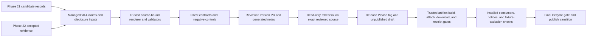

# Phase 23: Qualified v0.4.0 Release - Research

**Researched:** 2026-11-03
**Domain:** Release engineering, evidence provenance, package qualification
**Confidence:** MEDIUM

<user_constraints>
## User Constraints (from CONTEXT.md)

### Locked Decisions

#### Public release notes
- **D-01:** Keep the v0.4.0 release notes concise while stating enough to satisfy the release contract: name Potion Panic and µCity 1.3, give each recorded source/rights-scope reason, say neither was built or run and no CGB game was admitted, distinguish the CGB-CPU-E harness-only result from game progress, distinguish diagnostic/reproducibility observations, retain the required limits, and link the versioned support ledger. Do not repeat the full evidence tables in the release notes.

#### Versioned support ledger
- **D-02:** Use a generated v0.4 support ledger with a concise but self-sufficient Phase 21/22 summary and direct links to the detailed evidence records. Preserve the evidence distinctions and enough source/model/outcome detail for REL-01; do not duplicate every candidate field or each of the seven diagnostic gate records in the ledger. Leave the historical v0.3.0 ledger unchanged.
- **D-03:** Generate and validate public claims from the project's source-bound release inputs and immutable evidence records. Do not hand-edit rendered ledger output or let the release notes and ledger drift into conflicting versions of the same result.

#### Evidence and claim boundaries
- **D-04:** Phase 21 admitted no CGB game after its two ordered attempts. Potion Panic stopped before source acquisition because the creator-linked source could not be reached and exact component grants plus repository/public-CI scope were not established. µCity 1.3 stopped at the required `source/engine/hardware.inc` component, for which no identified grant or notice establishes repository/public-CI scope. Neither candidate was built or run; ROM bytes, loaded mode, progress, observations, and candidate receipts remain unobserved. Describe these as source/rights-scope no-go outcomes, not license prohibitions.
- **D-05:** Report the original CGB-CPU-E native-mode harness as harness-only evidence. Its repeatable RGB555/PCM observations do not establish admitted-game progress, rendering accuracy, perceptual quality, physical CGB-E behavior, mode-3 timing, or general compatibility.
- **D-06:** Report Phase 22 as a synthetic composition tracer plus metadata-only assessment: 513 named entries, seven unresolved real-fixture gates, zero real fixtures admitted, and zero real fixtures executed. Keep DIAG-01, DIAG-02, and RIGHTS-01 Pending. Do not imply that metadata identities, the synthetic tracer, or a digest establish fixture admission or diagnostic execution.

#### Release qualification
- **D-07:** Use the established version PR, trusted release rehearsal, exact-source/tag release gates, downloaded-artifact checks, installed-consumer smoke, notices, and fixture-exclusion controls. Publish only after the existing required checks qualify the reviewed release bytes. Preserve the actual supported product/platform matrix and unsigned/not-notarized limits; checksums and source binding must not be described as code signing or notarization.
- **D-08:** Do not repeat earlier phase qualification as if it were new v0.4.0 evidence. Bind this release to its reviewed implementation source and downloaded package identities while carrying Phase 20–22 receipts as historical records.

### the agent's Discretion
- Choose the exact v0.4 support-claim input fields, renderer/verifier organization, concise prose, headings, test controls, and plan decomposition within the roadmap's nine-plan cap. Prefer existing CMake and Python standard-library tooling; add no dependency or release capability without demonstrated need and an in-scope blocker.

### Deferred Ideas (OUT OF SCOPE)
None — discussion stayed within Phase 23 scope.
</user_constraints>

<phase_requirements>
## Phase Requirements

| ID | Description | Research Support |
|----|-------------|------------------|
| REL-01 | The qualified v0.4 release and support documentation state whether a CGB game was admitted or why it was not, identify evidence by model and source, and preserve limits on hardware, perceptual, timing, and general-compatibility claims. | Versioned source-bound support claims and release-note checks; immutable Phase 21 candidate records and Phase 22 evidence; exact tag/source, downloaded package, consumer, notice, and fixture-boundary release gates. [VERIFIED: .planning/REQUIREMENTS.md:28-30] `- [ ] **REL-01**: The qualified v0.4 release and support documentation state whether a CGB game was admitted or why it was not, identify evidence by model and source, and preserve limits on hardware, perceptual, timing, and general-compatibility claims.` |
</phase_requirements>

## Summary

Phase 23 should add the v0.4 evidence summary to GabbaBoy's established generated support-ledger and trusted release path, then qualify the reviewed v0.4.0 source through rehearsal and the existing downloaded-artifact lifecycle. Release notes and the new ledger must derive from source-bound data and the accepted immutable Phase 21/22 records; the old v0.3.0 ledger stays unchanged. [VERIFIED: .planning/phases/GB-23-qualified-v0-4-0-release/23-CONTEXT.md:9-13, 19-36; docs/release.md:43-64, 489-534]

The implementation gap is specific: today's support verifier names a v0.3 claims input and requires its v0.3.0 profile, the version-window checker tracks that input, and the release-note checker enforces the current disclosure contract. Extend those existing contracts for the new version and evidence boundaries, with positive and negative controls. Then require the generated version PR to show the intended 0.4.0 version before it can enter the freeze/rehearsal/tag path. [VERIFIED: tests/scripts/verify-support-ledger.py:2861-2871, 2930-2936; tests/scripts/verify-version-window.py:46-54; .github/workflows/release.yml:136-146; .planning/ROADMAP.md:130-144]

**Primary recommendation:** Add versioned v0.4 support-claim inputs and generated-copy controls to the current CMake/Python/CTest path; keep Phase 21/22 outcomes narrow; require exact 0.4.0 version-PR, rehearsal, source/tag and downloaded-byte gates before publication. Do not add release infrastructure or broaden CI policy absent a concrete in-scope blocker. [VERIFIED: 23-CONTEXT.md:23-36; docs/release.md:103-118, 489-534; .planning/ROADMAP.md:137-144]

## Architectural Responsibility Map

| Capability | Primary Tier | Secondary Tier | Rationale |
|------------|-------------|----------------|-----------|
| Versioned evidence claim generation and rendering | Build / CI | Public documentation | The Python verifier consumes immutable Git objects and managed inputs; CTest checks both output and rejection controls. The renderer owns consistency between evidence inputs and public ledger text. [VERIFIED: tests/scripts/verify-support-ledger.py:2861-2871, 2910-2936, 3088-3117; tests/CMakeLists.txt:1464-1526, 5071-5083] |
| Version PR and reviewed content window | Release automation | Build / CI | Release Please generates the version PR; the existing window gate freezes generated content only after checks and rehearsal pass for a single source head. [VERIFIED: .github/workflows/release.yml:56-63; .github/workflows/release-please.yml:45-62, 106-131; docs/release.md:103-118] |
| Rehearsal, tag, artifacts and publication | Release automation | Package / consumer boundary | The read-only rehearsal runs source-side producers; the trusted release workflow later builds, attaches, downloads and judges exact tag bytes before the final publish transition. [VERIFIED: .github/workflows/release-rehearsal.yml:1-15, 28-85; .github/workflows/release.yml:1311-1545; docs/release.md:489-534] |
| Installed consumer and fixture / notice qualification | Package / consumer boundary | Build / CI | Consumer tests must run against downloaded package bytes. The existing product policy checks notices and excluded game ROM insertion controls. [VERIFIED: docs/release.md:19-48; .planning/phases/GB-23-qualified-v0-4-0-release/23-CONTEXT.md:31-33, 67-70] |
| Public support statement and limitations | Public documentation | Build / CI | The release notes and versioned ledger are generated/checked contract outputs; detailed Phase 21/22 records remain the source for linked evidence. [VERIFIED: 23-CONTEXT.md:19-29, 63-70; docs/support/unreleased.md:21-31; docs/diagnostic-evidence.md:23-55] |

## Project Constraints (from AGENTS.md)

- Use the installed `@opengsd/gsd-core` runtime and verify identity when changing runtime/tool path; stop at the Phase 23 boundary, keep both auto-advance flags false, and carry forward the specific next command. [VERIFIED: AGENTS.md:27-31]
- Keep within the roadmap's nine-plan cap. Across the milestone, keep to four phases/about 40 plans; a 50% overrun triggers rescope. A phase may have at most two review-fix rounds and one gap round; unresolved correctness/security findings require rescope. [VERIFIED: .planning/ROADMAP.md:141-144; AGENTS.md:33-35] `**Plan cap**: 9` and `At most 4 phases and about 40 plans per milestone, and at most 12 plans per phase. A 50% overrun triggers a rescope.`
- Every deliverable needs an automated check and negative control. Put checkers in `tests/scripts/`, make them read an immutable commit, and register them in CTest. Avoid human-reading checkpoints when a contract check can cover them; use the existing UAT-closure checker at the verification boundary. [VERIFIED: AGENTS.md:32-38]
- Assess measured CI/release timing and queue waits. Preserve platform/configuration coverage, sanitizers, fuzz policy, exact-source/artifact binding, required checks and release authority. A justified no-change outcome is valid; keep wider work as a bounded follow-up. [VERIFIED: AGENTS.md:40; .planning/context/WORKFLOW.md:31-39]
- Use a phase branch and PR when the remote exists; merge only the reviewed revision with required checks on its latest head. A local pass, skipped check or stale run does not qualify the remote revision. [VERIFIED: AGENTS.md:41-43; .planning/ROADMAP.md:138-140]
- Keep the C core portable with explicit ownership/error behavior and bounded operations; keep host timing, filesystem, UI, audio devices and environment configuration in adapters. Guard boundaries and use portable serialization rather than raw C structure dumps. [VERIFIED: AGENTS.md:45-50]
- Label hardware tests, differential results, metamorphic properties, regression fixtures and private observations accurately; state model applicability, exclusions and expected failures. [VERIFIED: AGENTS.md:51]
- Do not add boot ROMs, commercial images, unlicensed homebrew, private data or mandatory telemetry. Third-party fixtures require redistribution rights and a digest. Keep local secrets ignored and never add personal paths, emails, machine identifiers or secrets to public artifacts. [VERIFIED: AGENTS.md:52-53]
- Update source, API docs, examples, tests and limitation notes together; consult current verification, release/consumer evidence and requirement traceability before declaring completion. Keep `.planning/research/INDEX.md` and topic research as the navigation/evidence structure. [VERIFIED: AGENTS.md:42-43, 55-59]

## Standard Stack

### Core

| Library / tool | Version | Purpose | Why Standard |
|---|---|---|---|
| CMake and CTest | Project minimum 3.25; this checkout has CMake/CTest 4.4.3 | Configure/build the native suite and run release contract tests. | Already defines `phase1`, `cmake-3.25.3`, relocated-install and sanitizer presets; release rehearsal consumes CTest output. [VERIFIED: CMakeLists.txt:1; CMakePresets.json:1-22; local shell probe] `cmake_minimum_required(VERSION 3.25)` |
| Python 3 standard library | Local Python 3.14.4 | Strict JSON, immutable Git-source readers, support-ledger/release validators and negative controls. | Existing contract scripts run isolated with `python3 -I`; the phase context explicitly prefers the current Python standard-library approach. [VERIFIED: .github/workflows/release.yml:136-146; 23-CONTEXT.md:35-36; local shell probe] |
| GitHub Actions and `gh` | Existing pinned workflow actions; local `gh` 2.101.0 | Version PR, exact-head hosted checks, rehearsal, attached assets and gated publication. | Existing workflow files implement this path, with the action and producer/judge privileges pinned or checked by policy. The local CLI is available; authenticated API access was not tested. [VERIFIED: .github/workflows/release.yml:23-63, 1311-1545; docs/release.md:489-523; local shell probe] |
| Bash and `jq` | Local GNU Bash 5.2.37; jq 1.7.1 | Existing workflow scripts and bounded API-response processing. | Already used by trusted release scripts and workflow checks; no new shell framework is needed. [VERIFIED: .github/workflows/release.yml:90-106; docs/release.md:196-216; local shell probe] |

### Supporting

| Tool / input | Version | Purpose | When to Use |
|---|---|---|---|
| `release-please-action` | Existing immutable pin `45996ed1f6d02564a971a2fa1b5860e934307cf7` (`v5.0.0`) | Generate the release PR, version files and draft/tag outputs under current policy. | Retain the pin; the expected version PR must be inspected and checked before merge. [VERIFIED: .github/workflows/release.yml:56-63] `uses: googleapis/release-please-action@45996ed1f6d02564a971a2fa1b5860e934307cf7 # v5.0.0` |
| `release-please-config.json` + manifest | Current manifest `0.3.0` | Existing simple release type, draft/tag behavior, changelog and CMake version update. | Keep current config unless a concrete in-scope blocker is exposed; do not assume the action will produce 0.4.0 without inspecting the generated PR. [VERIFIED: release-please-config.json:3-14; .release-please-manifest.json:1-3] `"release-type": "simple"`, `"draft": true`, `"force-tag-creation": true`, `".": "0.3.0"` |
| Source-bound JSON claims / immutable Git object reader | Existing Python implementation | Tie public statements to reviewed data and source revision. | Extend current validation and rendering for v0.4; do not hand-edit the generated ledger. [VERIFIED: tests/scripts/verify-support-ledger.py:2861-2871, 2910-2936, 3088-3117] `CLAIMS_PATH = "tests/data/support-claims-v0.3.json"`; `data["applies_from_version"] != "0.3.0"` |

### Alternatives Considered

| Instead of | Could Use | Tradeoff |
|------------|-----------|----------|
| Existing CMake/CTest + Python standard library | New schema, release, or signing dependencies | Context directs no new dependency or release capability absent a demonstrated need and in-scope blocker; extra release tooling would expand the trusted path and policy review. [VERIFIED: 23-CONTEXT.md:35-36; .planning/ROADMAP.md:144] |
| Generated, managed v0.4 claims | Hand-authored rendered ledger | Manual output would break the existing source-bound generation contract and let release notes and ledger drift. [VERIFIED: 23-CONTEXT.md:23-24; tests/scripts/verify-support-ledger.py:3088-3117] |

**Installation:** No new packages should be installed for this phase. [VERIFIED: 23-CONTEXT.md:35-36]

### Package Legitimacy Audit

Not applicable: the recommended phase work uses tools and dependencies already in the repository/workflow and adds no external package. Keep existing workflow action pins unchanged unless a demonstrated blocker requires a reviewed change. [VERIFIED: 23-CONTEXT.md:35-36; .github/workflows/release.yml:56-63]

## Architecture Patterns

### System Architecture Diagram

The diagram follows existing ownership: Phase 21/22 records are inputs; the release generator and test suite validate the reviewable copy; rehearsal runs source-side producers without publishing; a separate trusted draft-bound flow proves downloaded bytes before publication. [VERIFIED: 23-CONTEXT.md:74-92; .github/workflows/release-rehearsal.yml:1-15; docs/release.md:489-534]

### Recommended Project Structure

| Concern | Existing location / Phase 23 plan action |
|---|---|
| Accepted game-candidate outcomes | `tests/data/cgb-candidates/potion-panic.json` and `tests/data/cgb-candidates/ucity-1.3.json`; read as immutable facts, do not change their admission disposition. [VERIFIED: 23-CONTEXT.md:51-56; tests/data/cgb-candidates/potion-panic.json:120-131; tests/data/cgb-candidates/ucity-1.3.json:1870-1943] |
| Diagnostic metadata-only outcome | `tests/external/diagnostic-assessment.json`, `tests/external/gbmicrotest-inventory.json`, and `docs/diagnostic-evidence.md`; reference final Phase 22 evidence and keep requirements Pending. [VERIFIED: 23-CONTEXT.md:58-61; .planning/phases/GB-22-composition-and-microtest-evidence/22-EVIDENCE.md:1-10; docs/diagnostic-evidence.md:23-55] |
| Versioned public support scope | Add/extend the versioned claims input and renderer in the existing support-ledger generator; keep `docs/support/v0.3.0.md` historical and unchanged. [VERIFIED: 23-CONTEXT.md:22-24, 65-70; tests/scripts/verify-support-ledger.py:2861-2871, 2930-2936] |
| Release notes and disclosure contract | Extend the source-controlled disclosure input/checker and release-note validation, with test controls; current release workflow invokes `verify-v02-adoption.py`. [VERIFIED: 23-CONTEXT.md:69; .github/workflows/release.yml:136-146; tests/CMakeLists.txt:1508-1512] |
| Version window and release workflow | Update the managed version-window input inventory and reuse `.github/workflows/release-rehearsal.yml` / `.github/workflows/release.yml`. [VERIFIED: tests/scripts/verify-version-window.py:46-54; docs/release.md:103-118, 489-534] |

### Pattern 1: Managed claims rendered from immutable source

**What:** Current support claims are validated against a fixed schema and enums, read from an immutable revision, and rendered by the generator. The existing profile hard-codes the v0.3 claims filename and `0.3.0` applies-from version, so the plan needs explicit v0.4 support rather than silently replacing historical input. [VERIFIED: tests/scripts/verify-support-ledger.py:2861-2871, 2910-2936, 3088-3117] `CLAIMS_PATH = "tests/data/support-claims-v0.3.json"`; `data["applies_from_version"] != "0.3.0"`.

**When to use:** For every public v0.4 statement whose scope depends on evidence: validate source paths/references, model and outcome labels, and the required non-claims before rendering. Keep source records and generated prose separately reviewable. [VERIFIED: 23-CONTEXT.md:23-29; tests/scripts/verify-support-ledger.py:2910-2936]

**Example:** Register both a positive renderer/generator check and a mutated-input or missing-evidence refusal in CTest, following the current support claims and release-disclosure contract pattern. Current tests include `support_claims`, `support_claims_controls`, `release_disclosure_generator`, and `release_disclosure_controls`. [VERIFIED: tests/CMakeLists.txt:1508-1512, 5071-5077] `support_claims`; `support_claims_controls`; `release_disclosure_generator`; `release_disclosure_controls`.

### Pattern 2: Two-stage release qualification

**What:** A rehearsal branch uses the source tree's own CMake/manifest version, creates only a local runner tag, and runs source-side corpus, evidence, fuzz, performance, consumer and archive producers. It does not publish or prove the later draft-bound download/attach/final-gate path. [VERIFIED: .github/workflows/release-rehearsal.yml:1-15, 39-85, 186-245; docs/release.md:489-500]

**When to use:** Run the rehearsal against the reviewed version-PR tree before allowing the release tag; after tagging, rely on the existing trusted release lifecycle to qualify exact downloaded package bytes and installed consumers. [VERIFIED: docs/release.md:489-534; .github/workflows/release.yml:1311-1545]

**Example:** The release workflow checks the active version window from the exact release source with the existing command `python3 -I "$RUNNER_TEMP/verify-version-window.py" --check-tracked --rev "$SOURCE_SHA" --require-active --repo .`. [VERIFIED: .github/workflows/release.yml:136-141] `python3 -I "$RUNNER_TEMP/verify-version-window.py" --check-tracked --rev "$SOURCE_SHA" --require-active --repo .`

### Anti-Patterns to Avoid

- Do not treat the rehearsal as proof of draft asset download, attach, final gate or publication. The rehearsal explicitly does not cover those steps. [VERIFIED: .github/workflows/release-rehearsal.yml:7-15; docs/release.md:489-500]
- Do not hand-edit rendered support ledgers or change the historical v0.3.0 ledger. [VERIFIED: 23-CONTEXT.md:22-24]
- Do not turn Phase 21/22 outcomes into new v0.4 execution evidence or infer license prohibitions from a rights-scope no-go. [VERIFIED: 23-CONTEXT.md:27-33]
- Do not treat SHA-256/source binding as a signature or notarization; the existing product remains unsigned and not notarized. [VERIFIED: 23-CONTEXT.md:31-33; docs/release.md:412-421]
- Do not solve duplicate hosted work by dropping exact-head checks or required platform/coverage lanes. [VERIFIED: AGENTS.md:40-41; .planning/context/WORKFLOW.md:35-39]

## Don't Hand-Roll

| Problem | Don't Build | Use Instead | Why |
|---|---|---|---|
| Evidence-to-ledger binding | A free-form Markdown publishing script or manually edited release ledger | Extend the managed-input, immutable-source verifier/renderer with schema and negative controls | Existing code already validates claim profile and derives facts from Git objects; manual copy can drift or overstate scope. [VERIFIED: tests/scripts/verify-support-ledger.py:2861-2936, 3088-3117] |
| Release lifecycle | A second tag, asset-upload, retry or publish workflow | Existing release/rehearsal workflows and trusted lifecycle scripts | Existing gates enforce source/tag identity, asset inventory, draft retry and one publish transition. [VERIFIED: docs/release.md:196-216, 489-534; .github/workflows/release.yml:1448-1545] |
| Package correctness | Re-test only the installed build prefix and infer the downloadable release works | Existing exact downloaded-artifact checker and installed consumers against extracted release bytes | Documentation explicitly distinguishes prefix tests from the downloaded archive's own bytes. [VERIFIED: docs/release.md:43-48; .github/workflows/release.yml:1311-1545] |
| Rights/fixture policy | A new broad fixture scan or implied grant | Existing notice and forbidden-fixture package controls | Phase 23 must preserve current package policy and must not reopen or bypass unresolved rights gates. [VERIFIED: 23-CONTEXT.md:31-33, 67-70; AGENTS.md:52] |

**Key insight:** Release qualification is a chain of separate identities and evidence types: reviewed source, tagged source, producer receipts, downloaded package bytes, installed consumers, notices and fixture exclusion. A green local build or generated ledger alone proves only its own layer. [VERIFIED: docs/release.md:43-64, 489-534]

## Common Pitfalls

### Pitfall 1: Assuming Release Please will select v0.4.0

**What goes wrong:** A PR/tag can have a different version than the qualified release target if generated version output is assumed instead of reviewed. Current manifest and CMake project version both say `0.3.0`; roadmap scope says Phase 23 is “Qualified v0.4.0 Release.” [VERIFIED: .release-please-manifest.json:1-3; CMakeLists.txt:1-2; .planning/ROADMAP.md:130] `".": "0.3.0"`; `project(GabbaBoy VERSION 0.3.0 LANGUAGES C)`; `### Phase 23: Qualified v0.4.0 Release`.

**Why it happens:** Release Please generates a reviewed version PR from commit history and release configuration; its official documentation describes Conventional Commit-based selection and says `feat:` correlates with a minor bump. The current non-merge history after v0.3.0 contains subjects such as `docs(state): point to phase 23 planning route`, `ci: serialize phase 22 evidence controls on Windows (#143)`, `Phase 21: compose source-bound CGB game outcome (#140)`, and `test(release): preserve v0.3.0 notes and retry source proof`; no `feat:` subject was observed. The repo uses the `simple` strategy and does not pin the target version in the workflow. [CITED: https://github.com/googleapis/release-please-action; https://github.com/googleapis/release-please/blob/main/README.md; VERIFIED: git log --no-merges --format=%s v0.3.0..HEAD; release-please-config.json:3-14; .github/workflows/release.yml:56-63]

**How to avoid:** Make the generated PR's CMake version, manifest, tag, ledger filename and notes version an explicit pre-merge gate. If it does not target 0.4.0, stop before the version window/tag and identify the narrow release-path issue; do not silently publish another version or manufacture a misleading feature commit. RM-032 candidates remain deferred, while the roadmap permits a narrowly scoped release-path change only for a concrete blocker. [VERIFIED: .planning/ROADMAP.md:130-144; .planning/context/FUTURE-MILESTONES.md:64, 128; docs/release.md:103-118, 489-534]

### Pitfall 2: Leaving v0.3-only claim inputs in a new release path

**What goes wrong:** New ledger text may fail validation or be excluded from the version-window digest because the generator and managed-input list still name only the v0.3 claim file/profile. [VERIFIED: tests/scripts/verify-support-ledger.py:2861-2871, 2930-2936; tests/scripts/verify-version-window.py:46-54]

**How to avoid:** Version the v0.4 source input, make the generator select/validate the correct profile from the immutable source revision, register both passing and rejection controls, and add every new managed input to the version-window contract. Keep existing v0.3 generator assertions passing. [VERIFIED: tests/scripts/verify-support-ledger.py:2861-2936, 3088-3117; tests/scripts/verify-version-window.py:46-54; tests/CMakeLists.txt:5071-5077]

### Pitfall 3: Disclosure drift between release notes and ledger

**What goes wrong:** The current release-note checker requires a fixed list of existing CGB and signing statements. If the new notes/ledger disclosures are not checked from source-controlled data, omission or conflicting wording may pass the old contract. [VERIFIED: .github/workflows/release.yml:136-146; docs/release.md:525-532; 23-CONTEXT.md:19-24]

**How to avoid:** Extend the release-note verifier and generated disclosure tests to cover candidate reasons, harness-only evidence, synthetic/metadata-only scope, pending requirements and limits. Add negative controls for missing, swapped or promoted claims; keep the release note concise and link to detailed evidence. [VERIFIED: 23-CONTEXT.md:19-29, 69-70; tests/CMakeLists.txt:1464-1512]

### Pitfall 4: Treating token-created events or stale checks as qualification

**What goes wrong:** GitHub documents that workflow events caused by `GITHUB_TOKEN` do not generally start new workflow runs; certain PR events can be created in approval-required state. Required checks must be successful for the latest commit SHA. [CITED: https://docs.github.com/en/actions/how-tos/write-workflows/choose-when-workflows-run/trigger-a-workflow; https://docs.github.com/en/pull-requests/how-tos/merge-and-close-pull-requests/troubleshooting-required-status-checks]

**How to avoid:** Follow the repo's explicit generated PR approval, `workflow_dispatch`/retry and exact-head release gates. Confirm the actual branch-protection contexts and current run heads; do not infer live hosted status from this local research or a stale result. [VERIFIED: .github/workflows/release.yml:31-63; .github/workflows/release-please.yml:1-20; docs/release.md:103-118, 489-534]

### Pitfall 5: Promoting Phase 21/22 into stronger claims

**What goes wrong:** A source/rights-scope cutoff can be misstated as a license ban; a harness digest can be mistaken for game progress; source/ROM names can be mistaken for diagnostic ROM bytes or test execution. [VERIFIED: 21-UAT-EVIDENCE.md:7-9, 27; 22-EVIDENCE.md:1-10; docs/diagnostic-evidence.md:17, 33-55]

**How to avoid:** Summarize only immutable accepted outcomes. For Phase 21, quote separate reasons and state no candidate was built/run and no CGB game admitted. For Phase 22, state synthetic tracer plus metadata-only inventory, 513 names, seven unresolved real-fixture gates, zero admitted/executed, with DIAG-01/02 and RIGHTS-01 Pending. Link details instead of duplicating the evidence tables. [VERIFIED: 23-CONTEXT.md:27-29; 22-EVIDENCE.md:1-10; docs/diagnostic-evidence.md:23-55]

### Pitfall 6: Treating rehearsal as the full publishing proof

**What goes wrong:** The rehearsal does not create the tag, upload or publish and does not exercise draft-bound download, attach or final-publish gates. [VERIFIED: .github/workflows/release-rehearsal.yml:7-15; docs/release.md:489-500]

**How to avoid:** Require both the pre-tag rehearsal and the later real draft-bound exact-byte checks. Verify that downloaded Linux/macOS/Windows core archives and macOS player bytes, installed consumers, notices and fixture-exclusion controls reconcile to the reviewed release source before publication. [VERIFIED: docs/release.md:8-16, 43-48, 525-534; .github/workflows/release.yml:1311-1545]

### Pitfall 7: Reusing the v0.3 draft-note repair as a v0.4 runbook

**What goes wrong:** The v0.3 recovery record is a specific incident. Its first body-only PATCH changed the draft's tag association and triggered a refusal; its exact tag restoration and source/hash evidence are not a generic repair recipe. [VERIFIED: docs/release.md:536-586]

**How to avoid:** If v0.4 generated notes omit a disclosure, hold publication and use the documented general approach: reviewed non-releasable correction, full offline lifecycle replay and retry-readback controls before touching a draft. Treat any moved tag/state as a hold and require an explicitly approved current recovery procedure; the documented v0.3 procedure does not authorize a live v0.4 mutation. [VERIFIED: docs/release.md:536-544, 574-628]

## Code Examples

These are existing commands for planning/execution reference; they were not run as part of this research.

**Configured full local validation command:** `.planning/config.json` contains the exact command `cmake --preset phase1 && cmake --build --preset phase1 && ctest --preset phase1 --output-on-failure --no-tests=error`. [VERIFIED: .planning/config.json:48-55] `"test_command": "cmake --preset phase1 && cmake --build --preset phase1 && ctest --preset phase1 --output-on-failure --no-tests=error"`

**Existing release-note checker invocation:** `.github/workflows/release.yml` runs `python3 -I tests/scripts/verify-v02-adoption.py --release-notes "$RELEASE_NOTES_FILE" --rev "$GITHUB_SHA"`; extend its expectations rather than replacing its place in the trusted workflow. [VERIFIED: .github/workflows/release.yml:136-146] `python3 -I tests/scripts/verify-v02-adoption.py --release-notes "$RELEASE_NOTES_FILE" --rev "$GITHUB_SHA"`

**Existing version-window gate invocation:** `python3 -I "$RUNNER_TEMP/verify-version-window.py" --check-tracked --rev "$SOURCE_SHA" --require-active --repo .`. The checker hashes managed version-PR inputs; add the v0.4 claims input to its inventory. [VERIFIED: .github/workflows/release.yml:136-141; tests/scripts/verify-version-window.py:46-54] `python3 -I "$RUNNER_TEMP/verify-version-window.py" --check-tracked --rev "$SOURCE_SHA" --require-active --repo .`

**Current claims test identities:** CTest registers the positive `support_claims` and rejection `support_claims_controls` checks using `--check-claims` and `--self-test-claims`; update the pair for v0.4 and retain v0.3 coverage. [VERIFIED: tests/CMakeLists.txt:5071-5077; tests/scripts/verify-support-ledger.py:3662-3667] `support_claims`; `support_claims_controls`; `--check-claims`; `--self-test-claims`.

## State of the Art

| Old / incorrect approach | Current approach | When / source | Impact |
|---|---|---|---|
| Treat the rehearsal as release publication proof | Rehearsal is read-only and proves source-side producers; the actual draft flow downloads and judges release bytes before one gated publish transition. | Local release workflow/docs. [VERIFIED: .github/workflows/release-rehearsal.yml:1-15; docs/release.md:489-534] | Preserve both gates; don't substitute rehearsal for downloaded-artifact evidence. |
| Assume `GITHUB_TOKEN` will recursively start push-triggered workflows | GitHub documents that most events caused by `GITHUB_TOKEN` do not start a new workflow; dispatch events are exceptions and created PR runs may need approval. | Current official GitHub Actions docs. [CITED: https://docs.github.com/en/actions/how-tos/write-workflows/choose-when-workflows-run/trigger-a-workflow] | Plan PR approval and retry/dispatch sequencing explicitly. |
| Treat a successful earlier status as enough | Required checks must succeed on the latest commit SHA; stale statuses are not current qualification. | Current official GitHub required-status docs. [CITED: https://docs.github.com/en/pull-requests/how-tos/merge-and-close-pull-requests/troubleshooting-required-status-checks] | Bind the phase proof to the reviewed head and verify live check identity at execution time. |
| Rely on prior release-please knowledge for defaults | The action's primary docs describe release PR generation, version/changelog update, tag and GitHub Release on merge; local manifest controls draft/force-tag behavior. | Current official Google release-please docs and repository config. [CITED: https://github.com/googleapis/release-please-action; https://github.com/googleapis/release-please/blob/main/docs/manifest-releaser.md; VERIFIED: release-please-config.json:3-14] | Inspect generated version and tag outputs; do not assume an exact bump or draft state. |

**Deprecated/outdated:** Do not copy the v0.3.0-specific claim filename/profile or current release-note expectations into a v0.4 generator without updating their checks. Existing implementation literally binds these values. [VERIFIED: tests/scripts/verify-support-ledger.py:2861-2871, 2930-2936; tests/scripts/verify-v02-adoption.py:704-770]

## CI / Release Efficiency Findings

The repository has measured duplicate same-SHA push and PR work from Phase 21: duplicate native lanes took roughly 18–34 minutes, an ASan shard took 26–39 minutes, and package preview jobs waited about 40 minutes for their exact-head CI result while holding runners. This remains a measured RM-025 follow-up; Phase 21 did not change triggers or required coverage. [VERIFIED: .planning/context/FUTURE-MILESTONES.md:116-119]

The Phase 22 evidence records the later duplicate full push run was canceled only after exact-head PR checks passed; its local final review found no justified workflow scheduling change, and RM-025 remains a measured follow-up. A separate Linux support-ledger self-test took about 20 seconds and is repeated by CTest; the documented follow-up requires proving equivalent environment, assertions and lane membership before consolidation. Phase 23 has no new release run measurements yet, so inspect available durations and queue/dependency waits, but do not weaken checks or rewrite triggers as speculative optimization. [VERIFIED: .planning/phases/GB-22-composition-and-microtest-evidence/22-EVIDENCE.md:51-53, 69-75; .planning/context/WORKFLOW.md:35-39; .planning/context/FUTURE-MILESTONES.md:126-128]

**Planning consequence:** Treat runner occupancy and duplicate trigger work as operational evidence to monitor, not an automatic Phase 23 workflow change. A safe improvement must preserve exact-source citations, required PR checks, all platform/sanitizer/fuzz coverage and downstream waiting deadlines. [VERIFIED: .planning/context/WORKFLOW.md:35-39; AGENTS.md:40-41]

## Recommended Plan Ordering

Use the roadmap's nine-plan cap as a ceiling; a likely convergent order is: [VERIFIED: .planning/ROADMAP.md:141-142] `**Plan cap**: 9`

1. Add the v0.4 source-bound claim profile and immutable-source validation using accepted Phase 21/22 facts; leave the v0.3.0 ledger and evidence source records unchanged. [VERIFIED: 23-CONTEXT.md:22-29; tests/scripts/verify-support-ledger.py:2861-2936]
2. Add CTest positive and negative controls for claim generation, profile selection, source/evidence references, Pending requirements and forbidden claim promotion. [VERIFIED: AGENTS.md:32-38; tests/CMakeLists.txt:5071-5077]
3. Extend release-note/disclosure validation to cover concise candidate reason, harness-only, synthetic/metadata-only and limitation statements without copying the full gate tables. [VERIFIED: 23-CONTEXT.md:19-29; .github/workflows/release.yml:136-146]
4. Add the v0.4 managed input to the version-window contract and verify generated docs/changelog/version outputs form a consistent exact 0.4.0 release PR. Current repository version inputs remain 0.3.0. [VERIFIED: tests/scripts/verify-version-window.py:46-54; CMakeLists.txt:1-2; .release-please-manifest.json:1-3]
5. Run configured local full validation and the established pre-tag rehearsal for the reviewed version-PR tree; preserve hosted CMake/platform, consumer, fixture, fuzz and performance coverage. [VERIFIED: .planning/config.json:54; docs/release.md:489-500]
6. Run an independent release-path/security/consumer review plus an adversarial pass over the new claim and disclosure controls; resolve findings within the phase's bounded review rounds. [VERIFIED: 23-CONTEXT.md:102; AGENTS.md:32-38]
7. Qualify the exact PR head and generated content window; merge only after the current required checks/reviews succeed on that revision. [VERIFIED: docs/release.md:103-118; AGENTS.md:41-43]
8. After the tag and draft exist, verify the trusted downloaded candidate artifacts, exact source/digests, installed consumers, notices, fixture exclusion and final lifecycle inventory; require the successful exact-tree nightly ASan replay, then publish only through the existing final gate. [VERIFIED: docs/release.md:525-534; .github/workflows/release.yml:1518-1545]
9. Close REL-01 against final phase evidence, run the repository's automated verify-work closure checker, and stop at Phase 23 with the next owner-controlled phase route recorded. [VERIFIED: AGENTS.md:29-38; .planning/ROADMAP.md:130-144]

## Assumptions Log

No unverified technical claims are recommended as facts. The expected release version, hosted checks and live GitHub/API outcomes remain gates to observe, not assumptions. [VERIFIED: .planning/ROADMAP.md:130-144; .planning/STATE.md:5-10]

## Open Questions

1. **Will the first generated release PR produce exactly 0.4.0?**
   - What we know: The current manifest and CMake version are both `0.3.0`; Phase 23's target is v0.4.0. The current non-merge commit subjects after v0.3.0 are docs, CI, test, chore and phase-title subjects; no `feat:` subject appears in the observed history. Release Please documents `feat:` as a minor-version signal. [VERIFIED: .release-please-manifest.json:1-3; CMakeLists.txt:1-2; .planning/ROADMAP.md:130-144; git log --no-merges --format=%s v0.3.0..HEAD; CITED: https://github.com/googleapis/release-please-action]
   - What's unclear: The generated PR/tag and actual hosted action output have not been observed; the current config does not explicitly set a 0.4.0 target. [VERIFIED: release-please-config.json:3-14; local research boundary]
   - Recommendation: Treat 0.4.0 CMake, manifest, tag, ledger and notes agreement as a pre-merge gate. Stop before the version-window/tag if generation differs; resolve only the narrow release blocker within phase scope. [VERIFIED: docs/release.md:103-118, 489-534; .planning/ROADMAP.md:141-144]
2. **Will the owner-approved remote checks and credentials be available when the phase executes?**
   - What we know: Local `gh` is installed, but this research did not inspect authenticated GitHub state or run hosted workflows. [VERIFIED: local shell probe; .planning/STATE.md:8-10]
   - What's unclear: Current branch protection, open PRs, action approvals, secrets and exact-head check status are live state.
   - Recommendation: Use the existing documented remote qualification path and report access failures precisely; do not treat local CTest or historical Phase 22 checks as v0.4 qualification. [VERIFIED: AGENTS.md:41-43; docs/release.md:489-534]

## Environment Availability

| Dependency | Required By | Available | Version | Fallback |
|---|---|---:|---|---|
| CMake / CTest | Local full validation; project declares CMake 3.25 minimum | Yes | 4.4.3 / 4.4.3 | Hosted workflow for required remote coverage. [VERIFIED: CMakeLists.txt:1; local shell probe] |
| Python 3 | Source-bound claim, note and release validators | Yes | 3.14.4 | Use existing hosted Python workflow environment; do not infer an untested compatibility range from this probe. [VERIFIED: local shell probe; .github/workflows/release.yml:136-146] |
| GitHub CLI (`gh`) | Workflow API access/retry and release lifecycle | Yes, local CLI | 2.101.0 | Hosted workflow; credentials/access untested here. [VERIFIED: local shell probe; docs/release.md:196-216] |
| `jq` / Bash | Existing workflow scripts | Yes | 1.7.1 / GNU 5.2.37 | Hosted runner. [VERIFIED: local shell probe; .github/workflows/release.yml:90-106] |
| GitHub Actions repository, permissions, checks and release API | Version PR, hosted rehearsal, actual draft/download/publish gates | Not probed live | — | None for real publication proof; require the existing hosted process and authorized repository access. [VERIFIED: docs/release.md:489-534; local research boundary] |

**Missing dependencies with no fallback:** None identified for planning. Live GitHub access is required later for hosted/release proof, but availability was not established by this research.

## Validation Architecture

### Test Framework

| Property | Value |
|---|---|
| Framework | CTest through the existing CMake preset suite. [VERIFIED: CMakePresets.json:1-22] |
| Config file | `CMakePresets.json`; `phase1` configure/build/test presets already exist. [VERIFIED: CMakePresets.json:4-22] |
| Quick run command | The plan should select the focused new/affected CTest contract IDs after v0.4 controls are registered; pair each with its negative control. [VERIFIED: AGENTS.md:32-38; tests/CMakeLists.txt:1464-1526, 5071-5083] |
| Full suite command | `cmake --preset phase1 && cmake --build --preset phase1 && ctest --preset phase1 --output-on-failure --no-tests=error`. [VERIFIED: .planning/config.json:54] `"test_command": "cmake --preset phase1 && cmake --build --preset phase1 && ctest --preset phase1 --output-on-failure --no-tests=error"` |

### Phase Requirements → Test Map

| Req ID | Behavior | Test Type | Automated Command | File Exists? |
|---|---|---|---|---|
| REL-01 | Generated v0.4 ledger reflects source-bound Phase 21/22 outcomes and rejects unsupported promotions or missing evidence. | Unit/contract | Existing CTest identity `support_claims` plus `support_claims_controls`, updated for v0.4. [VERIFIED: tests/CMakeLists.txt:5071-5077] | Existing CTest entries and verifier exist; v0.4-specific profile/controls are a Wave 0 gap. |
| REL-01 | Release notes and ledger agree on required candidate/model/diagnostic limits and exact version link. | Contract | Existing release disclosure generator/control and release-note checks, extended for v0.4. [VERIFIED: tests/CMakeLists.txt:1464-1512; .github/workflows/release.yml:136-146] | Existing checks exist; new phase contract assertions are needed. |
| REL-01 | New claims input is covered by the generated version window so reviewed bytes cannot drift. | Contract | Existing `version-window` CTest and controls, extended with the v0.4 input. [VERIFIED: tests/CMakeLists.txt:1518-1526; tests/scripts/verify-version-window.py:46-54] | Existing checker/control exist; managed input list currently names v0.3. |
| REL-01 | Reviewed release source and downloaded assets reconcile; installed consumers, notices and fixture-exclusion control pass. | Integration / e2e | Existing release rehearsal then trusted release candidate workflow and product policy checks. [VERIFIED: docs/release.md:43-48, 489-534; .github/workflows/release.yml:1311-1545] | Existing workflows/checkers exist; final live assets only exist after the release-candidate stage. |

### Sampling Rate

- Per task: run the focused new/affected CTest contracts and their negative controls. [VERIFIED: AGENTS.md:32-38]
- Per reviewed change: run the configured full local build and CTest command; require exact-head hosted checks for PR qualification. [VERIFIED: .planning/config.json:54; AGENTS.md:41-43]
- Release gate: non-publishing rehearsal before tag, then real draft-bound downloaded-byte checks and final lifecycle gate before publish. [VERIFIED: docs/release.md:489-534]

### Wave 0 Gaps

- Add v0.4 claim input/profile validation and positive/negative CTest coverage. [VERIFIED: tests/scripts/verify-support-ledger.py:2861-2871, 2930-2936; tests/CMakeLists.txt:5071-5077]
- Add release-note/disclosure controls for the exact v0.4 evidence summary and limits. [VERIFIED: .github/workflows/release.yml:136-146; tests/CMakeLists.txt:1464-1512]
- Add the v0.4 claims source to version-window managed input and retain a mutated-input control. [VERIFIED: tests/scripts/verify-version-window.py:46-54, 445-465]
- No new test framework/configuration install is needed; CMake/CTest and contract-check patterns exist. [VERIFIED: CMakePresets.json:4-22; tests/CMakeLists.txt:1464-1526, 5071-5083]

## Security Domain

Security enforcement is enabled and configured at level 1. The selected ASVS 5.0.0 source describes ASVS as a security verification standard for web applications/services; this phase is release automation, document generation and package qualification rather than a web app, so apply the input/encoding controls where they fit and do not invent auth/session requirements. [VERIFIED: .planning/config.json:48-50] `"security_enforcement": true`, `"security_asvs_level": 1`; [CITED: https://asvs.owasp.org/; https://github.com/OWASP/ASVS/blob/master/5.0/docs_en/OWASP_Application_Security_Verification_Standard_5.0.0_en.flat.json]

### Applicable ASVS Categories

| ASVS 5.0 category | Applies | Phase control |
|---|---|---|
| V1 Encoding and Sanitization | Yes, narrowly | Validate and bound managed input; safely render markdown/URLs and avoid interpreting evidence strings as shell or workflow syntax. [CITED: https://github.com/OWASP/ASVS/blob/master/5.0/docs_en/OWASP_Application_Security_Verification_Standard_5.0.0_en.flat.json] |
| V2 Validation and Business Logic | Yes, narrowly | Positive schema/profile validation, immutable source references, required fields, model/outcome relationships and refusal controls. [CITED: https://github.com/OWASP/ASVS/blob/master/5.0/docs_en/OWASP_Application_Security_Verification_Standard_5.0.0_en.flat.json; VERIFIED: tests/scripts/verify-support-ledger.py:2861-2936] |
| V3 Web Frontend Security / V4 API and Web Service | Not applicable | This phase adds no web frontend, application API or service endpoint. Keep release workflow control-plane protections in their existing GitHub workflow policy. [CITED: https://github.com/OWASP/ASVS/blob/master/5.0/docs_en/OWASP_Application_Security_Verification_Standard_5.0.0_en.json; VERIFIED: .planning/ROADMAP.md:130-144] |
| V6 Authentication / V7 Session Management / V8 Authorization | Not applicable to app sessions | No user-facing web login/session feature is introduced; preserve existing GitHub token permissions and release authority boundaries. [CITED: https://github.com/OWASP/ASVS/blob/master/5.0/docs_en/OWASP_Application_Security_Verification_Standard_5.0.0_en.json; VERIFIED: .github/workflows/release.yml:23-41] |
| V5 File Handling | Not an upload feature | Product archive checking remains covered by existing artifact/fixture policy; do not describe this as an ASVS upload implementation. [CITED: https://github.com/OWASP/ASVS/blob/master/5.0/docs_en/OWASP_Application_Security_Verification_Standard_5.0.0_en.json; VERIFIED: docs/release.md:19-48] |

### Known Threat Patterns for the release path

| Pattern | STRIDE | Standard mitigation |
|---|---|---|
| Edited claim input or release-note text expands public evidence | Tampering | Strict allowlisted schema, immutable-source reads, version-window digest and negative controls. [VERIFIED: tests/scripts/verify-support-ledger.py:2861-2936; tests/scripts/verify-version-window.py:46-54] |
| Wrong source SHA/tag or stale CI evidence is represented as qualified | Spoofing / Tampering | Exact tag/source identity, reviewed version-window checks, latest-head check validation and trusted validator checkout. [VERIFIED: .github/workflows/release.yml:85-106, 136-146; docs/release.md:103-118; CITED: https://docs.github.com/en/pull-requests/how-tos/merge-and-close-pull-requests/troubleshooting-required-status-checks] |
| Release token or tagged code receives excess authority | Elevation of Privilege | Preserve job-scoped permissions, trusted-checkout judging and existing workflow policy; do not introduce new write path. [VERIFIED: docs/release.md:501-523; .github/workflows/release.yml:23-41] |
| ROM or unqualified third-party fixture enters a product archive | Information Disclosure / IP scope | Retain notices, fixture manifest and forbidden-fixture checks against real package bytes and insertion controls. [VERIFIED: 23-CONTEXT.md:31-33, 67-70; AGENTS.md:52] |
| Secret, personal path or machine identity enters public artifact/evidence | Information Disclosure | Use existing secret handling; keep local secrets ignored and redact host identities from retained public evidence. [VERIFIED: AGENTS.md:52-53] |

## Sources

### Primary (HIGH confidence)

- `.planning/phases/GB-23-qualified-v0-4-0-release/23-CONTEXT.md` — locked decisions, scope, current implementation pointers and phase boundaries.
- `.planning/REQUIREMENTS.md` and `.planning/ROADMAP.md` — exact REL-01 language, success criteria, plan cap and excluded work.
- `.planning/phases/GB-21-cgb-game-progress-and-scene-regressions/21-UAT-EVIDENCE.md`, `tests/data/cgb-candidates/potion-panic.json`, `tests/data/cgb-candidates/ucity-1.3.json` — accepted candidate status and no-go boundaries.
- `.planning/phases/GB-22-composition-and-microtest-evidence/22-EVIDENCE.md`, `docs/diagnostic-evidence.md` — metadata-only outcome, unresolved gates, no admissions/execution and pending requirements.
- `docs/release.md`, `.github/workflows/release.yml`, `.github/workflows/release-rehearsal.yml`, `.github/workflows/release-please.yml` — existing release path and recovery/qualification rules.
- `tests/scripts/verify-support-ledger.py`, `tests/scripts/verify-version-window.py`, `tests/scripts/verify-v02-adoption.py`, `tests/CMakeLists.txt`, `CMakePresets.json` — source-bound generation, release-note, version-window and validation contracts.
- `.planning/context/WORKFLOW.md`, `.planning/context/FUTURE-MILESTONES.md`, `AGENTS.md` — measured CI efficiency evidence and project execution constraints.

### Official external documentation (MEDIUM confidence)

- [GitHub Actions: Triggering a workflow](https://docs.github.com/en/actions/how-tos/write-workflows/choose-when-workflows-run/trigger-a-workflow) — `GITHUB_TOKEN`-triggered event exceptions and approval-required PR workflow runs.
- [GitHub: Troubleshooting required status checks](https://docs.github.com/en/pull-requests/how-tos/merge-and-close-pull-requests/troubleshooting-required-status-checks) — required checks must match the latest commit SHA.
- [googleapis/release-please-action](https://github.com/googleapis/release-please-action) and [release-please manifest configuration](https://github.com/googleapis/release-please/blob/main/docs/manifest-releaser.md) — release PR/tag/release flow and draft/force-tag configuration.
- [OWASP ASVS 5.0](https://asvs.owasp.org/) and [official ASVS 5.0 JSON](https://github.com/OWASP/ASVS/blob/master/5.0/docs_en/OWASP_Application_Security_Verification_Standard_5.0.0_en.flat.json) — current standard scope and input/output-related category mapping.

### Tertiary (LOW confidence)

- None used to support recommendations.

## Metadata

**Confidence breakdown:**
- Standard stack: HIGH — based on repository config, workflow pins and local availability probes.
- Architecture: HIGH — derived from the current release workflow, verifier and version-window implementation.
- Pitfalls: MEDIUM — local release contracts are directly verified; GitHub-hosted runtime and the future generated PR have not been observed.

**Research date:** 2026-11-03
**Valid until:** 2026-12-03 for repository architecture; recheck live GitHub docs/checks at execution because hosted behavior and status are time-sensitive.
