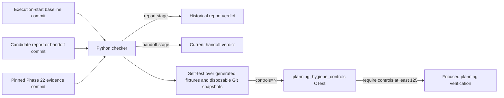

# Phase GB-23.1: Close v0.4 Requirement and Verification Gaps - Research

**Researched:** 2026-11-15
**Domain:** Python standard-library planning contracts, Markdown frontmatter and protected-section validation, CMake/CTest integration
**Confidence:** HIGH for current contracts, findings, and stop limits; MEDIUM for the narrow Setext recognizer details because the implementation remains to be chosen.

<user_constraints>
## User Constraints (from CONTEXT.md)

### Locked Decisions

## Implementation Decisions

### Rescope authority and review limit

- **D-01:** The owner authorizes exactly one additional bounded review-fix cycle for the incomplete Phase 23.1, after the two prior cycles. This phase-local amendment applies only to the current three open findings. It does not reset prior review history or authorize another plan, another gap round, or any broader scope. Record the amendment as a new dated decision; retain D-193's other limits. The additional cycle is consumed once used; earlier review history remains intact.
- Reuse the existing `23.1-01` plan allocation; do not add a second plan. The added cycle consists of implementing and verifying the three selected corrections, then one independent review of those corrections. If that review leaves a Critical/correctness/security issue open or finds a new blocker, stop Phase 23.1 and return to the owner; do not take another fix cycle without new explicit authority.
- **D-04 (D-195):** Following the owner's explicit instruction in this discussion to fan out and automatically follow the synthesized recommendations, authorize exactly one final correction-and-review cycle in the same `23.1-01` plan. This narrowly supersedes D-194's consumed-cycle stop and the phase review-round limit for CR-01 and CR-02 only. It does not add a plan, reset earlier review history, or change any other D-193/D-194 stop. If the independent review leaves a Critical/correctness/security issue or identifies a new blocker, stop with no further code or review cycle.

### CR-01 — Root requirement map and scalar syntax

- **D-05:** Require exactly one root-level `requirements:` mapping in the known Phase 22 report frontmatter. Preserve mapping pairs until validation so duplicate IDs cannot disappear; read only immediate entries of that root map; reject nested lookalikes, missing/extra IDs, duplicate IDs, and unmatched/mismatched quotes. Compare the four lowercase `pending` statuses with the existing Pending/owner dispositions and `requirements_satisfied: []`. Keep this schema-specific and use the Python standard library; do not add a general YAML parser for this fixed report contract.

### CR-02 — Visible protected Markdown sections

- **D-06:** Use a single standard-library visible-line mask before both ATX heading counting and section extraction. Fenced or indented code must not satisfy a protected heading or supply its section body. Keep the existing ATX-only contract and optional closing hashes. Correctly handle fence character/length matching and unclosed fences; do not add a general-purpose CommonMark dependency for these repository-controlled, top-level contract headings.

### Verification and stop condition

- **D-07:** Keep the existing `planning_hygiene_controls` CTest identity and its 125-control floor. Use production-CLI negative controls for the wrong-parent/malformed-quote cases and fenced/indented code heading cases, plus visible ATX positive controls. Run the direct self-test and immutable report/handoff checks, the existing 125/124 wrapper boundary, the two named focused CTests, SUMMARY coverage, and shared UAT closure. Obtain one independent review after fixes. No broad suite, third lifecycle retest, D-103 milestone suite, release/fixture/rights work, or next phase/milestone.

### D-196 — Owner-authorized recovery after the D-195 review

- **D-08:** The owner explicitly authorized exactly one further same-plan correction cycle for CR-01 and CR-02, followed by one independent review of the exact committed candidate. Append the work to `23.1-01`; do not add a plan or replay completed tasks. This narrowly superseded D-195's exhausted-cycle stop and the review-round cap only as needed for D-196. All other D-193/D-194/D-195 boundaries remain. Any Critical/correctness/security finding or new blocker left by that review immediately blocks Phase 23.1; no further correction, review, or phase verification follows under D-196.
- **D-09 — YAML-equivalent root keys:** The known Phase 22 report accepts only the canonical column-zero `requirements:` root-map spelling. Before constructing a dictionary, retain key/value pairs and detect equivalent root spellings (including whitespace before `:`, quoted scalar keys, and unsupported explicit-key forms). Reject noncanonical aliases, duplicate roots, duplicate nested IDs, malformed quoting, wrong-parent lookalikes, missing/extra IDs, and contradictory values through the existing report CLI refusal family. Do not build a general YAML parser or add a dependency; use the Python standard library and fail closed on syntax outside this fixed contract.
- **D-10 — HTML-comment visibility:** Extend the existing shared line-preserving Markdown mask so HTML comment spans cannot supply protected headings, section bodies, global facts, or links in the report, STATE, PROJECT, or continuation. Handle same-line, multiline, multiple, and unclosed comments; preserve line boundaries; stop at the first `-->`; keep comment markers in fenced/indented code literal by resolving block-code state before comment state. Respect matched inline code spans for comment recognition, but do not implement a general CommonMark parser. Keep one mask as the source for heading counts, section extraction, Setext scanning, global evidence, and links.
- **D-11 — D-196 controls:** Add causal report-stage CLI negatives for hidden required headings/body/table/facts/links and for alias roots (`requirements :`, quoted and escaped equivalents, tab separation, and explicit-key syntax); add handoff-stage negatives independently for hidden headings and required body evidence in STATE, PROJECT, and continuation. Include visible twins, closed/unclosed/multiline comments, text after a close, and comment markers in code blocks or matched inline code spans. Run cheap direct controls before only `plan_cap` and `planning_hygiene_controls`; retain the 125/124 wrapper boundary, immutable baseline, SUMMARY coverage and shared UAT closure. No broad suite, third lifecycle retest, D-103 suite, release/fixture/rights work, or next phase/milestone.

### D-198 — One bounded recovery for the D-196 Critical findings

- **D-12 — Scope and stop:** Append exactly one correction task (Task 6) to the existing `23.1-01` plan. Address only active D-196 CR-01 and CR-02, then obtain one independent review of the exact committed candidate. This is a narrow new exception to D-196's exhausted-cycle stop; it adds no plan, does not replay Tasks 1–5, and does not reset prior review or gap history. If the review is unavailable, leaves any Critical/correctness/security issue open, or identifies another blocker, keep Phase 23.1 blocked and stop before its verifier; no additional fix or review is authorized.
- **D-13 — YAML root-map syntax:** Keep the existing Python standard-library checker and fixed Phase 22 report schema. Accept only the literal column-zero `requirements:` root map. Reject unsupported decorated root-key syntax that can represent a YAML-equivalent key, including anchor or tag properties in either order, explicit-key notation, aliases, quoted/escaped forms, and whitespace variants. Preserve key/value pairs through duplicate and shape validation. Do not add a YAML dependency or implement a general YAML parser.
- **D-14 — Markdown line boundaries:** In the shared Markdown visibility path, normalize only CRLF and bare CR to LF and split only on LF. U+2028, U+2029, vertical tab, and form feed stay inside their source line. Use spaces/tabs—not broad `\s`—for ATX heading delimiters, and ensure downstream section-row consumers do not reintroduce `splitlines()` boundaries. Preserve existing fence, comment, inline-code, section-body, and source-offset behavior.
- **D-15 — Verification:** Add causal production-CLI negatives for anchored/tagged/explicit YAML root-key forms and for all four non-CommonMark separators, with visible positive twins and valid LF/CR/CRLF headings. Run the direct checker controls, immutable report/handoff checks, 125/124 wrapper boundary, SUMMARY coverage, shared UAT closure, then only the existing `plan_cap` and `planning_hygiene_controls` CTests. Obtain the one D-198 independent review after the exact candidate is committed. If accepted, continue normal Phase 23.1 verification and closure through GSD Autonomous. No broad local suite, third local lifecycle retest, D-103 final milestone suite, release/retry/tag/asset action, fixture/source/rights action, new plan, or next milestone is authorized by D-198. The four requirements remain Pending under their original owners.

### D-199 — One bounded recovery for the D-198 YAML block-scalar finding

- **D-16 — Scope and stop:** Append exactly one correction task (Task 7) to the existing `23.1-01` plan, then obtain one independent review of the exact committed candidate. This is a fresh, narrow exception to D-198's exhausted-cycle stop; it adds no plan and resets no prior review/gap history. If the review leaves any Critical/correctness/security issue or identifies a new blocker, stop Phase 23.1 before its verifier; no further correction or review is authorized.
- **D-17 — YAML line boundaries:** Keep the fixed report contract and standard-library-only parser. Use YAML's actual CR/LF/CRLF line endings for every `frontmatter_*` reader in `verify-planning-hygiene.py`; normalize CRLF and bare CR to LF, then split only on LF. This keeps valid YAML non-break characters such as NEL, U+2028, and U+2029 inside their scalar line so block-scalar content cannot fabricate root fields, sequences, requirement dispositions, or maps. Do not add a YAML dependency or general-purpose parser.
- **D-18 — Causal evidence and stop:** Add production-CLI negative controls showing block-scalar content cannot synthesize the `requirements` root map and other required frontmatter values, paired with valid visible positives that retain those apparent entries inside the scalar. Cover YAML-valid NEL, U+2028, and U+2029 separators; test malformed/non-supported input only as fail-closed behavior, not as a valid YAML requirement. Run cheap checker controls first, then the immutable report/handoff checks, 125/124 wrapper boundary, SUMMARY coverage, shared UAT closure, and only the existing `plan_cap` and `planning_hygiene_controls` CTests. Preserve all other D-193–D-198 limits, including the D-103 exact-final-head suite, third local lifecycle retest, release, fixture, and rights boundaries, and all four Pending requirement owners. If the sole review accepts the candidate and all normal phase gates pass, continue via GSD Autonomous. No new phase or milestone is authorized.

### D-200 — One final owner-authorized recovery after D-199 (2026-11-15)

- **D-19 — Scope and stop:** The owner authorizes exactly one correction task (Task 8) appended to the existing `23.1-01` plan, followed by one independent review of the exact committed candidate. This narrowly supersedes D-199's exhausted-cycle stop; it adds no plan, resets no review/gap history, and renews no unrelated budget. If the review is unavailable, leaves any Critical/correctness/security issue open, or finds another blocker, stop Phase 23.1 before its verifier with no further correction or review.
- **D-20 — YAML lexical boundary:** Keep the fixed Phase 22 report contract and the existing Python standard-library checker. Use the existing CR/LF/CRLF-only line normalization, and make every `frontmatter_*` reader recognize structural whitespace only according to YAML's space/tab token rules; do not let NEL, U+2028, U+2029, vertical tab, or form feed normalize keys, values, sequence/object entries, or apparent roots. Preserve those characters inside scalar content and fail closed on syntax outside the checker’s supported subset. Do not add a YAML parser or dependency.
- **D-21 — Causal controls and disposition:** Extend the existing production-CLI self-test with boundary negatives and valid positives covering required keys/values, root sequences, requirement-disposition objects, nested fields, and the `requirements` map across all existing frontmatter readers. Keep the existing CTest identity and 125-control floor; run cheap checker controls first, then immutable report/handoff checks, the 125/124 wrapper boundary, SUMMARY coverage, shared UAT closure, and only `plan_cap` plus `planning_hygiene_controls`. The one independent review must consider all Criticals still listed in `23.1-REVIEW-DISPOSITION.md`; close the carried D-196 Markdown finding only when current code and regression evidence support it. No verifier runs while any Critical remains open.
- Preserve D-193–D-199 limits: all four requirements remain Pending under their original owners; v0.4 remains open; no broad local suite, third local lifecycle retest, D-103 exact-final-head suite, release/retry/tag/asset action, fixture/source/rights action, new phase, or new milestone is authorized by D-200. After an accepted review and all normal Phase 23.1 gates, continue through the already authorized GSD Autonomous route.

### D-201 — Formal rescope for the D-200 Critical findings (2026-11-15)

- **D-22 — Authority and phase structure:** The owner authorizes one formal rescope of the existing `23.1-01` plan for D-200 CR-03 and CR-04. The rescope permits exactly one correction task and one independent review of its exact committed candidate. It adds no plan, does not reset earlier review or gap history, and renews no unrelated budget. Preserve every D-193–D-200 limit not explicitly changed here.
- **D-23 — Parser boundary:** Keep the fixed Phase 22 report schema and existing Python standard-library checker. Correct the disagreement between key parsing and duplicate detection so whitespace aliases are rejected before fields, sequences, or objects are consumed. Decode only supported, correctly paired quote delimiters; preserve plain scalar content and refuse unmatched or mixed quotes. Apply the shared contract across existing frontmatter readers, without a new YAML dependency, general-purpose parser, checker, or CTest identity.
- **D-24 — Evidence and stop:** Add causal production-CLI negative controls for conflicting spaced/tabbed duplicate root keys and unmatched/mixed quotes across required fields, sequences, and nested disposition values, with valid paired-quote or canonical-key twins. Run cheap checker controls first, followed by immutable report/handoff checks, the 125/124 wrapper boundary, SUMMARY coverage, shared UAT closure, and only `plan_cap` plus `planning_hygiene_controls` after configure-only generation. Obtain exactly one independent review. If review is unavailable, leaves any Critical/correctness/security finding, or finds a new blocker, stop before Phase 23.1 verification with no further fix or review. Keep all four requirements Pending and v0.4 open until normal phase gates and later owner-only audit decisions resolve them.
- Preserve the no-broad-suite, no-third-lifecycle-retest, no-D-103-suite, no-release/retry/tag/asset, no-fixture/source/rights, and no-new-phase/milestone limits. After the phase gates pass, resume the already authorized `$gsd-autonomous --from 23.1` route.

### D-202 — One bounded recovery for the D-201 Critical findings (2026-11-15)

- **D-25 — Owner authorization and limit:** The owner instructed the discussion to consider all relevant perspectives and follow the synthesized recommendation. Authorize exactly one correction task in the existing `23.1-01` plan for CR-05 and CR-06, followed by one independent review of the exact committed candidate. This narrowly supersedes D-201's exhausted-cycle stop only for these two findings. It adds no plan, resets no prior review/gap history, and renews no unrelated budget. If either Critical remains, a new blocker appears, or the review is unavailable, stop Phase 23.1 before its verifier with no further correction or review.
- **D-26 — Protected YAML roots:** Keep the fixed Phase 22 report schema and Python standard-library checker. Detect YAML-equivalent spellings of every protected root key before fields, sequences, or objects are consumed; reject quoted, decorated, explicit-key, duplicate, or unsupported forms when they can represent a protected key. Preserve pairs until validation and fail closed outside the checker’s supported subset. Do not add a YAML dependency, general parser, checker module, CTest identity, or CI wiring change.
- **D-27 — Disposition object rows:** The protected `requirement_dispositions` reader must account for every nonblank sequence row. Parse each row under the supported object grammar or reject it; never silently omit a spaced/tabbed or otherwise unsupported item key and its nested fields. A malformed or extra contradictory row must fail the production report CLI before the four expected dispositions can pass. Add causal controls with the row both before and after canonical entries, and retain valid canonical positive twins.
- **D-28 — Bounded evidence and preserved stops:** Add causal production-CLI negatives for quoted/decorated/explicit protected roots and spaced/tabbed disposition item keys, with unrelated report facts valid and positive twins. Run cheap syntax/direct controls first, then immutable report/handoff checks, the 125/124 wrapper boundary, SUMMARY coverage, shared UAT closure, and only the existing `plan_cap` and `planning_hygiene_controls` CTests after configure-only generation. The one independent review must reconcile the carried dispositions against exact-candidate evidence. Preserve all four Pending requirements, open v0.4, both false automatic-advance flags, the original baseline, and all D-193–D-201 limits: no broad local suite, third lifecycle retest, D-103 final suite, release/retry/tag/asset, fixture/source/rights work, new phase, or milestone. A clean review permits normal phase gates and the already authorized GSD Autonomous route; any Critical or unavailable review keeps the phase blocked.

### Findings and verification floor

- **D-02:** Address all three findings from `23.1-REVIEW.md`: validate the historical report's nested `requirements` mapping against the exact four Pending IDs and owners, reject duplicate mapping keys and contradictory statuses, and keep it consistent with the checked disposition sequence and empty `requirements_satisfied` field; close the Setext-heading bypass in the report and handoff contracts; and raise the existing planning-hygiene CTest control floor to 125.
- Preserve the existing checker, its CLI stages, and the existing `planning_hygiene_controls` CTest identity. Add causal negative controls for a changed nested requirement status, duplicate mapping key, Setext duplicate/required-section bypass in report and handoff inputs, and the 125-control floor. Do not weaken existing ATX heading or immutable-commit checks.
- Keep local verification bounded to the changed checker contracts, their negative controls, and the existing `plan_cap` / `planning_hygiene_controls` CTests. Run cheap targeted checks before those CTests. The broad local suite, third local lifecycle retest, and D-103 exact-final-head milestone suite remain stopped.

### Protected Markdown heading contract

- **D-03:** Protected report and handoff contract sections are ATX-only. A Setext form that would name, replace, or duplicate one of these protected sections must be rejected by the checker; it must not be ignored as ordinary prose. Preserve ATX headings with optional closing hashes.
- Do not add a Markdown parsing dependency or a partial general-purpose CommonMark parser. These artifacts are repository-controlled and already use ATX headings; the narrow contract is sufficient for their purpose. Avoid mistaking code samples or thematic breaks for protected headings.
- CommonMark §4.3 was consulted: Setext headings are valid CommonMark, including multiline forms. The project contract deliberately narrows syntax for these protected sections to keep the checker small and unambiguous.

### the agent's Discretion

- Choose the smallest standard-library scanner that enforces the exact root-key and visible-comment contracts without changing unrelated parsing behavior. The tests and exact refusal outcomes above are fixed; implementation details remain flexible within them.
- Keep the code-review and test changes local to the existing checker and CTest wiring. Preserve every existing control and test identity; do not add dependencies or new CTest identities.
- Update phase handoffs and verification records only as needed to state the rescope and its evidence honestly. Keep the final milestone audit, release artifacts, Phase 20/21 reports, and immutable Phase 22 evidence unchanged.

## Deferred Ideas

None — discussion stayed within the existing Phase 23.1 scope.
</user_constraints>

## Current D-202 Planning Summary

D-201's committed checker passed its bounded checks, but the independent review found two Critical acceptance gaps: YAML-equivalent protected root keys can be ignored while a canonical key is consumed, and a spaced disposition item key can cause an extra row to be skipped. The current scope is only these findings. [VERIFIED: `23.1-REVIEW.md:40-56`; `23.1-CONTEXT.md:7-11,70-75`]

**Primary recommendation:** Keep the fixed-schema Python standard-library checker. Before any reader consumes protected root fields, reject noncanonical YAML-equivalent protected root forms rather than trying to normalize all YAML syntax. For `requirement_dispositions`, make each nonblank row parse under the supported object grammar or return a refusal; the exact expected-ID/status/owner comparison must see every row. This keeps the implementation narrow while preventing malformed or contradictory evidence from disappearing. [VERIFIED: `tests/scripts/verify-planning-hygiene.py:312-391,394-454,823-868`; `23.1-CONTEXT.md:72-75`]

Use causal production-CLI controls with unrelated report facts valid: cover quoted, escaped, decorated, alias, explicit-key, and unsupported protected root forms before and after canonical roots; cover extra spaced and tabbed disposition rows both before and after canonical rows; pair each refusal with a valid canonical positive. Test through the existing disposable-Git CLI path and assert the intended refusal family, not just a nonzero exit. YAML 1.2.2 supports these alternate representations: mapping keys are unique; scalar style is presentation; anchors/tags can precede node content in either order; aliases refer to preceding anchored nodes; and block mappings allow explicit keys. [CITED: https://yaml.org/spec/1.2.2/; VERIFIED: `23.1-REVIEW.md:40-56`; `tests/scripts/verify-planning-hygiene.py:1290-1465`]

The tradeoff favors fail-closed fixed-schema handling over adding a YAML parser: the checker only needs to recognize canonical protected fields, while full alias/key resolution would broaden the parser and dependency surface. Preserve the existing CTest identity, 125-control floor, immutable baseline, and valid current inputs. Run cheap direct controls, immutable report/handoff checks, the 125/124 wrapper boundary, SUMMARY coverage and shared UAT closure, then configure-only generation and only `plan_cap` plus `planning_hygiene_controls`. One independent review must inspect the exact committed candidate and reconcile carried dispositions. Any remaining Critical, new blocker, or unavailable review stops before phase verification with no further fix/review. [VERIFIED: `23.1-CONTEXT.md:72-75`; `AGENTS.md:34-40`]

## Historical Summary (initial D-194 research baseline)

The authorized correction is three items in the existing `23.1-01` allocation: validate the Phase 22 report's nested `requirements` map; reject protected Setext headings in report and handoff inputs while preserving ATX behavior; and raise the existing CTest floor to 125. The current review records two Critical findings and one Warning, and all three remain open. [VERIFIED: `.planning/phases/GB-23.1-close-v0-4-requirement-and-verification-gaps/23.1-CONTEXT.md:20-27`, `23.1-REVIEW.md:32-50`, `23.1-REVIEW-DISPOSITION.md:5-19`]

The Phase 22 report contains two related requirement representations plus an empty completion list. The nested map must contain the four original IDs with the report's lowercase `pending` values; the separate disposition sequence carries capitalized `Pending` statuses and original owners. Validate both representations together, reject duplicate map keys before they collapse into a dictionary, and keep `requirements_satisfied: []`. The canonical requirement traceability remains unchanged and Phase 23.1 owns no original requirement. [VERIFIED: `.planning/phases/GB-22-composition-and-microtest-evidence/22-VERIFICATION.md:27-45`, `.planning/REQUIREMENTS.md:60-63`, `23.1-01-PLAN.md:18-19,60`]

**Primary recommendation:** Amend the existing plan only. Extend the current standard-library checker and its disposable-Git CLI self-test, retain its `report` and `handoff` stages, then set the existing `planning_hygiene_controls` CTest minimum to 125. Keep the one-plan allocation, the one additional review-fix cycle, all Pending owners, and every existing stop. [VERIFIED: `23.1-CONTEXT.md:20-27`, `23.1-01-PLAN.md:114-124`]

## Architectural Responsibility Map

| Capability | Primary Tier | Secondary Tier | Rationale |
|---|---|---|---|
| Historical report and current handoff contract | Repository verification tooling | Immutable Git object store | The Python checker reads candidate documents and supporting facts from full immutable commits; the checker owns structural and evidence-consistency rules. [VERIFIED: `tests/scripts/verify-planning-hygiene.py:35-43,480-545,620-680`] |
| Nested requirement-map validation | Repository verification tooling | Phase 22 report metadata | The checker must preserve duplicate keys long enough to reject them, then compare map status with the separately checked disposition sequence. [VERIFIED: `tests/scripts/verify-planning-hygiene.py:297-327,508-517`; `22-VERIFICATION.md:27-45`] |
| Protected section heading contract | Repository verification tooling | Report and handoff Markdown | Exact ATX headings currently define sections; report and handoff stages use the heading counter and section reader. [VERIFIED: `tests/scripts/verify-planning-hygiene.py:378-394,551-555,632-637`] |
| Minimum control count | CMake/CTest integration | Python checker self-test | The checker emits a control count and the existing CTest wrapper parses a minimum from its output. [VERIFIED: `tests/cmake/hygiene.cmake:82-85`; `tests/expect_exit.cmake:49-63`] |

## Project Constraints (from AGENTS.md)

- Keep D-202 within the existing Phase 23.1 plan and one correction/review for CR-05/CR-06. A remaining Critical, new blocker, or unavailable review stops before phase verification without another correction/review. After Phase 23.1 gates pass, use the owner-authorized `$gsd-autonomous --from 23.1` route through the remaining v0.4 lifecycle; it does not bypass any stop. [VERIFIED: `AGENTS.md:30-33`; `23.1-CONTEXT.md:9-11,72-75`]
- Preserve all previous review history, D-193 limits, and unrelated budgets; D-202 supersedes only D-201's exhausted-cycle stop for CR-05/CR-06. [VERIFIED: `23.1-CONTEXT.md:72-75`]
- Keep machine checks causal: each deliverable has an automated contract and a negative control; do not create routine human UAT checkpoints where a contract check can prove the result. Use immutable point-in-time facts for boundary checks. [VERIFIED: `AGENTS.md:33,38-39`]
- Preserve the project's limits of at most 12 plans per phase and about 40 per milestone, the one-gap-round rule, and the rule that unresolved correctness/security findings require a rescope. Do not add a plan or another gap/review round. [VERIFIED: `AGENTS.md:34-39`; `23.1-CONTEXT.md:20-27`]
- Keep checker code in `tests/scripts/`, use existing CTest wiring, and retain the existing CLI stages, controls, identity, and immutable-commit checks. Do not add dependencies or CTest identities. [VERIFIED: `AGENTS.md:38`; `23.1-CONTEXT.md:25-38`]
- Keep `FIXT-01`, `RIGHTS-01`, `DIAG-01`, and `DIAG-02` Pending with their original owners; leave the Phase 20/21 reports, Phase 22 evidence, milestone audit, and release artifacts unchanged. No fixture, rights, emulator qualification, release, or milestone-close work belongs here. [VERIFIED: `23.1-CONTEXT.md:9-11,39`; `REQUIREMENTS.md:60-63`]
- Preserve both automatic-advance flags as false and all broad-suite, third lifecycle-retest, exact-final-head suite, fixture/rights, publication, and phase/milestone stops. [VERIFIED: `AGENTS.md:30`; `.planning/config.json:24-25,53`; `STATE.md:39-56`; `23.1-CONTEXT.md:25-27`]
- Keep code direct and narrow, explain parsing invariants, and avoid framework-like abstractions. The task is planning-tooling work; no emulator core or public runtime operation changes are indicated. [VERIFIED: `AGENTS.md:48-50`; `23.1-CONTEXT.md:74-88`]

## Standard Stack

### Core

| Tool | Version | Purpose | Why Standard |
|---|---:|---|---|
| Python standard library | Python 3.14.4 available in this environment | Extend the existing checker and its self-test without an install step | The checker already uses standard-library regex, collections, Git subprocess, and temporary-directory tools; the locked decision requires the smallest standard-library implementation. [VERIFIED: `python3 --version` output; `tests/scripts/verify-planning-hygiene.py:55-69`; `23.1-CONTEXT.md:35-38`] |
| CMake/CTest | 4.4.3 available in this environment | Retain the current test registration and parsed minimum-output assertion | Existing hygiene tests use the shared wrapper and CTest identity; no new test framework is needed. [VERIFIED: `cmake --version`, `ctest --version` outputs; `tests/cmake/hygiene.cmake:28-42,68-85`] |
| Git | 2.41.0 available in this environment | Read report, handoff, baseline, and evidence from immutable commits | Existing checker already uses Git snapshots and full-commit validation; do not switch to live worktree facts. [VERIFIED: `git --version` output; `tests/scripts/verify-planning-hygiene.py:65-73,225-282,480-545`] |

### Supporting

| Tool | Purpose | When to Use |
|---|---|---|
| Existing `verify-planning-hygiene.py` | Frontmatter, report/handoff reconciliation, plan-cap check, and production-path negative controls | Extend only for the nested map and protected Setext contract; keep the current CLI stages. [VERIFIED: `tests/scripts/verify-planning-hygiene.py:35-43,1480-1525`] |
| Existing `hygiene.cmake` and `expect_exit.cmake` | Register the planning hygiene CTest and enforce exactly one parsed minimum count | Raise the current control floor while retaining the test identity and helper semantics. [VERIFIED: `tests/cmake/hygiene.cmake:28-42,82-85`; `tests/expect_exit.cmake:49-63`] |

No external packages are proposed, so package legitimacy review and a package install are not applicable. [VERIFIED: `23.1-CONTEXT.md:31-38`; checker imports at `tests/scripts/verify-planning-hygiene.py:55-69`]

## Architecture Patterns

### System Architecture Diagram



The report stage compares the candidate report and execution-start baseline with pinned Phase 22 evidence; the handoff stage checks current state and continuation facts. The self-test invokes the real checker stages against disposable commits, while CTest checks the emitted control count. [VERIFIED: `tests/scripts/verify-planning-hygiene.py:225-282,480-545,620-680,1290-1465`; `tests/cmake/hygiene.cmake:82-85`]

### Recommended Project Structure

```text
tests/
├── scripts/
│   └── verify-planning-hygiene.py   # Existing parser, contract stages, and self-test
└── cmake/
    └── hygiene.cmake                # Existing CTest registration and control floor
tests/expect_exit.cmake              # Shared exact exit/output/minimum assertion
.planning/phases/GB-23.1-.../
└── 23.1-01-PLAN.md                  # Existing plan allocation to amend, not duplicate
```

This is the existing ownership boundary: checker logic and its fixture controls stay in the Python script; reusable CTest wiring stays in the existing CMake file. [VERIFIED: `23.1-CONTEXT.md:35-39,68-88`; `23.1-01-PLAN.md:101-116`]

### Pattern 1: Preserve mapping pairs before validation

**What:** Read only the known nested `requirements` block from report frontmatter into ordered key/status pairs so a duplicate ID remains visible. Validate exact key membership and expected status before converting to a lookup structure; then compare it with the existing disposition sequence and empty satisfaction field. [INFERENCE from `tests/scripts/verify-planning-hygiene.py:297-327,508-517`, `22-VERIFICATION.md:27-45`, and locked D-02 at `23.1-CONTEXT.md:25-27`]

The exact requirement identities and owners in the repository traceability table are:

> `| FIXT-01 | Phase 21 | Pending |`  
> `| RIGHTS-01 | Phase 20 | Pending |`  
> `| DIAG-01 | Phase 22 | Pending |`  
> `| DIAG-02 | Phase 22 | Pending |`

[VERIFIED: `.planning/REQUIREMENTS.md:60-63`]

The historical report's current representations are:

> `requirements_satisfied: []`  
> `requirements:`  
> `  FIXT-01: pending`  
> `  RIGHTS-01: pending`  
> `  DIAG-01: pending`  
> `  DIAG-02: pending`

> `- id: FIXT-01` / `status: Pending` / `original_owner: Phase 21`  
> `- id: RIGHTS-01` / `status: Pending` / `original_owner: Phase 20`  
> `- id: DIAG-01` / `status: Pending` / `original_owner: Phase 22`  
> `- id: DIAG-02` / `status: Pending` / `original_owner: Phase 22`

[VERIFIED: `.planning/phases/GB-22-composition-and-microtest-evidence/22-VERIFICATION.md:27-45`]

**When to use:** Only for this explicitly structured report field. Do not turn the existing lightweight frontmatter readers into a general YAML parser or alter unrelated frontmatter behavior. [VERIFIED: `23.1-CONTEXT.md:35-38`; `tests/scripts/verify-planning-hygiene.py:285-375`]

### Pattern 2: Reject only protected Setext section titles

**What:** Keep existing ATX recognition, including optional closing hashes. Add a narrow check for known protected plain-text section titles followed by a Setext underline, and reject such a form whether it replaces a required ATX heading or appears as a duplicate. Account for simple multiline title text; skip fenced/indented code examples and do not treat an unrelated thematic break as a protected heading. [INFERENCE from locked D-03 at `23.1-CONTEXT.md:29-33`, existing heading checks at `tests/scripts/verify-planning-hygiene.py:378-394,551-555,632-637`, and the CommonMark syntax below]

CommonMark 0.31.2 §4.3 says a Setext title can span one or more paragraph-text lines and is followed by a line of equals or hyphens; up to three leading spaces are allowed. A hyphen underline creates a level-2 heading. This is why counting ATX lines alone does not close the bypass. [CITED: https://spec.commonmark.org/0.31.2/#setext-headings]

The protected report section labels are `Historical reconstruction scope`, `Goal Achievement`, `Exact game no-go facts`, and `Requirement truth and preserved limits`. The handoff labels are `Owner Handoff` and `Current State`. [VERIFIED: `tests/scripts/verify-planning-hygiene.py:551-555,632-637`]

**When to use:** Only in the report and handoff stages for those known labels. A full CommonMark parser or dependency is explicitly out of scope. [VERIFIED: `23.1-CONTEXT.md:29-33`]

### Pattern 3: Keep failures on the real CLI path

**What:** Follow the existing self-test pattern: create an immutable disposable Git commit, call the real CLI stage, and require the expected stable refusal class. Keep a passing twin for each mutated report or handoff. The self-test already provides a commit helper and `cli_check` for this path. [VERIFIED: `tests/scripts/verify-planning-hygiene.py:1290-1405`]

**When to use:** For each new frontmatter and heading contract, including report and handoff stage variants. Avoid tests that call a helper in isolation if they would miss the immutable-commit and CLI integration rules. [VERIFIED: `23.1-CONTEXT.md:25-27`; `tests/scripts/verify-planning-hygiene.py:1353-1405,1442-1465`]

### Anti-Patterns to Avoid

- Do not parse a YAML mapping into a normal dictionary before detecting duplicate keys; that would erase the evidence the negative control must catch. [INFERENCE from the existing duplicate scanner at `tests/scripts/verify-planning-hygiene.py:297-327` and CR-01 at `23.1-REVIEW.md:32-36`]
- Do not treat any underline-looking line as a protected heading; code samples and unrelated thematic breaks must stay ordinary content. [VERIFIED: `23.1-CONTEXT.md:31-33`]
- Do not weaken existing ATX checks, immutable commit checks, the exact CTest identity, or unrelated controls to make the new cases pass. [VERIFIED: `23.1-CONTEXT.md:25-27,37-39`]
- Do not increase the threshold merely to match a changing self-test count. The selected threshold is the locked 125-control minimum. [VERIFIED: `23.1-CONTEXT.md:25-27`]

## Don't Hand-Roll

| Problem | Don't Build | Use Instead | Why |
|---|---|---|---|
| General YAML parsing | A new parser or dependency | A narrow pair-preserving reader for the one nested report block, alongside existing standard-library frontmatter helpers | The owner explicitly chose the smallest standard-library implementation; broad parsing would change behavior outside the contract. [VERIFIED: `23.1-CONTEXT.md:35-38`; `tests/scripts/verify-planning-hygiene.py:285-375`] |
| General Markdown/CommonMark parsing | A partial CommonMark parser or dependency | A bounded protected-title Setext detector plus existing ATX section helpers | Protected artifacts are repository-controlled and explicitly ATX-only; code examples and thematic breaks must not be mistaken for protected headings. [VERIFIED: `23.1-CONTEXT.md:29-33`] |
| Disposable CLI contract tests | New testing harness or CTest identity | Existing Python self-test, disposable Git snapshots, and `cli_check` | The checker already tests both report and handoff production stages this way. [VERIFIED: `tests/scripts/verify-planning-hygiene.py:1290-1465`; `23.1-CONTEXT.md:25-27`] |
| Minimum-output assertion | New test-count mechanism | Existing `expect_exit.cmake` minimum-key assertion | It already requires one parsed key and rejects values below the configured minimum. [VERIFIED: `tests/expect_exit.cmake:49-63`] |

**Key insight:** The risks are ambiguity and evidence drift, not a missing parsing framework. Keep each rule tied to a known field or protected section, preserve duplicate evidence until checked, and prove it through the immutable CLI path. [INFERENCE from `23.1-CONTEXT.md:25-38`, `tests/scripts/verify-planning-hygiene.py:297-327,480-545,620-680`]

## Common Pitfalls

### Pitfall 1: Duplicate requirement keys disappear during parsing

**What goes wrong:** A conflicting duplicate nested key can be collapsed by a mapping conversion, while the disposition sequence and empty satisfied list still look correct.  
**Why it happens:** The existing duplicate scanner checks top-level fields and sequence-object fields, not keys inside an arbitrary nested map; the report validator currently checks only the sequence.  
**How to avoid:** Preserve key/value pairs first; require the exact four-key set, reject duplicates and unexpected/missing keys, then compare statuses against the sequence and preserve an empty `requirements_satisfied`.  
**Warning signs:** A changed or repeated nested requirement status still passes the report stage. [VERIFIED: `tests/scripts/verify-planning-hygiene.py:297-327,503-517`; `23.1-REVIEW.md:32-36`]

### Pitfall 2: Setext headings evade ATX section boundaries

**What goes wrong:** A protected Setext title is not counted and does not terminate the current ATX section, allowing contradictory text to be absorbed as ordinary prose.  
**Why it happens:** Both the section reader and exact heading counter match ATX forms only; CommonMark recognizes Setext headings, including multiline title text.  
**How to avoid:** Reject known protected Setext titles in both report and handoff inputs, for both duplicate and replacement/missing-section cases. Include code-fence and unrelated thematic-break controls so the narrow detector does not overreach.  
**Warning signs:** A report or handoff with a Setext duplicate still passes an exact-one-ATX count. [VERIFIED: `tests/scripts/verify-planning-hygiene.py:378-394,551-555,632-637`; `23.1-REVIEW.md:38-42`] [CITED: https://spec.commonmark.org/0.31.2/#setext-headings]

### Pitfall 3: CTest permits the control suite to shrink

**What goes wrong:** The self-test can lose controls while CTest still passes.  
**Why it happens:** The reviewed script reports 125 controls while the CTest minimum is 116.  
**How to avoid:** Set the existing minimum to 125 and keep it parsed by the shared assertion helper. Include a causal floor control that demonstrates a synthetic count of 124 is rejected against 125 while retaining the existing CTest identity.  
**Warning signs:** A lowered control count passes `planning_hygiene_controls`. [VERIFIED: `23.1-REVIEW.md:46-50`; `tests/cmake/hygiene.cmake:82-85`; `tests/expect_exit.cmake:49-63`]

### Pitfall 4: Fix cycle or suite scope silently expands

**What goes wrong:** A local fix becomes an unauthorized additional review round, plan, broad test run, lifecycle retest, release action, or milestone advance.  
**Why it happens:** The original phase review limit is already exhausted; the new authority is narrowly phase-local.  
**How to avoid:** Record the dated amendment, reuse the single existing plan, run cheap targeted checks before only the named CTests during execution, perform the one independent review, and stop on any remaining Critical/correctness/security issue or new blocker.  
**Warning signs:** A proposed plan adds files/tasks for emulator, rights, fixtures, release, or milestone closure. [VERIFIED: `23.1-CONTEXT.md:20-27,39`; `STATE.md:39-56`]

## Code Examples

Existing reconciliation CLI shape, for later execution after the candidate commit and baseline are fixed. These commands were inspected, not run during this research:

> `--check` accepts `v04-reconciliation`; `--stage` accepts `report` or `handoff`; both require full `--rev` and `--baseline-rev` values. [VERIFIED: `tests/scripts/verify-planning-hygiene.py:1480-1525`]

```bash
python3 -I tests/scripts/verify-planning-hygiene.py \
  --check v04-reconciliation --stage report \
  --rev "$PHASE23_1_CHECK_REV" --baseline-rev "$PHASE23_1_BASELINE_REV" --repo .

python3 -I tests/scripts/verify-planning-hygiene.py \
  --check v04-reconciliation --stage handoff \
  --rev "$PHASE23_1_CHECK_REV" --baseline-rev "$PHASE23_1_BASELINE_REV" --repo .
```

The existing plan uses these same CLI stages and then runs only `plan_cap` and `planning_hygiene_controls` after cheap direct checks; do not run any of them during planning. [VERIFIED: `23.1-01-PLAN.md:114-124,145-148,165-166`]

## State of the Art

| Old Approach | Current Approach | When Changed | Impact |
|---|---|---|---|
| Count exact ATX lines and ignore other Markdown heading forms | Keep ATX as the contract syntax and reject Setext forms of protected section titles | Locked in Phase 23.1 D-03 on 2026-11-14 | A valid CommonMark heading can no longer bypass the repository's narrower protected-section contract. [VERIFIED: `23.1-CONTEXT.md:29-33`] [CITED: https://spec.commonmark.org/0.31.2/#setext-headings] |
| Check only the disposition sequence | Validate the nested requirement map, its duplicate keys, the sequence, and the empty satisfied field as one report contract | Authorized by Phase 23.1 D-02 on 2026-11-14 | The report cannot claim a contradictory nested requirement status while retaining a Pending sequence. [VERIFIED: `23.1-CONTEXT.md:23-27`; `23.1-REVIEW.md:32-36`] |
| Allow 116 controls at the CTest gate | Require at least 125 controls through the existing CTest output assertion | Authorized by Phase 23.1 D-02 on 2026-11-14 | CTest enforces the recorded control floor without introducing another test identity. [VERIFIED: `23.1-CONTEXT.md:25-27`; `tests/cmake/hygiene.cmake:82-85`] |

**Deprecated/outdated:**
- The 116-control minimum is below the locked floor and should be replaced by 125. [VERIFIED: `23.1-CONTEXT.md:25-27`; `23.1-REVIEW.md:46-50`]

## Assumptions Log

| # | Claim | Section | Risk if Wrong |
|---|---|---|---|

No unresolved factual assumptions were needed; implementation detail remains within the agent's discretion and must obey the locked scope. [VERIFIED: `23.1-CONTEXT.md:35-39`]

## Open Questions

No scope questions remain. The planner should choose the least complex way to exercise the 124-below-125 rejection through the existing minimum assertion while preserving the CTest identity; the required outcome and threshold are locked, so this is an implementation detail, not a user decision. [VERIFIED: `23.1-CONTEXT.md:25-27,35-39`; `tests/expect_exit.cmake:49-63`]

## Environment Availability

| Dependency | Required By | Available | Version | Fallback |
|---|---|---|---|---|
| Python 3 | Existing checker and self-test | ✓ | 3.14.4 | — |
| Git | Immutable checker inputs and disposable snapshots | ✓ | 2.41.0 | — |
| CMake/CTest | Existing focused CTest integration | ✓ | 4.4.3 | — |

Versions were read from local version commands; no tests or builds were run. No missing dependency blocks planning or execution. [VERIFIED: local `python3 --version`, `git --version`, `cmake --version`, and `ctest --version` outputs]

## Validation Architecture

Nyquist validation is enabled: the project config contains `"nyquist_validation": true`. [VERIFIED: `.planning/config.json:20-25`]

### Test Framework

| Property | Value |
|---|---|
| Framework | Python standard-library checker self-test; CMake/CTest integration |
| Config file | Existing `tests/cmake/hygiene.cmake` |
| Quick run command | `python3 -I tests/scripts/verify-planning-hygiene.py --self-test --rev "$PHASE23_1_CHECK_REV" --repo .` |
| Focused CTest command | `cmake --preset phase1 && ctest --preset phase1 --output-on-failure --no-tests=error -R '^(plan_cap|planning_hygiene_controls)$'` |

The commands are execution candidates from the existing plan, not run during research. Do cheap direct checker checks first, then only the two named CTests. [VERIFIED: `23.1-01-PLAN.md:119-125,147-148`; `23.1-CONTEXT.md:25-27`]

### Phase Findings → Test Map

| Finding | Behavior | Test Type | Automated Check | File Exists? |
|---|---|---|---|---|
| CR-01 | Changed nested status and duplicate nested key reject; exact map remains consistent with sequence and empty satisfied list | Integration/negative control | Existing report CLI stage via self-test over disposable Git commits | ✓ existing self-test; add mutations |
| CR-02 | Setext duplicate and replacement/missing-section attempts reject in report and handoff; code and unrelated thematic-break content do not trigger false positives | Integration/negative control | Existing report and handoff CLI stages via self-test over disposable Git commits | ✓ existing self-test; add mutations |
| WR-01 | CTest requires at least 125 reported controls; a synthetic count below threshold rejects | Integration | Existing `planning_hygiene_controls` and shared minimum assertion | ✓ existing CTest; raise floor and prove low-side rejection |

Finding IDs and descriptions are the review's exact three open findings. [VERIFIED: `23.1-REVIEW.md:32-50`; `23.1-REVIEW-DISPOSITION.md:5-19`]

### Sampling Rate

- **Per task commit:** Run only the direct changed checker checks and negative controls relevant to that task.
- **Per phase gate:** Configure the existing `phase1` preset and run only `plan_cap` and `planning_hygiene_controls`, after the cheap checks. [VERIFIED: `23.1-CONTEXT.md:25-27`; `23.1-01-PLAN.md:114-125`]
- **Stopped:** Do not run the broad local suite, a third local lifecycle retest, or D-103's exact-final-head milestone suite. [VERIFIED: `23.1-CONTEXT.md:25-27`; `STATE.md:39-56`]

### Wave 0 Gaps

None. Existing checker, self-test, CTest identity, and shared minimum-output wrapper are present; this phase changes their contracts and controls rather than establishing a new test framework. [VERIFIED: `tests/scripts/verify-planning-hygiene.py:1290-1465`; `tests/cmake/hygiene.cmake:68-85`; `tests/expect_exit.cmake:49-63`]

## Security Domain

Security enforcement is enabled at ASVS level 1. Because OWASP ASVS 5.0 is a web application and service verification standard, apply its relevant input-handling principles narrowly here; this phase does not claim ASVS compliance for a non-web Markdown checker. [VERIFIED: `.planning/config.json:48-50`; CITED: https://asvs.owasp.org/; https://github.com/OWASP/ASVS/blob/master/5.0/docs_en/OWASP_Application_Security_Verification_Standard_5.0.0_en.flat.json]

| ASVS 5.0 Category | Applies | Phase control |
|---|---|---|
| V1 Encoding and Sanitization | Yes, narrowly | Keep Markdown heading interpretation explicit and constrained; treat document text as data, and reject protected Setext headings without interpreting code samples or thematic breaks as headings. |
| V2 Validation and Business Logic | Yes | Validate the exact nested requirement IDs, Pending statuses, owner values, duplicate-key absence, and consistency with the ordered requirement sequence. |

Authentication, session, API, frontend, cryptography, and upload controls do not apply to this checker change. These controls concern repository-owned planning inputs and evidence integrity. The checker already validates full commit IDs and reads snapshots with Git; no network fetch, new parser dependency, secrets, or emulator-facing input is in scope. [VERIFIED: `tests/scripts/verify-planning-hygiene.py:65-73,225-282,480-545,620-680`; `23.1-CONTEXT.md:31-39`; CITED: https://github.com/OWASP/ASVS/blob/master/5.0/docs_en/OWASP_Application_Security_Verification_Standard_5.0.0_en.flat.json]

### Known Threat Patterns

| Pattern | STRIDE | Standard Mitigation |
|---|---|---|
| Duplicate or contradictory metadata changes the apparent requirement state | Tampering | Preserve duplicate entries, compare exact expected IDs/statuses, and keep sequence/map representations consistent. |
| A visible alternate heading bypasses report/handoff section checks | Tampering | Reject Setext forms only when they name protected sections; retain code/thematic-break controls. |
| A moving worktree or ref changes what historical facts are checked | Tampering | Require full immutable commit IDs and keep baseline/evidence reads commit-bound. |

Threat descriptions and mitigations are tied to the review findings and existing immutable-input checker. [VERIFIED: `23.1-REVIEW.md:32-42`; `tests/scripts/verify-planning-hygiene.py:225-282,480-545,620-680`]

## Sources

### Primary local sources

- `.planning/phases/GB-23.1-close-v0-4-requirement-and-verification-gaps/23.1-CONTEXT.md` — locked owner decisions, review limit, test scope, protected-heading contract.
- `.planning/REQUIREMENTS.md` — original requirement descriptions, owners, and Pending status.
- `.planning/STATE.md` — current phase state, milestone stops, and owner handoff.
- `.planning/phases/GB-23.1-close-v0-4-requirement-and-verification-gaps/23.1-REVIEW.md` and `23.1-REVIEW-DISPOSITION.md` — exact current findings and dispositions.
- `tests/scripts/verify-planning-hygiene.py` — existing frontmatter and heading helpers, immutable report/handoff stages, and CLI self-test.
- `tests/cmake/hygiene.cmake` and `tests/expect_exit.cmake` — current CTest identity and threshold assertion.
- `.planning/phases/GB-23.1-close-v0-4-requirement-and-verification-gaps/23.1-01-PLAN.md` — current one-plan allocation and bounded validation commands.

### Primary external source

- [CommonMark Specification 0.31.2 §4.3: Setext headings](https://spec.commonmark.org/0.31.2/#setext-headings) — syntax and multiline title behavior. [CITED]
- [YAML 1.2.2 Specification §§3.2.1.1, 6.9, 7.1, 7.3, and 8.2.2](https://yaml.org/spec/1.2.2/) — unique mapping keys, node-property ordering, alias semantics, quoted scalar style, and explicit block keys. [CITED]

## Metadata

**Confidence breakdown:**
- Standard stack: HIGH — the checker imports standard-library modules and Python, Git, CMake, and CTest versions were probed locally.
- Architecture: HIGH — existing checker stages, CTest identity, and immutable Git paths were inspected directly.
- Pitfalls: HIGH — each maps to one of the three open review findings and the locked decisions; the Setext grammar claim is cited to the CommonMark specification.

**Research date:** 2026-11-15
**Valid until:** 2026-12-14, or until the owner changes the approved scope, review limit, or verification stops.
