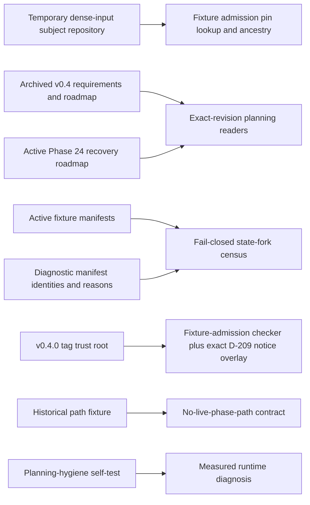

<user_constraints>
## User Constraints (from CONTEXT.md)

### Locked Decisions

### Additive verification evidence
- **D-01:** Keep the Phase 20/21 verification reports and their source identities unchanged. Record current checks in an additive Phase 24 evidence record pinned to an exact commit; label them as point-in-time checks, not refreshed phase verification.
- **D-02:** Run only the existing focused checks that cover changed in-scope contracts, after cheaper identity/consistency checks. Do not run the broad CTest suite, claim the full Phase 20/21 criteria are refreshed, or change their GSD stale statuses. The D-103 exact-final-head suite remains a separate milestone gate.

### Read-only candidate research
- **D-03:** If source metadata helps explain the current gaps, consult only first-party pages for Potion Panic, µCity 1.3, dmg-acid2, cgb-acid2, and the pinned gbmicrotest upstream. Record source identity and page-access results as facts. Do not search a third game candidate, fetch ROM/source payloads, build, run, or admit fixture bytes, or draw a legal/rights conclusion from metadata labels.
- **D-04:** Treat upstream-page access failures as access failures, not evidence that a source or permission is absent. A later rights determination or fixture action requires separate explicit authorization.

### Phase exit with gaps
- **D-05:** Phase 24 can pass when its additive evidence map and automated controls are complete, even if the four original requirements remain Pending and Phase 20/21 remain marked stale. Keep the milestone audit at `gaps_found`; do not accept gaps, close v0.4, or imply that phase completion satisfies the original requirements.
- **D-06:** Preserve the 40-plan total ceiling. The roadmap currently has 39 plan files, so Phase 24 has one plan available; no plan, review, gap, test-suite, lifecycle, release, fixture, or rights budget is reset by this rescope.

### the agent's Discretion
- Select the existing focused CTest targets that match the files and claims touched by the one plan; keep the existing test identities and CMake/Python standard-library patterns.
- Use machine-checkable positive and negative controls for the Phase 24 report so false requirement completion, ownership changes, or milestone closure are rejected.
- Keep source facts, evaluator/reviewer outcomes, current freshness, and remaining authority gates in separate fields to avoid conflating a focused control pass with requirement completion.
- Add no dependency or new CTest identity unless the plan demonstrates a concrete recurring need and stays within this one-plan scope.

### Deferred Ideas (OUT OF SCOPE)
- Candidate-specific rights determination, fixture/source payload acquisition, build/run/admission, and any new candidate require separate explicit owner authorization.
- The D-103 exact-final-head broad suite and milestone archival remain separate owner-controlled gates.

### D-212 current authority (supersedes D-206/D-211 execution scope)

```text
DATA_D2120A1B_START
The owner selected an integrated recovery scope after the D-211 candidate failed its protected PR matrix. This authorizes discussion and planning of one gap round in the existing Phase 24 plan; it does not authorize implementation, a new review, a new CI matrix, merge, or starting v0.5. Preserve PR #154 and candidate `96d502d4733ac54aa8bf7fbfd7813065143771dc` unchanged while the original run concludes. Run `44189691301` has failed native macOS, native Linux, Linux ASan acceptance, Linux ASan tests, and the CMake-floor job; Windows is still running its required test-inventory step. Related package-preview run `44189691412` is waiting for successful matching CI. The required-native gate cannot pass with the recorded failed dependencies. Do not cancel or rerun that attempt.
DATA_D2120A1B_END
```

Source: [VERIFIED: `.planning/phases/GB-24-resolve-remaining-v0-4-evidence-and-verification-gaps/24-CONTEXT.md:234-236`]. The run state above is the recorded D-212 status; this research did not query GitHub or refresh that external status.

The latest D-212 discussion findings are also binding for this research. Their exact six-blocker scope and execution fence are copied here because D-212 supersedes the earlier D-206/D-211 execution route:

```text
DATA_D2120Q6R_START
The owner selected an integrated recovery scope after the D-211 candidate failed its protected PR matrix. This authorizes discussion and planning of one gap round in the existing Phase 24 plan; it does not authorize implementation, a new review, a new CI matrix, merge, or starting v0.5. Preserve PR #154 and candidate `96d502d4733ac54aa8bf7fbfd7813065143771dc` unchanged while the original run concludes. Run `44189691301` has failed native macOS, native Linux, Linux ASan acceptance, Linux ASan tests, and the CMake-floor job; Windows is still running its required test-inventory step. Related package-preview run `44189691412` is waiting for successful matching CI. The required-native gate cannot pass with the recorded failed dependencies. Do not cancel or rerun that attempt.

1. **Dense-input mutant Git context:** `verify-dense-input.py` copies tracked files without `.git`, then gives the mutant configure an object store containing only the legacy baseline. Repository admission correctly reads the baseline there but requires each active fixture admission pin and its ancestry in the subject repository. Keep `check_commit`, full commit identity, and ancestry checks fail-closed. Repair only the harness's temporary Git context, and add a cheap preconfigure assertion that its candidate HEAD and required admission pins resolve with the expected ancestry.
2. **Archived v0.4 planning evidence:** Phase 22 evidence and planning-hygiene checks still require root `.planning/REQUIREMENTS.md` or an active root roadmap section. The D-209 closeout deliberately keeps v0.4 detail in `.planning/milestones/v0.4-REQUIREMENTS.md` and `v0.4-ROADMAP.md`, while Phase 24 recovery remains active. Keep D-209's administrative close and requirement statuses authoritative; teach exact-revision checkers to follow the archived v0.4 source for this recovery state. Do not restore archived requirements as a new active tracker or reopen v0.4 requirements.
3. **State-fork fixture accounting:** `tests/data/state-forks.json` lists 20 manifests, while the candidate has two additional diagnostic manifests, Acid2 and gbmicrotest. The matrix iterates listed ROM rows, so adding these manifests as ordinary rows would execute Acid2 and the 512 excluded gbmicrotest cases. Keep those executions excluded; encode their exact identities and exclusion reasons in the existing inventory/contract and retain negative controls that reject accidental execution. Do not rerun the one admitted gbmicrotest case.
4. **Historical phase-path fixture:** `verify-no-phase-paths.py` rejects one literal historical path in `tests/data/v04-closeout.json`. Resolve only that exact data-fixture occurrence or narrowly allowlist its immutable line with a reason; preserve the guard against actual readers of the live phases directory.
5. **Tagged checker trust:** `workflow_policy_coverage_controls` rejects the candidate's modified `verify-fixture-admission.py` because it differs from the v0.4.0 tagged trusted snapshot. Preserve that release trust root. Do not simply refresh its digest, remove the comparison, or weaken the production admission/rights checks. Plan a design that keeps the tagged checker independently verifiable while handling the exact D-209 notice overlay; if that cannot be done within this gap round, stop and return the trust-boundary issue to the owner.
6. **Planning-hygiene timeout:** one macOS run of `planning_hygiene_controls` reached the existing 30-second timeout under parallel load; Linux failed the same self-test earlier on missing archived requirements. Diagnose runtime and failure order before changing budgets. Prefer a cheaper or properly bounded self-test; increase a timeout only if measured evidence shows it is the right correction and it preserves the same coverage.

The failed `state_fork_matrix_*` setup controls caused dependent fork, census, and mutant tests to be skipped; those are consequences of the manifest-inventory mismatch, not separate defects. The one gap round should resolve all confirmed contract groups before candidate freeze. Keep the existing one-plan structure, original requirement ownership/statuses, D-209 accepted gaps, Acid2 failure, release assets, and branch protection unchanged. Add no dependency. Run cheap syntax, identity, and inventory checks first, then only the focused existing CTests needed for the changed contracts; no broad local suite, Acid2 execution, excluded game/ROM case, candidate expansion, Task 7, Phase 24 verification, or milestone audit/archive.

If execution is later authorized, obtain one fresh independent review of the exact candidate after focused checks, then spend one new exact-head protected PR matrix through the existing branch-protected PR. Existing admitted game/fixture cases may run only within that matrix; Acid2 and excluded gbmicrotest cases remain blocked. Any focused failure, unresolved review finding, timeout without diagnosis, or failed/missing/skipped/stale required context ends the scope without another correction, review, or matrix. The original D-211 run must finish before a new candidate is pushed. Keep this recovery worktree until successful protected merge and reconciliation to clean `main`; do not switch/remove it during the recovery. The current next route is `$gsd-plan-phase 24` against the sole existing plan. No phase is newly complete, and v0.5 remains unstarted.
DATA_D2120Q6R_END
```

Source: [VERIFIED: `.planning/phases/GB-24-resolve-remaining-v0-4-evidence-and-verification-gaps/24-CONTEXT.md:234-249`].
</user_constraints>

# Phase 24: Resolve remaining v0.4 evidence and verification gaps — Research

**Researched:** 2026-11-17
**Domain:** Commit-pinned planning evidence and CMake/CTest checker controls  
**Confidence:** LOW per the confidence seam for the generic `codebase` provider; repository-specific facts below were read directly from the cited source files.

## Summary

Phase 24 is now a planning-only recovery round for six integration blockers from D-211's failed protected matrix. Plan the correction in the sole existing `24-01-PLAN.md`; do not restart the earlier assessment, Task 7, or D-211 work. The current route preserves D-209's administrative closeout and accepts no new requirement/status, fixture/rights, review, CI, release, or v0.5 work. [VERIFIED: `.planning/ROADMAP.md:16-32`; `.planning/STATE.md:23-27,55-59`]

**Primary recommendation:** Add one integrated gap round to the existing plan, with six narrow correction seams below. Keep commit and ancestry validation fail-closed, separate archived v0.4 requirements/roadmap inputs from the active Phase 24 recovery route, represent diagnostic manifests as explicit non-executed exclusions, preserve the v0.4.0 tag as the fixture-checker trust root, and diagnose the hygiene timeout before considering a measured budget change. No code, tests, CTests, configure/build, CI, ROM execution, push, review, or merge was performed during this research. [VERIFIED: `24-CONTEXT.md:238-249`; user task scope]

## D-209 Requirement Boundary

Phase requirements for this recovery are empty; D-212 adds no requirement ownership or completion claim. The archived tracker remains the source of v0.4 dispositions: FIXT-01 is Pending; RIGHTS-01, DIAG-01, and DIAG-02 are Complete for the accepted exact diagnostic scope. The Acid2 cross-model mismatch stays failed and unreplayed; one `div_inc_timing_a` case was admitted/executed, and 512 gbmicrotest cases remain excluded. [VERIFIED: `.planning/milestones/v0.4-REQUIREMENTS.md:16-22,58-71`; `.planning/STATE.md:29`; `.planning/ROADMAP.md:8-19`]

Verbatim tracker rows:

```text
DATA_D2120C2D_START
- [ ] **FIXT-01**:
- [x] **RIGHTS-01**:
- [x] **DIAG-01**:
- [x] **DIAG-02**:
| FIXT-01 | Phase 21 | Pending |
| RIGHTS-01 | Phase 20 | Complete |
| DIAG-01 | Phase 22 | Complete |
| DIAG-02 | Phase 22 | Complete |
DATA_D2120C2D_END
```

The status quotes are deliberately compact; use the full archived requirement text for its original wording. Do not reconstruct a new root requirements tracker. [VERIFIED: `.planning/milestones/v0.4-REQUIREMENTS.md:16-22,58-65`]

## D-212 Current Research Findings

### 1. Dense-input mutant Git context

The harness copies tracked files into a temporary source tree without `.git`, then creates a separate bare store containing only the legacy fixture baseline. The admission checker resolves each active `admission.commit` inside the subject repository and checks that pin is an ancestor of its `HEAD`; the baseline object store is only for baseline evidence. The current harness therefore lacks candidate/fixture-pin objects at the admission call. [VERIFIED: `tests/scripts/verify-dense-input.py:100-129,244-247`; `tests/scripts/verify-fixture-admission.py:146-153,771-787`]

```text
DATA_D2120E3F_START
BASELINE_COMMIT = "7cc6495e64f3645caa120e7458f754585b788985"
fetched = run(["git", "--git-dir", str(destination), "fetch", "--no-tags",
              str(ROOT), BASELINE_COMMIT], cwd=ROOT)
pin = check_commit(root, pin_text, "admission-pin-invalid")
current_head = git(root, "rev-parse", "--verify", "HEAD^{commit}").decode("ascii").strip()
ancestry = subprocess.run(["git", "merge-base", "--is-ancestor", pin, current_head], cwd=root,
                          capture_output=True, check=False, timeout=30)
DATA_D2120E3F_END
```

Plan a harness-only temporary Git context that resolves the exact candidate `HEAD`, every active fixture pin, and the intended ancestry before CMake configure. Add a cheap preconfigure assertion for those facts. Keep the legacy baseline store separate, retain `check_commit` and ancestry checks, and preserve the existing gitless source-archive configure assertion (`GBB_BUILD_REVISION="unknown"`, unqualified). Do not change production admission behavior. [VERIFIED: `tests/scripts/verify-dense-input.py:120-129,244-257`; `tests/scripts/verify-fixture-admission.py:771-787`]

The dense-input self-test also runs a Libbet acceptance through a built runner, so any invocation that executes its admitted ROM belongs only in the authorized protected PR matrix. The local planning/research pass did not run it. [VERIFIED: `tests/scripts/verify-dense-input.py:140-173,258-272`; D-212 execution fence in `24-CONTEXT.md:247-249`]

### 2. Archived v0.4 planning evidence

`verify-diagnostic-evidence.py` requires and reads the root requirements file in its snapshot and validates the old three-item Pending disposition. `verify-planning-hygiene.py` hard-codes the same root path for its D-206 report inputs; its plan-cap reader only switches to an archived roadmap when the root roadmap has no phase details, no active phase paths, the milestone status is complete, and no root requirements file exists. That fallback does not match the current state because the Phase 24 recovery remains active. [VERIFIED: `tests/scripts/verify-diagnostic-evidence.py:68-79,519-529,930-943`; `tests/scripts/verify-planning-hygiene.py:232-261,289-301,1113-1119`]

```text
DATA_D2120G4H_START
".planning/REQUIREMENTS.md"
".planning/ROADMAP.md"
requirements_path = ".planning/REQUIREMENTS.md"
V04_GAP_REQUIREMENTS_PATH = ".planning/REQUIREMENTS.md"
".planning/milestones/v0.4-REQUIREMENTS.md"
".planning/milestones/v0.4-ROADMAP.md"
DATA_D2120G4H_END
```

Teach exact-revision readers to select archived v0.4 requirements and roadmap for historical v0.4 facts while retaining the root recovery roadmap and current Phase 24 plan as the active route. The pre-D-209 requirement snapshot may remain an immutable historical comparison input; it must not replace the archived D-209 statuses. Negative controls should reject missing/wrong archive identity, altered original criteria/owners/statuses, accidental requirement promotion, and a fallback that loses the active recovery phase. Do not restore `.planning/REQUIREMENTS.md` or reactivate the old milestone. [VERIFIED: `.planning/ROADMAP.md:8-22`; `.planning/milestones/v0.4-REQUIREMENTS.md:67-71`; `tests/scripts/verify-diagnostic-evidence.py:68-79,519-529`]

### 3. State-fork manifest census without diagnostic execution

The current `state-forks.json` has 20 execution-bearing fixture manifests and a 153-case union (147 manifest rows plus six acceptance rows). The checker compares that active list against every manifest under `fixtures/`, then converts listed `.gb`/`.gbc` rows into matrix cases. The current candidate adds the two diagnostic manifests `fixtures/acid2/manifest.json` and `fixtures/gbmicrotest/manifest.json`; their exact current manifest digests are `7f198d5964a8547d1a122d5d64d395547ba6f365264cdb00abf190a5880c5da6` and `d3aedaa5d9f583bea2951a9a58a3190ff2314fafbfa53b7e63e98ed6349cb7c` respectively. D-212 says adding them as ordinary entries would cause Acid2 and excluded gbmicrotest executions. [VERIFIED: `tests/data/state-forks.json:1-14,715-724`; `tests/scripts/verify-state-forks.py:133-209,284-290`; `24-CONTEXT.md:242-247`; manifest digests from `sha256sum` on those two files]

Represent the two diagnostic manifests in the existing inventory/contract as explicit exclusions, each bound to its exact manifest identity and a reason that prevents row expansion. Keep active-manifest equality fail-closed against `active ∪ excluded`; census must still detect an unlisted new manifest, changed exclusion digest, or accidental execution. Do not replay Acid2, the previously admitted `div_inc_timing_a` case, or any of the 512 excluded gbmicrotest cases. The existing CTest fixture setup chain means a matrix setup failure also skips its dependent census and mutant controls; those skips are consequences of the inventory error, not new failures. [VERIFIED: `tests/scripts/verify-state-forks.py:133-209,824-860`; `tests/CMakeLists.txt:5393-5427`; `.planning/milestones/v0.4-REQUIREMENTS.md:22`]

### 4. Historical phase-path fixture

The no-live-phase-path checker scans tracked text outside `.planning/`; its existing allowlist pins a file-wide hit count and a reason, not an exact line or digest. The v0.4 closeout fixture contains the same historical Phase 22 context path twice (two evidence rows). This is a provenance value, not a reader of the live phase tree. The D-212 description calls it one literal path, but source inspection found two identical occurrences; plan for both. [VERIFIED: `tests/scripts/verify-no-phase-paths.py:38-66,131-153`; `tests/data/v04-closeout.json:488,662`]

```text
DATA_D2120J5K_START
".planning/phases/GB-22-composition-and-microtest-evidence/22-CONTEXT.md"
(file, max hits, reason)
DATA_D2120J5K_END
```

Either change only those exact data values to a non-live immutable reference representation if the schema permits, or extend the checker to pin the exact expected lines/content for this fixture. A broad file-wide exception would permit unrelated live-phase paths and would not meet the D-212 narrow-allowlist intent. Retain the current negative controls for true readers. [VERIFIED: `tests/scripts/verify-no-phase-paths.py:38-66,220-308`; `tests/data/v04-closeout.json:488,662`]

### 5. v0.4.0 fixture-checker trust root and D-209 notice overlay

The workflow-policy checker reads the tagged v0.4.0 source commit and requires the working fixture-admission checker bytes to equal that trusted snapshot. The current checker differs from the tagged blob by 59 lines; the inspected delta is the narrow D-209 Acid2 notice overlay and its controls. Do not refresh the trusted digest, remove the byte comparison, or weaken production rights/admission rules. [VERIFIED: `tests/scripts/verify-workflow-policy-coverage.py:2117-2122,2436-2440`; `git rev-parse v0.4.0^{commit}` and `git diff --stat v0.4.0 -- tests/scripts/verify-fixture-admission.py`]

```text
DATA_D2120L7M_START
recovery_source = "3de1b0e427f37a202be4469dd818266f359c8b20"
if trusted_fixture.read_bytes() != fixture_source:
    reject("release recovery fixture checker differs from the tagged trusted snapshot")
DATA_D2120L7M_END
```

T12's selected planning strategy is unchanged tagged bytes plus the exact literal reversible D-209 overlay, with complete byte equality before import. Independently obtain the tagged base; apply only fixed, uniquely anchored before/after hunks taken from the immutable tag-to-frozen-candidate delta, and require inverse normalization to reproduce the tag bytes. Positive and mutation controls must establish that only the approved delta is accepted. This strategy is selected, not execution-proven: if separation cannot preserve the trust base without duplicated rights logic or weakened admission, stop and report that boundary to the owner. [VERIFIED source boundary: `git diff --unified=3 v0.4.0 -- tests/scripts/verify-fixture-admission.py`; `24-CONTEXT.md:244`; selected strategy: `24-01-PLAN.md`, T12]

### 6. Planning-hygiene timeout

The existing CTest is `planning_hygiene_controls`, with a 30-second timeout and a 125-control output floor. The prior Phase 24 validation took 27.21 seconds at an earlier candidate; D-212 records one macOS timeout under parallel load and one faster Linux failure on the missing archived requirements. These observations do not prove that a timeout increase is needed or that it preserves coverage. [VERIFIED: `tests/cmake/hygiene.cmake:82-85`; `.planning/phases/GB-24-resolve-remaining-v0-4-evidence-and-verification-gaps/24-VALIDATION.md:53-54`; `24-CONTEXT.md:245`]

```text
DATA_D2120N8P_START
set(GBB_HYGIENE_EXTRA_ARGS -DGBB_EXPECT_MIN_KEY=controls -DGBB_EXPECT_MIN_VALUE=125)
gbb_add_hygiene_test(planning_hygiene_controls 0 "planning-hygiene self-test pass controls=[0-9]+" 30
DATA_D2120N8P_END
```

Diagnose which self-test stage exhausted the macOS budget after the archived-source failure is fixed; compare its exact workflow evidence and focused execution under a measured, controlled load. Prefer reducing redundant Git/snapshot work or bounding an expensive self-test stage without removing controls. Consider a timeout change only if measured runtime evidence identifies it as the remedy and the same positive/negative control coverage remains enforced; do not increase it blindly. No timeout or CTest was changed or run in this research. [VERIFIED: `tests/scripts/verify-planning-hygiene.py:1957-2174,2487-2510`; `24-CONTEXT.md:245`]

The failed `state_fork_matrix_*` setup controls and dependent skips are one root-cause group, not separate defects. Preserve the one-plan/40-plan limit, D-209 accepted gaps, FIXT-01 Pending, Acid2's failed/no-replay status, branch protection, release assets, and all ROM exclusions. No dependencies or CTest identities are added. [VERIFIED: `24-CONTEXT.md:247-249`; `.planning/milestones/v0.4-REQUIREMENTS.md:67-71`]

## Architectural Responsibility Map

| Capability | Primary Tier | Secondary Tier | Rationale |
|------------|-------------|----------------|-----------|
| Temporary mutant Git context | Test harness | Git object database | Harness must expose the exact candidate and admission-pin ancestry to repository admission without changing the production checker or source-archive qualification. |
| Archived v0.4 planning compatibility | Planning checker/evidence tooling | Immutable Git snapshot | Historical v0.4 criteria come from the archive; Phase 24 recovery scope remains in the active root roadmap. |
| State-fork manifest inventory | Test tooling | CMake/CTest fixture graph | Exclusions must be counted and validated without converting diagnostic payloads into matrix cases. |
| Fixture-admission trust | Release/workflow policy checks | v0.4.0 tagged source | Exact D-209 notice overlay must remain separately verifiable against the unchanged tag trust root. |
| Planning-hygiene runtime | Test tooling | CMake/CTest | Diagnose test stages and contention before considering a measured timeout adjustment. |

There is no emulator-core behavior change in this phase. Keep work in existing repository scripts, test contracts, and planning records. D-212 does not authorize any test or ROM execution during research/planning. [VERIFIED: `24-CONTEXT.md:236-249`; task authorization]

## Project Constraints (from AGENTS.md)

> **Current-scope guard:** The D-206 discussion, plan outline, and validation notes retained below describe historical context only where they conflict with the D-212 authority and findings above. For planning the current recovery round, use the six D-212 blockers, the planning-only authorization, and the existing one-plan limit. Do not treat earlier proposed requirement completion, local ROM execution, a new review/matrix, or milestone closure as authorized.

- Keep the emulator scope and implementation untouched: GabbaBoy targets Game Boy and Game Boy Color, and no emulator build or game claim should be implied by planning evidence. [VERIFIED: AGENTS.md:22-24,48-55]
- Use the installed OpenGSD runtime; the repository's runtime identity was confirmed as `@opengsd/gsd-core`. [VERIFIED: AGENTS.md:28; tool: runtime-identity returned “{\"packageName\":\"@opengsd/gsd-core\",\"version\":\"1.20.0\"}”]
- Keep the phase within the one-plan allowance and the existing 40-plan total. Do not renew plan, review, gap, suite, lifecycle, release, fixture, or rights budgets. [VERIFIED: 24-CONTEXT.md:25-33; verbatim: “Preserve the 40-plan total ceiling.”]
- Put reusable checker code in `tests/scripts/`, have it read immutable commit facts where appropriate, and wire it into an existing CTest identity because the phase context explicitly allows no new identity. [VERIFIED: AGENTS.md:34-40; 24-CONTEXT.md:29-33]
- Every deliverable needs an automated positive and meaningful negative control. Use automated UAT closure and do not invent manual UAT just to satisfy a template. [VERIFIED: AGENTS.md:34]
- Run cheap identity and consistency checks before the focused controls. The phase context explicitly disallows a broad suite and says the D-103 exact-final-head suite remains a separate milestone gate. [VERIFIED: AGENTS.md:34; 24-CONTEXT.md:18-19,110-111]
- Keep summary coverage in the required GSD block schema and check UAT closure with the existing shared checker if phase closure requires it. Do not use human checkpoints for evidence that can be contract-checked. [VERIFIED: AGENTS.md:34]
- Read point-in-time facts from the checked boundary commit; do not assert live route or ancestry facts from a moving HEAD. [VERIFIED: AGENTS.md:34,39-40]
- Keep the milestone audit open with `gaps_found`; no requirement acceptance, milestone close, or archival belongs in this phase. [VERIFIED: 24-CONTEXT.md:25-27,107-111; .planning/v0.4-MILESTONE-AUDIT.md:2-4; verbatim: “status: gaps_found”]

## Standard Stack

### Core

| Library/tool | Version | Purpose | Why Standard |
|--------------|---------|---------|--------------|
| Python standard library | Existing configured Python; no new minimum selected | Maintain exact-revision readers, fixture inventory/admission controls, path checks, and deterministic negative controls. | Current checkers already use this pattern; D-212 prohibits adding a dependency. |
| CMake/CTest | Existing project presets; local CMake/CTest observed at 4.4.3 | Preserve existing test identities and select only changed-contract checks if execution is later authorized. | D-212 directs reuse of the existing CTest identity and no new matrix/CTest identity. |
| Git | Local 2.41.0 observed | Resolve full immutable commit objects and ancestry in the proper repository; preserve the v0.4.0 trust anchor. | The admission, planning, and workflow-policy checkers rely on Git object identity and ancestry. |

The local version probes are availability observations only; they do not establish a new Python compatibility floor. Do not add PyYAML or another parser dependency. Use the existing standard-library checkers, Git snapshot APIs, and existing CMake/CTest wrappers. The six blockers include fixture admission, planning readers, a manifest census, path hygiene, a tag-root policy control, and timeout diagnosis; keep test/fixture execution out of planning. [VERIFIED: 24-CONTEXT.md:238-249; tests/scripts/verify-planning-hygiene.py:256-282]

### Supporting

| Tool | Purpose | When to Use |
|------|---------|-------------|
| `git show` / immutable Git archive | Read exact historical files and tagged trust-root inputs from pinned commits. | For archived v0.4 planning evidence, fixture-pin ancestry, and trusted checker comparisons. |
| Existing CTest wrappers | Assert expected exit code and output without changing test identity. | Only for changed contracts if a later execution scope is authorized; this research did not run them. |

### Alternatives Considered

| Instead of | Could Use | Tradeoff |
|------------|-----------|----------|
| Extending the existing checker/test seams | Add a new standalone checker and CTest identity | A separate identity spends the explicitly limited test surface and duplicates existing validation patterns. Keep existing identities. |
| Existing parser and standard library | Add a YAML/Markdown dependency | Adds package and parser compatibility surface for a fixed local report format; context directs the plan to retain current Python/CMake patterns. |
| Point-in-time map with old Phase 20/21 reports preserved | Rewrite the historical Phase 20/21 verification reports | Would erase historical identity/status and contradict D-01. |

**Installation:** None. This scope proposes no external package installation. [VERIFIED: 24-CONTEXT.md:29-33]

**Package legitimacy audit:** Not applicable; no package is proposed or installed.

## Architecture Patterns

### System Architecture Diagram



The recovery keeps trust boundaries separate: candidate fixture pins resolve in the temporary subject repository, historical v0.4 records resolve from their archive, the active Phase 24 route remains the root roadmap, and the checker’s trust base remains the v0.4.0 tag. Do not combine those identities or weaken their validators. [VERIFIED: `tests/scripts/verify-dense-input.py:100-129,244-247`; `tests/scripts/verify-planning-hygiene.py:232-261`; `.planning/ROADMAP.md:16-30`; `.planning/milestones/v0.4-ROADMAP.md:3-15`; `tests/scripts/verify-workflow-policy-coverage.py:2117-2122,2436-2440`]

### Recommended Project Structure

```
.planning/phases/GB-24-resolve-remaining-v0-4-evidence-and-verification-gaps/
└── 24-01-PLAN.md                 # sole existing plan; D-212 plans one integrated recovery gap round
tests/scripts/
├── verify-dense-input.py         # temporary Git context for mutant admission
├── verify-planning-hygiene.py    # archived v0.4 reader and timeout diagnosis
├── verify-state-forks.py         # fail-closed active/excluded manifest census
├── verify-no-phase-paths.py      # narrow historical fixture handling
└── verify-workflow-policy-coverage.py # preserve tag trust and exact overlay evidence
tests/cmake/
├── hygiene.cmake                 # preserve planning-hygiene identities
└── ci-lanes.cmake                # preserve workflow-policy coverage identity
```

This mapping points to existing code and the single existing plan. It does not authorize implementation during this research turn or introduce new paths/test identities. [VERIFIED: `24-CONTEXT.md:238-249`; current `24-01-PLAN.md` frontmatter]

### Pattern 1: Separate the active recovery route from archived requirements

**What:** Resolve historical v0.4 criteria from `.planning/milestones/v0.4-REQUIREMENTS.md` and `.planning/milestones/v0.4-ROADMAP.md`, while keeping Phase 24's active recovery route in root `.planning/ROADMAP.md`. Preserve D-209's one Pending and three Complete dispositions exactly.

**When to use:** Exact-revision planning checks that validate historical v0.4 evidence during the active Phase 24 recovery.

**Example:**

```text
historical requirements and milestone detail: archived v0.4 Git tree
current recovery scope and active plan: root roadmap and Phase 24 plan
requirement state: retain archived D-209 dispositions; do not promote or reopen
```

Do not restore `.planning/REQUIREMENTS.md` as an active tracker or let archived-roadmap fallback discard the current Phase 24 route. [VERIFIED: `tests/scripts/verify-planning-hygiene.py:232-261,289-301`; `24-CONTEXT.md:239-241`]

### Pattern 2: Keep diagnostic manifest exclusions non-executable

**What:** Keep active execution manifests separate from the two diagnostic manifest identities and exact exclusion reasons. Make the inventory equality check account for both sets, while row expansion consumes only active execution rows.

**When to use:** Any census check that scans the repository's full fixture manifest tree but matrix-expands only a declared active subset.

**Example:**

```text
active_manifest: exact identity and executable row set
excluded_manifest: exact identity plus exclusion reason; never row-expand
census: every discovered manifest belongs to exactly one declared set
```

Preserve negative controls for new, changed, unlisted, or accidentally activated manifests. [VERIFIED: `tests/scripts/verify-state-forks.py:133-209`; `24-CONTEXT.md:242-247`]

### Pattern 3: Keep the release tag as trust root and scope the notice overlay

**What:** Compare the fixture-admission implementation to the immutable v0.4.0 tag source and model the accepted D-209 notice change as a separate exact overlay with positive and negative controls.

**Why:** Refreshing the trusted digest or dropping byte comparison would erase the tag-based trust anchor; merging the overlay into the trust base makes its D-209 scope difficult to audit.

**Example:**

```text
trusted base: exact v0.4.0 tag commit and fixture-admission bytes
overlay: exact D-209 notice-only delta
reject: any other changed byte or altered production admission behavior
```

If the overlay cannot be isolated without duplicate rights logic or a weakened checker, stop and return the boundary to the owner. [VERIFIED: `tests/scripts/verify-workflow-policy-coverage.py:2117-2122,2436-2440`; `24-CONTEXT.md:244`]

## Don't Hand-Roll

| Problem | Don't Build | Use Instead | Why |
|---------|-------------|-------------|-----|
| Temporary Git context for admission mutants | Modify admission's validation rules to accept missing objects | Populate the isolated subject repository with the candidate commit and required pin ancestry, leaving baseline evidence in its separate store | This preserves fail-closed full commit and ancestry checks. |
| Historical planning reads | Recreate an active root requirements tracker or use a live worktree fallback | Read the archived v0.4 files from the exact revision while retaining the active root recovery roadmap | D-209 deliberately archived the old milestone details. |
| Fixture census exclusions | Add diagnostic manifests to ordinary matrix rows or maintain a hand-waved skip list | Exact identity plus reason in the existing inventory contract, distinct from active execution rows | Row expansion can execute the ROMs; exclusions need to be machine-checkable. |
| Tagged admission checker verification | Refresh the v0.4.0 expected digest or duplicate all rights rules in a wrapper | Preserve tag bytes as trust base and verify only a bounded exact notice overlay | D-212 explicitly keeps the tag as trust root. If this cannot be achieved, stop for owner resolution. |
| Planning-hygiene runtime | Raise the timeout without diagnosis or delete controls | Locate the slow/failing stage and remove redundant work while preserving control coverage | The observed macOS timeout followed parallel-load conditions; Linux failed earlier on the missing archive source. |

**Key insight:** These are boundary-integration defects across existing checkers: each input has an authoritative identity and each active/excluded or trusted/overlay boundary must remain explicit. Repair the seam that produced each failure; do not weaken downstream validators. [VERIFIED: `24-CONTEXT.md:238-249`; cited checker sources under D-212 findings above]

## Common Pitfalls

### Pitfall 1: Treating a historical pass as current freshness

**What goes wrong:** The map copies `status: passed` from a historical report and calls Phase20/21 current.  
**Why it happens:** The report's verification result and current freshness answer different questions.  
**How to avoid:** Record the historical result, current GSD stale disposition, and separate remaining full-refresh gate in distinct fields.  
**Warning signs:** Phase20/21 are listed as fresh because only their old report frontmatter was read.  
[VERIFIED: .planning/v0.4-MILESTONE-AUDIT.md:70-77,121-129; exact report fields at 20-VERIFICATION.md:3-8 and 21-VERIFICATION.md:3-5]

### Pitfall 2: Letting a focused check satisfy an original requirement

**What goes wrong:** A D-212 control pass is treated as new requirement acceptance or a reason to reopen D-209 decisions.
**Why it happens:** Checker behavior and v0.4 tracker dispositions are mistaken for the same fact.
**How to avoid:** Preserve the archived D-209 state verbatim: FIXT-01 Pending; RIGHTS-01, DIAG-01, and DIAG-02 Complete for their accepted scope. Keep milestone audit `gaps_found`; leave Acid2 failure/no replay and the gbmicrotest exclusions intact.
**Warning signs:** A control changes owner/status, makes Acid2 pass, or replays excluded cases.
[VERIFIED: `.planning/milestones/v0.4-REQUIREMENTS.md:16-22,58-71`; `24-CONTEXT.md:242-249`]

### Pitfall 3: Confusing “not observed” with a negative fact

**What goes wrong:** Upstream access failure becomes “source missing” or “no permission”; no-go metadata becomes a legal conclusion.  
**How to avoid:** Record the page-access outcome, source identity, and authority gate as separate observations; do not state a rights result.  
**Warning signs:** Wording such as “license absent” inferred only from inaccessible source pages, labels, or a stopped attempt.  
[VERIFIED: 24-CONTEXT.md:21-23,68-73,100-104]

### Pitfall 4: Pinning a mutable or self-referential revision

**What goes wrong:** A symbolic branch/tag, dirty working tree, abbreviated ID, or report's own future commit hash is used as the evidence boundary.  
**How to avoid:** Use the existing full-commit validator and immutable snapshot reader; record the input revision separately from the commit that later stores the record.  
**Warning signs:** The checker shells out to `HEAD` at runtime or reads the report with `Path.read_text` rather than from the pinned snapshot.  
[VERIFIED: tests/scripts/verify-planning-hygiene.py:13-17,256-282; tests/cmake/hygiene.cmake:9,14-25]

### Pitfall 5: Spending the focused test's full time budget on new mutants

**What goes wrong:** More report controls push `planning_hygiene_controls` over its existing 30-second timeout.  
**How to avoid:** Add a small number of semantic mutations to the existing self-test, retain the current CTest identity/timeout, and run the cheap `plan_cap` first. Keep controls deterministic and local; avoid needless temporary commits or repeated identical Git queries.  
**Warning signs:** A self-test run approaches the 30-second ceiling or requires widening the timeout.  
[VERIFIED: tests/cmake/hygiene.cmake:73-85; .planning/phases/GB-23.1-close-v0-4-requirement-and-verification-gaps/23.1-01-SUMMARY.md:448; verbatim: “The final direct self-test took about 25.5 seconds; the final named CTest took 26.42 seconds.”]

### Pitfall 6: Updating a historical report while adding current evidence

**What goes wrong:** Phase20/21 reports or their source identities are edited to look current.  
**How to avoid:** Add Phase24 evidence separately and compare old report bytes against the pinned baseline.  
**Warning signs:** Historical `source_head`, `verification_head`, `covered_digest`, or original owner/status fields change.  
[VERIFIED: .planning/phases/GB-24-resolve-remaining-v0-4-evidence-and-verification-gaps/24-CONTEXT.md:17-19; .planning/phases/GB-20-fixture-admission-tune-up/20-VERIFICATION.md:3-8,67; .planning/phases/GB-21-cgb-game-progress-and-scene-regressions/21-VERIFICATION.md:3-5,48-49]

## Code Examples

The existing planning checker validates full commit objects and reads snapshots by object ID. D-212 planning should identify the precise historical source selector that must point at the archive; do not assume the prior D-206 report stage already supports the active recovery plus archived v0.4 inputs. [VERIFIED: `tests/scripts/verify-planning-hygiene.py:232-282,3073-3080`; `24-CONTEXT.md:239-241`]

If later execution is authorized, first run cheap syntax, identity, and inventory checks, then select only existing CTests that cover changed contracts. This research does not authorize configure or test execution. ROM-executing fixture/state-fork tests are not local planning checks; admitted cases remain confined to the separately authorized protected PR matrix.

```bash
# Illustrative only: select exact targets after the changed contracts are known.
ctest --preset phase1 --output-on-failure --no-tests=error -R '^(plan_cap|planning_hygiene_controls|workflow_policy_coverage_controls|no_phase_paths_controls|no_phase_paths|phase22_evidence_controls|phase22_evidence_contract)$'
```

These names are existing CTest identities, not a blanket instruction to run each one. The later executor should select only identities needed for changed contracts and omit fixture-dependent `state_fork_*` targets locally because their setup executes admitted ROM cases. The original D-211 run must finish before a new candidate or protected matrix is considered. [VERIFIED: `tests/cmake/hygiene.cmake:73-85`; `tests/cmake/ci-lanes.cmake:147-148`; `tests/CMakeLists.txt:3004-3020,3784-3799,5393-5427`; `24-CONTEXT.md:234-249`]

These are executor commands, not tests run during this research. No source/test mutation or test execution occurred in this research pass. [VERIFIED: task scope; current-research activity]

## State of the Art

No external framework or package is required. The current project pattern is standard-library Python checkers, immutable Git snapshot reads, existing CMake/CTest identities, and positive plus causal-negative controls. Keep using those seams for the six D-212 checker/inventory defects. [VERIFIED: `24-CONTEXT.md:238-249`; `tests/scripts/verify-planning-hygiene.py:256-282`; `tests/cmake/hygiene.cmake:28-43`]

**Deprecated/outdated:** None identified for this repository-only phase. Do not refresh first-party candidate metadata in this research; the context already records it and expressly bounds any such lookup. [VERIFIED: 24-CONTEXT.md:21-23,68-73]

## Assumptions Log

| # | Claim | Section | Risk if Wrong |
|---|-------|---------|---------------|
| — | No new D-212 technical claim is assumed. The evidence filename and self-referential commit pattern noted in older D-206 research are historical suggestions only; they are not current scope decisions. | Historical D-206 notes | Could distract the one-plan recovery from the six D-212 blockers. |

## Selected Strategy and Execution Proof Gates

No planning decision remains open for these seams. T12 selects exact tagged-byte trust plus the literal reversible D-209 overlay, requiring whole-file equality before import and inverse reconstruction of the unchanged tag bytes. Execution must prove unique anchors, approved-overlay acceptance and causal refusal of unrelated drift. If that separation fails without duplicating rights logic or weakening admission, stop and report the trust boundary; do not refresh a hash or waive the comparison. The implementation and controls have not run. [Selected strategy: `24-01-PLAN.md`, T12; source boundary: `24-CONTEXT.md:244`; `tests/scripts/verify-workflow-policy-coverage.py:2117-2122,2436-2440`]

The timeout strategy is also selected: retain the existing 30-second limit and 125-control floor, diagnose source-failure order and measured stage/load cost after archived-source correction, and prefer removal of proven duplicate work with identical control coverage. Only measured stage evidence establishing a narrow necessary same-coverage adjustment can justify a limit change. Missing diagnosis or an undiagnosed timeout stops execution rather than opening another planning choice or retry. No runtime diagnosis or adjustment is claimed as proven here. [Selected strategy: `24-01-PLAN.md`, T12; source boundary: `24-CONTEXT.md:245-249`; `tests/cmake/hygiene.cmake:82-85`]

## Environment Availability

| Dependency | Required By | Available | Version | Fallback |
|------------|------------|-----------|---------|----------|
| Python 3 | Existing planning checker and self-test | ✓ | 3.14.4 | — |
| CMake | Configure existing focused CTest targets | ✓ | 4.4.3 | — |
| CTest | Run focused existing checks only if later authorized | ✓ | 4.4.3 | — |
| Git | Immutable commit and planning snapshot reads | ✓ | 2.41.0 | — |

These are read-only availability probes; they do not validate compatibility or execute tests. No missing dependency blocks planning. [VERIFIED: environment probe, 2026-11-17]

## Validation Architecture (D-212 planning guidance)

### Test Framework

| Property | Value |
|----------|-------|
| Framework | Existing CMake/CTest; local CMake and CTest 4.4.3 |
| Config file | CMakePresets.json; `phase1` uses the existing test-enabled configure preset |
| Quick run command | No command is authorized during research/planning. If execution is later authorized, run cheap syntax/identity/inventory preflight, then select focused existing CTests for changed contracts. |
| Full suite command | Out of scope here. D-103 remains a separate exact-final-head milestone gate. |

Existing focused candidates are `plan_cap`, `planning_hygiene_controls`, `workflow_policy_coverage_controls`, `no_phase_paths_controls`, `no_phase_paths`, and `phase22_evidence_controls` / inventory-only `phase22_evidence_contract`, subject to necessity and the later authorized test boundary. `planning_hygiene_controls` currently has a 30-second timeout and minimum 125 controls; D-212 records that one macOS run timed out under parallel load. The state-fork census and mutant controls require the matrix fixture and must not be selected as local checks because the setup executes admitted cases. Exact existing identity spellings include:

```text
DATA_D2120S9T_START
gbb_add_hygiene_test(plan_cap
gbb_add_hygiene_test(planning_hygiene_controls
gbb_add_ci_lane_test(workflow_policy_coverage_controls
add_test(NAME no_phase_paths_controls
add_test(NAME no_phase_paths
add_test(NAME phase22_evidence_contract
add_test(NAME phase22_evidence_controls
add_test(NAME state_fork_census
add_test(NAME state_fork_census_controls
DATA_D2120S9T_END
```

[VERIFIED: `tests/cmake/hygiene.cmake:73-85`; `tests/cmake/ci-lanes.cmake:147-148`; `tests/CMakeLists.txt:3004-3020,3784-3799,5411-5418`]

### D-212 blocker → existing validation surface

| Blocker | Contract to preserve | Existing validation surface | Scope note |
|---------|----------------------|-----------------------------|------------|
| Dense-input mutant Git context | Candidate HEAD and each active fixture-pin ancestry resolve in the subject repository; baseline store stays separate. | Dense-input harness controls / authorized matrix path | The self-test invokes Libbet acceptance; keep any execution out of local planning checks. |
| Archived v0.4 planning evidence | Exact-revision readers use archived v0.4 facts while the active recovery stays in the root roadmap. | `phase22_evidence_controls`, `phase22_evidence_contract`, `planning_hygiene_controls`, as applicable | `phase22_evidence_contract` is inventory-only; preserve D-209 statuses. |
| State-fork manifest census | Exact diagnostic identities and reasons are excluded from row expansion; census stays fail-closed. | `state_fork_census_controls` and matrix setup chain | Fixture-dependent chain executes admitted ROM rows; omit locally and keep in the separately authorized protected matrix. |
| Historical phase-path fixture | Only exact historical data values are handled; live phase readers remain rejected. | `no_phase_paths_controls`, `no_phase_paths` | Narrow fixture exception only; preserve negative reader controls. |
| v0.4.0 trust root and D-209 notice overlay | Tagged checker stays immutable trust base; overlay is separately and exactly verifiable. | `workflow_policy_coverage_controls` | Do not refresh the trust digest or weaken production admission. |
| Planning-hygiene timeout | Diagnose failure stage/load and retain controls before any measured timeout decision. | `planning_hygiene_controls`, preceded by cheap checks such as `plan_cap` | Do not blindly increase the 30-second bound. |

There are no Phase 24 requirement IDs in the current recovery route. These are research mappings to existing validation surfaces, not commands run or a blanket mandate to invoke all listed tests. Existing manifest-dependent census/mutant tests are downstream of execution-bearing fixture setup, so the contract must keep the two diagnostics outside active rows. [VERIFIED: `.planning/ROADMAP.md:16-32`; `tests/cmake/hygiene.cmake:9-25,73-85`; `tests/CMakeLists.txt:5393-5427`; `tests/scripts/verify-state-forks.py:133-209`]

### Sampling Rate

- **During research/planning:** Run no tests, CTests, configure/build, CI, or ROMs.
- **If execution is later authorized:** Run cheap syntax/identity/inventory checks first, then only existing focused CTests necessary for changed contracts; keep ROM execution inside the separately authorized protected PR matrix.
- **Phase gate:** Resolve the D-212 gap round within its existing authority. A focused control pass does not change D-209 requirement statuses, close v0.4, or satisfy the D-103 full-suite gate.

### Wave 0 Gaps

- Diagnose and plan the six D-212 blocker groups in the sole existing `24-01-PLAN.md`; do not add a plan or CTest identity.
- Preserve the tag-root/overlay separation and fail-closed manifest exclusions as explicit positive/negative contracts.
- No package installation or emulator build is part of research/planning. This document authorizes no implementation or test execution.

## Security Domain

This is a local report parser and Git snapshot checker, not a network service. Security enforcement is enabled and the configured ASVS level is 1. [VERIFIED: .planning/config.json:48-50; quote: “\"security_enforcement\": true” and “\"security_asvs_level\": 1”]

### Applicable ASVS Categories

| ASVS Category | Applies | Standard Control |
|---------------|---------|-----------------|
| V2 Authentication | no | No user or service authentication is introduced. |
| V3 Session Management | no | No session state is introduced. |
| V4 Access Control | no | No hosted endpoint or authorization boundary is introduced. |
| V5 Input Validation | yes | Validate full commit IDs, exact requirement ID/status/owner sets, frontmatter structure, field cardinality, and source references. Read checked inputs only from pinned Git objects. |
| V6 Cryptography | no new primitive | Use the existing digest/hash identity mechanisms only as identifiers; do not invent a rights or authenticity claim from a hash. |

### Known Threat Patterns for this tooling

| Pattern | STRIDE | Standard Mitigation |
|---------|--------|---------------------|
| A contradictory or malformed report masquerades as a valid status | Tampering | Validate exact key sets and semantic owner/status pairs; add causal mutants for false completion, changed owner, and milestone closure. |
| A moving branch or dirty worktree changes what a check actually read | Tampering / Repudiation | Require a full commit object ID and read the planning tree from the immutable commit, not the live path. |
| A source-page failure is rewritten as proof of absent source or permission | Information disclosure / Elevation of privilege | Preserve the access-failure fact and leave the rights gate unresolved; perform no rights conclusion. |

The phase scope excludes fixture bytes, candidate execution, rights review, build/run/admission, lifecycle retries, and release operations. [VERIFIED: 24-CONTEXT.md:9-11,21-23,107-111]

## Sources

### Primary (repository source of truth)

- `.planning/phases/GB-24-resolve-remaining-v0-4-evidence-and-verification-gaps/24-CONTEXT.md` — locked scope, ownership limits, existing tool and source boundaries.
- `.planning/ROADMAP.md`, `.planning/milestones/v0.4-ROADMAP.md`, and `.planning/milestones/v0.4-REQUIREMENTS.md` — active Phase 24 route versus archived D-209 v0.4 scope and requirement statuses.
- `.planning/phases/GB-24-resolve-remaining-v0-4-evidence-and-verification-gaps/24-DISCUSSION-LOG.md` — current D-212 discussion and six blocker record.
- `.planning/v0.4-MILESTONE-AUDIT.md` — point-in-time audit status, requirement matrix, and Phase20/21 stale reasons.
- `.planning/phases/GB-20-fixture-admission-tune-up/20-VERIFICATION.md`, `.planning/phases/GB-21-cgb-game-progress-and-scene-regressions/21-VERIFICATION.md`, `.planning/phases/GB-22-composition-and-microtest-evidence/22-VERIFICATION.md`, and `.planning/phases/GB-23.1-close-v0-4-requirement-and-verification-gaps/23.1-VERIFICATION.md` — the historical reports and field conventions.
- `tests/scripts/verify-dense-input.py`, `tests/scripts/verify-fixture-admission.py`, `tests/scripts/verify-diagnostic-evidence.py`, `tests/scripts/verify-planning-hygiene.py`, `tests/scripts/verify-state-forks.py`, `tests/scripts/verify-no-phase-paths.py`, `tests/scripts/verify-workflow-policy-coverage.py`, `tests/data/state-forks.json`, `tests/data/v04-closeout.json`, `tests/cmake/hygiene.cmake`, `tests/cmake/ci-lanes.cmake`, and relevant `tests/CMakeLists.txt` sections — exact D-212 seams and existing controls.
- `AGENTS.md` and `.planning/config.json` — project constraints and workflow/security settings.

No external source lookup was needed: this is repository-only checker and evidence planning, and no external library or package is proposed. Current CI state in this artifact is quoted from D-212 context, not independently refreshed. [VERIFIED: `24-CONTEXT.md:234-249`]

## Metadata

**Confidence breakdown:**
- Standard stack: LOW per the generic `codebase` classifier result; no dependency lookup or new version decision is required.
- Architecture: LOW per the same classifier result; direct repository files establish the existing boundaries.
- Pitfalls: LOW per the same classifier result; the audit, old reports, and self-test timeout are directly inspectable, but no Phase24 control has yet been implemented.

**Research date:** 2026-11-17
**Valid until:** 2026-12-16 for these stable in-repository patterns; refresh exact status and commit pins at execution.
