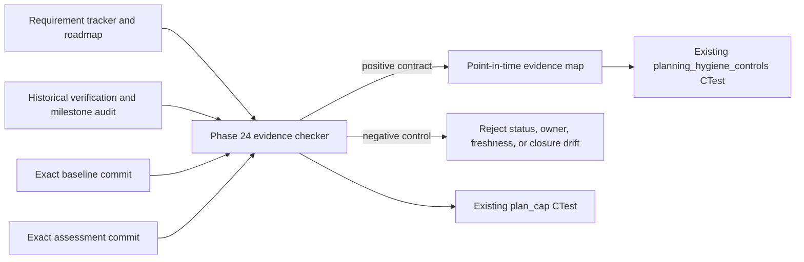

<user_constraints>
## User Constraints (from CONTEXT.md)

### Locked Decisions

### Additive verification evidence
- **D-01:** Keep the Phase 20/21 verification reports and their source identities unchanged. Record current checks in an additive Phase 24 evidence record pinned to an exact commit; label them as point-in-time checks, not refreshed phase verification.
- **D-02:** Run only the existing focused checks that cover changed in-scope contracts, after cheaper identity/consistency checks. Do not run the broad CTest suite, claim the full Phase 20/21 criteria are refreshed, or change their GSD stale statuses. The D-103 exact-final-head suite remains a separate milestone gate.

### Read-only candidate research
- **D-03:** If source metadata helps explain the current gaps, consult only first-party pages for Potion Panic, µCity 1.3, dmg-acid2, cgb-acid2, and the pinned gbmicrotest upstream. Record source identity and page-access results as facts. Do not search a third game candidate, fetch ROM/source payloads, build, run, or admit fixture bytes, or draw a legal/rights conclusion from metadata labels.
- **D-04:** Treat upstream-page access failures as access failures, not evidence that a source or permission is absent. A later rights determination or fixture action requires separate explicit authorization.

### Phase exit with gaps
- **D-05:** Phase 24 can pass when its additive evidence map and automated controls are complete, even if the four original requirements remain Pending and Phase 20/21 remain marked stale. Keep the milestone audit at `gaps_found`; do not accept gaps, close v0.4, or imply that phase completion satisfies the original requirements.
- **D-06:** Preserve the 40-plan total ceiling. The roadmap currently has 39 plan files, so Phase 24 has one plan available; no plan, review, gap, test-suite, lifecycle, release, fixture, or rights budget is reset by this rescope.

### the agent's Discretion
- Select the existing focused CTest targets that match the files and claims touched by the one plan; keep the existing test identities and CMake/Python standard-library patterns.
- Use machine-checkable positive and negative controls for the Phase 24 report so false requirement completion, ownership changes, or milestone closure are rejected.
- Keep source facts, evaluator/reviewer outcomes, current freshness, and remaining authority gates in separate fields to avoid conflating a focused control pass with requirement completion.
- Add no dependency or new CTest identity unless the plan demonstrates a concrete recurring need and stays within this one-plan scope.

### Deferred Ideas (OUT OF SCOPE)
- Candidate-specific rights determination, fixture/source payload acquisition, build/run/admission, and any new candidate require separate explicit owner authorization.
- The D-103 exact-final-head broad suite and milestone archival remain separate owner-controlled gates.
</user_constraints>

# Phase 24: Resolve remaining v0.4 evidence and verification gaps — Research

**Researched:** 2026-11-16  
**Domain:** Commit-pinned planning evidence and CMake/CTest checker controls  
**Confidence:** LOW per the confidence seam for the generic `codebase` provider; repository-specific facts below were read directly from the cited source files.

## Summary

Phase 24 is a repository evidence and planning-control phase. Produce one additive, commit-pinned map that separates (a) original requirement text and ownership, (b) current REQUIREMENTS and audit dispositions, (c) what the historical verification reports actually say, (d) the point-in-time freshness result, and (e) the remaining gate. Keep the old Phase 20/21 reports byte-for-byte historical and leave the four original Pending requirements with their existing owners. The phase can complete its own evidence/control deliverable while the milestone remains open. [VERIFIED: .planning/phases/GB-24-resolve-remaining-v0-4-evidence-and-verification-gaps/24-CONTEXT.md:7-11,17-27]

**Primary recommendation:** Add one Phase 24 evidence record, then extend the existing Python planning-hygiene contract with a point-in-time report check and causal positive/negative controls. Preserve the registered `plan_cap` and `planning_hygiene_controls` identities; run only those two CTests after cheap commit and consistency checks. Do not refresh Phase 20/21, change their stale status, or imply requirement or milestone completion. [VERIFIED: .planning/phases/GB-24-resolve-remaining-v0-4-evidence-and-verification-gaps/24-CONTEXT.md:18-33; tests/cmake/hygiene.cmake:68-85]

No new package, external API, emulator build, fixture bytes, or first-party metadata lookup is needed to plan the deliverable. The existing discussion already records the allowed metadata sources and access failures; its rule is to treat failures as access failures and not infer absent source or permission. [VERIFIED: .planning/phases/GB-24-resolve-remaining-v0-4-evidence-and-verification-gaps/24-CONTEXT.md:21-23,68-73]

## Phase Requirements

| ID | Description | Research Support |
|----|-------------|------------------|
| FIXT-01 | “Game-fixture search is bounded to Potion Panic (GB Compo 2025 demo) first and µCity 1.3 as the sole fallback; each attempt verifies the exact source/build, ROM digest, cartridge header, and CGB mode, and failure of both candidates produces a reasoned absence without a third search.” | Preserve the requirement verbatim and keep assessment status separate from the REQUIREMENTS checkbox and historical Phase 21 result. No candidate/build/ROM fact may be invented. |
| RIGHTS-01 | “An admitted game or diagnostic fixture has verified redistribution permission for repository and public-CI use, with per-component code, art, audio-driver, build-input, and notice terms recorded; game ROMs are excluded from installed and product-release packages, and GabbaBoy's root MIT license remains unchanged.” | Identity and package checks establish technical boundaries only. Keep rights determination and fixture admission out of this phase. |
| DIAG-01 | “The admitted dmg-acid2 and cgb-acid2 derivatives replace glyph tiles and mask the text region, with source/build provenance and rights recorded; their evidence is labeled as controlled composition, not mode-3 timing.” | Keep the historic synthetic-plus-metadata result separate from evidence that would require an admitted derivative and its source/build/rights records. |
| DIAG-02 | “Each admitted gbmicrotest case is tied to exact source and bytes, redistribution terms, and declared model applicability; suite results retain explicit eligible, executed, and excluded cases.” | Keep named cases distinct from exact source/bytes, terms, applicability, and eligible/executed/excluded results. |

These four IDs remain owned by Phases 20, 21, and 22; this table is an evidence-mapping scope, not a reassignment or completion claim. The source tracker lists `FIXT-01` and `RIGHTS-01` as Pending under Phases 21 and 20, and `DIAG-01` and `DIAG-02` as Pending under Phase 22. [VERIFIED: .planning/REQUIREMENTS.md:58-65; verbatim: “| FIXT-01 | Phase 21 | Pending |”, “| RIGHTS-01 | Phase 20 | Pending |”, “| DIAG-01 | Phase 22 | Pending |”, “| DIAG-02 | Phase 22 | Pending |”]

The downstream map should cover all eight original v0.4 requirements, even though only four remain Pending. It must retain both the tracker result and audit result because stale Phase21 verification makes three tracker-Complete items partial in the audit, while REL-01 remains satisfied. [VERIFIED: .planning/v0.4-MILESTONE-AUDIT.md:104-117; verbatim: “GAME-01 | 21 | Complete”, “GAME-01 | 21 | Complete | Stale”, “REL-01 | 23 | Complete | Passed”, “REL-01 | 23 | Complete | Passed | Listed in 23-06 and 23-08 | Satisfied”]

| Requirement | Owner / tracker | Current audit evidence and freshness | Exact remaining gate to record |
|-------------|----------------|----------------------------------|-------------------------------|
| GAME-01 | Phase 21 / Complete | Partial; Phase21 freshness stale. Historical report says satisfied. | Fresh full Phase21 verification is outside this phase; retain its prior claim as historical while the audit remains partial. |
| GAME-02 | Phase 21 / Complete | Partial; Phase21 freshness stale. Historical report records harness-level satisfaction. | Fresh full Phase21 verification is outside this phase; do not treat a Phase24 report-control pass as a refresh. |
| FIXT-01 | Phase 21 / Pending | Unsatisfied; Phase21 freshness stale. Both named candidate attempts stopped before builds or ROM facts. | Separate authorized work must establish the exact source/build, digest, cartridge header, and CGB mode for the bounded candidates, or preserve an evidence-backed reasoned absence. |
| RIGHTS-01 | Phase 20 / Pending | Unsatisfied; Phase20 freshness stale. No fixture was admitted or candidate-specific grant scope evaluated. | A separately authorized rights/admission review must verify repository/public-CI redistribution permissions and each component's terms. |
| DIAG-01 | Phase 22 / Pending | Unsatisfied; Phase22 verification passed for its historical metadata-only assessment; no derivative was admitted. | Separately authorized work must establish the required derivative composition, source/build provenance, and rights. |
| DIAG-02 | Phase 22 / Pending | Unsatisfied; Phase22 verification passed for its historical metadata-only assessment; 513 names, seven unresolved gates, admitted=0, executed=0. | Separately authorized work must tie eligible cases to exact source/bytes, terms, applicability, and observed eligible/executed/excluded outcomes. |
| FEED-01 | Phase 21 / Complete | Partial; Phase21 freshness stale. Historical report records the workflow contract. | Fresh full Phase21 verification is outside this phase; retain the requirement's current Complete tracker value separately from audit partial. |
| REL-01 | Phase 23 / Complete | Satisfied; Phase23 verification passed. | No requirement-specific gate appears in the current audit; the D-103 final-head broad suite remains a separate milestone gate. |

The tracker rows and original acceptance text are verbatim in REQUIREMENTS.md; the audit's separate statuses and evidence are in its requirements coverage and phase status sections. Treat the matrix above as the design contract for the future evidence map, not as new completion evidence. [VERIFIED: .planning/REQUIREMENTS.md:11-30,58-65; .planning/v0.4-MILESTONE-AUDIT.md:20-77,104-129; verbatim: “| GAME-01 | Phase 21 | Complete |”, “| FIXT-01 | Phase 21 | Pending |”, “| DIAG-02 | Phase 22 | Pending |”, “| REL-01 | Phase 23 | Complete |”]

Phase22's report also explicitly carries `current_freshness: not_evaluated`; its historical “passed” status applies to the approved metadata-only scope and does not say Phase20/21 are fresh. [VERIFIED: .planning/phases/GB-22-composition-and-microtest-evidence/22-VERIFICATION.md:3-11; verbatim: “status: passed”, “current_freshness: not_evaluated”]

## Architectural Responsibility Map

| Capability | Primary Tier | Secondary Tier | Rationale |
|------------|-------------|----------------|-----------|
| Requirement and phase-freshness evidence map | Repository planning/evidence | — | It reconciles committed planning records and historical verification; it does not change emulator/runtime behavior. |
| Positive and negative consistency controls | Existing test tooling (Python standard library + CMake/CTest) | Immutable Git snapshot | The checker validates the evidence record from an exact commit and the tests execute the checker. Existing controls already pin reports and inputs to immutable commits. |

There is no browser, frontend server, API service, emulator core, or database responsibility in this phase. Keep work in the planning artifacts and existing repository test tooling. [VERIFIED: .planning/phases/GB-24-resolve-remaining-v0-4-evidence-and-verification-gaps/24-CONTEXT.md:7-11,56-66]

## Project Constraints (from AGENTS.md)

- Keep the emulator scope and implementation untouched: GabbaBoy targets Game Boy and Game Boy Color, and no emulator build or game claim should be implied by planning evidence. [VERIFIED: AGENTS.md:22-24,48-55]
- Use the installed OpenGSD runtime; the repository's runtime identity was confirmed as `@opengsd/gsd-core`. [VERIFIED: AGENTS.md:28; tool: runtime-identity returned “{\"packageName\":\"@opengsd/gsd-core\",\"version\":\"1.20.0\"}”]
- Keep the phase within the one-plan allowance and the existing 40-plan total. Do not renew plan, review, gap, suite, lifecycle, release, fixture, or rights budgets. [VERIFIED: 24-CONTEXT.md:25-33; verbatim: “Preserve the 40-plan total ceiling.”]
- Put reusable checker code in `tests/scripts/`, have it read immutable commit facts where appropriate, and wire it into an existing CTest identity because the phase context explicitly allows no new identity. [VERIFIED: AGENTS.md:34-40; 24-CONTEXT.md:29-33]
- Every deliverable needs an automated positive and meaningful negative control. Use automated UAT closure and do not invent manual UAT just to satisfy a template. [VERIFIED: AGENTS.md:34]
- Run cheap identity and consistency checks before the focused controls. The phase context explicitly disallows a broad suite and says the D-103 exact-final-head suite remains a separate milestone gate. [VERIFIED: AGENTS.md:34; 24-CONTEXT.md:18-19,110-111]
- Keep summary coverage in the required GSD block schema and check UAT closure with the existing shared checker if phase closure requires it. Do not use human checkpoints for evidence that can be contract-checked. [VERIFIED: AGENTS.md:34]
- Read point-in-time facts from the checked boundary commit; do not assert live route or ancestry facts from a moving HEAD. [VERIFIED: AGENTS.md:34,39-40]
- Keep the milestone audit open with `gaps_found`; no requirement acceptance, milestone close, or archival belongs in this phase. [VERIFIED: 24-CONTEXT.md:25-27,107-111; .planning/v0.4-MILESTONE-AUDIT.md:2-4; verbatim: “status: gaps_found”]

## Standard Stack

### Core

| Library/tool | Version | Purpose | Why Standard |
|--------------|---------|---------|--------------|
| Python standard library | Existing configured Python; no new minimum selected | Parse and validate the structured evidence record; build isolated positive and mutant controls. | The phase context says existing contracts use Python standard library and asks to keep the dependency tree flat. |
| CMake/CTest | Existing project presets; local CMake/CTest observed at 4.4.3 | Configure the current source revision and run only the two approved focused tests. | Existing planning tests are registered from `tests/cmake/hygiene.cmake`. |
| Git | Local 2.41.0 observed | Read the full immutable input and target commits; do not rely on a symbolic ref or dirty working tree. | The existing checker validates full commit IDs and reads a committed planning snapshot. |

The local version probes are availability observations only; they do not establish a new Python compatibility floor. Do not add PyYAML or another parser dependency. Use the existing parser and CMake/Python conventions. [VERIFIED: 24-CONTEXT.md:87-94; tests/scripts/verify-planning-hygiene.py:256-282]

### Supporting

| Tool | Purpose | When to Use |
|------|---------|-------------|
| `git show` / immutable Git archive | Read exact report inputs and historical protected files from pinned commits. | For the Phase 24 report check and old-report immutability control. |
| Existing CTest wrapper | Assert the command's expected exit code and output without changing test identity. | For the two allowed focused tests. |

### Alternatives Considered

| Instead of | Could Use | Tradeoff |
|------------|-----------|----------|
| Extending the existing planning-hygiene contract | Add a new standalone checker and CTest identity | A separate identity spends the explicitly limited test surface and duplicates the existing immutable-snapshot and report-validation machinery. Keep the existing identities. |
| Existing parser and standard library | Add a YAML/Markdown dependency | Adds package and parser compatibility surface for a fixed local report format; context directs the plan to retain current Python/CMake patterns. |
| Point-in-time map with old Phase 20/21 reports preserved | Rewrite the historical Phase 20/21 verification reports | Would erase historical identity/status and contradict D-01. |

**Installation:** None. This scope proposes no external package installation. [VERIFIED: 24-CONTEXT.md:29-33]

**Package legitimacy audit:** Not applicable; no package is proposed or installed.

## Architecture Patterns

### System Architecture Diagram



The checker must read the source report and protected inputs from immutable Git objects. The existing helper validates a full commit ID, checks that it is a commit object, then reads the planning tree from that commit. [VERIFIED: tests/scripts/verify-planning-hygiene.py:256-282]

### Recommended Project Structure

```
.planning/phases/GB-24-resolve-remaining-v0-4-evidence-and-verification-gaps/
└── 24-EVIDENCE.md                 # one additive, commit-pinned assessment
tests/scripts/
└── verify-planning-hygiene.py     # extend the existing report contract and controls
tests/cmake/
└── hygiene.cmake                  # preserve the existing test identities
```

The evidence filename is a recommendation modeled on the existing Phase 22 and 23 evidence artifacts, not a locked path. [ASSUMED]

### Pattern 1: Separate requirement truth, audit result, and evidence freshness

**What:** Give each original requirement one row with exact acceptance text, original owner, REQUIREMENTS status, current audit status, source evidence references, phase-verification result/freshness, and the precise unsatisfied gate. Keep these as separate fields. [VERIFIED: .planning/phases/GB-24-resolve-remaining-v0-4-evidence-and-verification-gaps/24-CONTEXT.md:9,29-33]

**When to use:** Any phase that reconciles a completed requirement tracker with stale underlying phase evidence or a historical no-go assessment. [VERIFIED: .planning/v0.4-MILESTONE-AUDIT.md:104-129]

**Example:**

```text
Source criterion: quoted from REQUIREMENTS.md.
Tracker disposition: quoted from the current immutable REQUIREMENTS.md snapshot.
Audit outcome: quoted from the current immutable milestone-audit snapshot.
Historical report: status as recorded at its original verification boundary.
Current freshness: the audit's point-in-time GSD result, with its cited changed-file reason.
Remaining gate: the unmet acceptance evidence or the separately authorized full refresh.
```

This is a field separation recommendation, not an assertion that any old report is fresh. Phase 20/21 reports say “passed” at their recorded boundary, while the current audit says their GSD status is “stale”. [VERIFIED: .planning/phases/GB-20-fixture-admission-tune-up/20-VERIFICATION.md:3-8; .planning/phases/GB-21-cgb-game-progress-and-scene-regressions/21-VERIFICATION.md:3-5; .planning/v0.4-MILESTONE-AUDIT.md:70-77,121-129; verbatim: “status: passed”, “status: stale”]

### Pattern 2: Pin the input snapshot separately from the new record

**What:** Record the full input/assessment commit in the Phase 24 evidence. Let the containing later commit carry the evidence record; cite that record commit from the phase SUMMARY or verification output. Do not require the record to contain the commit hash of itself. Keep the initial comparison baseline distinct from the exact commit whose contents the checker assesses. [ASSUMED]

**When to use:** Whenever evidence is recorded in a commit that must refer to the exact commit whose files were checked. The existing checker already requires a full commit id and reads snapshots by object ID rather than a mutable tag or working-tree path. [VERIFIED: tests/scripts/verify-planning-hygiene.py:256-282; tests/scripts/verify-planning-hygiene.py:35-39]

**Example:**

```text
assessment_input_commit: the exact committed requirement/audit/report snapshot read
baseline_commit: the exact snapshot whose historical report bytes are protected
control_output: the result for the exact committed Phase 24 record under test
```

Do not insert a future test result or a hash that can only be known after the evidence record's own commit is created. The final phase evidence can point to the committed record after that commit exists. [ASSUMED]

### Pattern 3: Use current audit freshness as an explicitly dated observation

**What:** Preserve the old report's recorded status and the current audit/GSD freshness as two separate facts. For Phases 20/21, quote the audited stale status and changed covered-file category; do not claim Phase24's focused checks re-run or refresh the full historical criteria. [VERIFIED: .planning/v0.4-MILESTONE-AUDIT.md:70-77,98-102,119-129]

**Why:** Phase 20 stores source and verification heads plus a covered digest; Phase 21 stores its covered digest. The current audit separately reports that both are stale after covered-file changes. A recorded passed report and a stale current freshness status can both be true. [VERIFIED: .planning/phases/GB-20-fixture-admission-tune-up/20-VERIFICATION.md:3-8,67; .planning/phases/GB-21-cgb-game-progress-and-scene-regressions/21-VERIFICATION.md:3-5,48-49; .planning/v0.4-MILESTONE-AUDIT.md:121-129; verbatim: “status: passed”, “status: stale”]

## Don't Hand-Roll

| Problem | Don't Build | Use Instead | Why |
|---------|-------------|-------------|-----|
| Commit-pinned report reads | A second snapshot loader or trust the live file/branch | Existing `commit_snapshot`, `commit_file`, and full-commit validation helpers in `verify-planning-hygiene.py` | Existing code rejects abbreviated/non-commit revisions and reads a committed planning archive. |
| Report frontmatter validation | A second ad hoc YAML parser or substring-only checks | Existing frontmatter and mapping-pair helpers in `verify-planning-hygiene.py`; extend only as needed for the Phase24 schema | The current reconciliation already tests duplicate and contradictory requirement data with semantic error classes. |
| Requirement ownership/status controls | An unstructured prose search | Machine-checkable exact ID/owner/status sets and causal mutants | The context specifically requires rejection of false completion, ownership changes, and milestone closure. |
| UAT/phase closure evidence | A phase-local manual checklist | `tests/scripts/verify-uat-closure.py` and existing SUMMARY coverage contract | Project directives require automated closure with zero human checkpoints when machine checks can express the contract. |
| Permission conclusions from page labels or access failures | A checker that infers rights from metadata | Record source-page facts and access outcome separately; leave rights gate unresolved | Source metadata labels and page access are not a rights determination, and the phase boundary explicitly forbids one. |

**Key insight:** Existing controls already provide immutable snapshot reads, frontmatter parsing, semantic rejection tokens, and CTest wrapping. Extend that seam narrowly rather than building a new framework or broadening the test lane. [VERIFIED: tests/scripts/verify-planning-hygiene.py:256-282,369,614,847-922; tests/cmake/hygiene.cmake:28-43,68-85]

## Common Pitfalls

### Pitfall 1: Treating a historical pass as current freshness

**What goes wrong:** The map copies `status: passed` from a historical report and calls Phase20/21 current.  
**Why it happens:** The report's verification result and current freshness answer different questions.  
**How to avoid:** Record the historical result, current GSD stale disposition, and separate remaining full-refresh gate in distinct fields.  
**Warning signs:** Phase20/21 are listed as fresh because only their old report frontmatter was read.  
[VERIFIED: .planning/v0.4-MILESTONE-AUDIT.md:70-77,121-129; exact report fields at 20-VERIFICATION.md:3-8 and 21-VERIFICATION.md:3-5]

### Pitfall 2: Letting a focused check satisfy an original requirement

**What goes wrong:** A Phase24 contract-check pass is taken as satisfaction of FIXT-01, RIGHTS-01, DIAG-01, or DIAG-02.  
**Why it happens:** The evidence map, original requirement tracker, and milestone audit are collapsed into one status.  
**How to avoid:** Assert exact original owner and Pending tracker state for the four rows; keep report-control result in a separate field; retain milestone status `gaps_found`.  
**Warning signs:** Requirement statuses become Complete/Satisfied because the report checker passed.  
[VERIFIED: 24-CONTEXT.md:9-11,25-27; .planning/v0.4-MILESTONE-AUDIT.md:2-4,104-117]

### Pitfall 3: Confusing “not observed” with a negative fact

**What goes wrong:** Upstream access failure becomes “source missing” or “no permission”; no-go metadata becomes a legal conclusion.  
**How to avoid:** Record the page-access outcome, source identity, and authority gate as separate observations; do not state a rights result.  
**Warning signs:** Wording such as “license absent” inferred only from inaccessible source pages, labels, or a stopped attempt.  
[VERIFIED: 24-CONTEXT.md:21-23,68-73,100-104]

### Pitfall 4: Pinning a mutable or self-referential revision

**What goes wrong:** A symbolic branch/tag, dirty working tree, abbreviated ID, or report's own future commit hash is used as the evidence boundary.  
**How to avoid:** Use the existing full-commit validator and immutable snapshot reader; record the input revision separately from the commit that later stores the record.  
**Warning signs:** The checker shells out to `HEAD` at runtime or reads the report with `Path.read_text` rather than from the pinned snapshot.  
[VERIFIED: tests/scripts/verify-planning-hygiene.py:13-17,256-282; tests/cmake/hygiene.cmake:9,14-25]

### Pitfall 5: Spending the focused test's full time budget on new mutants

**What goes wrong:** More report controls push `planning_hygiene_controls` over its existing 30-second timeout.  
**How to avoid:** Add a small number of semantic mutations to the existing self-test, retain the current CTest identity/timeout, and run the cheap `plan_cap` first. Keep controls deterministic and local; avoid needless temporary commits or repeated identical Git queries.  
**Warning signs:** A self-test run approaches the 30-second ceiling or requires widening the timeout.  
[VERIFIED: tests/cmake/hygiene.cmake:73-85; .planning/phases/GB-23.1-close-v0-4-requirement-and-verification-gaps/23.1-01-SUMMARY.md:448; verbatim: “The final direct self-test took about 25.5 seconds; the final named CTest took 26.42 seconds.”]

### Pitfall 6: Updating a historical report while adding current evidence

**What goes wrong:** Phase20/21 reports or their source identities are edited to look current.  
**How to avoid:** Add Phase24 evidence separately and compare old report bytes against the pinned baseline.  
**Warning signs:** Historical `source_head`, `verification_head`, `covered_digest`, or original owner/status fields change.  
[VERIFIED: .planning/phases/GB-24-resolve-remaining-v0-4-evidence-and-verification-gaps/24-CONTEXT.md:17-19; .planning/phases/GB-20-fixture-admission-tune-up/20-VERIFICATION.md:3-8,67; .planning/phases/GB-21-cgb-game-progress-and-scene-regressions/21-VERIFICATION.md:3-5,48-49]

## Code Examples

The current immutable reconciliation command shape is documented in the checker as `--check v04-reconciliation --stage report|handoff --rev COMMIT --baseline-rev COMMIT`; Phase24 should extend this established two-commit pattern for its own report contract rather than reuse the Phase22-only meaning of the existing report stage. [VERIFIED: tests/scripts/verify-planning-hygiene.py:35-39,3073-3080,3112-3115]

After implementation, configure so the existing CMake test commands capture the committed source revision, then run only the two allowed tests:

```bash
cmake --preset phase1
ctest --preset phase1 --output-on-failure --no-tests=error -R '^(plan_cap|planning_hygiene_controls)$'
```

The exact existing identities are registered as `plan_cap` and `planning_hygiene_controls`, each with a 30-second timeout. [VERIFIED: tests/cmake/hygiene.cmake:73-85; exact quote: “gbb_add_hygiene_test(plan_cap ... 30” and “gbb_add_hygiene_test(planning_hygiene_controls ... 30”] The `phase1` configure/test preset exists in CMakePresets.json and the project config's full command uses it; the focused filter above limits execution to the approved identities. [VERIFIED: CMakePresets.json:1-20; .planning/config.json:54; quote: “cmake --preset phase1” and “ctest --preset phase1 --output-on-failure --no-tests=error”]

These are executor commands, not tests run during this research. No source/test mutation or test execution occurred in this research pass. [VERIFIED: task scope; current-research activity]

## State of the Art

No external framework or package is required. The current project pattern is standard-library Python checkers, immutable Git snapshot reads, CMake/CTest registration, and positive plus causal-negative controls. Keep using it for this report-level reconciliation. [VERIFIED: 24-CONTEXT.md:87-94; tests/scripts/verify-planning-hygiene.py:256-282; tests/cmake/hygiene.cmake:28-43]

**Deprecated/outdated:** None identified for this repository-only phase. Do not refresh first-party candidate metadata in this research; the context already records it and expressly bounds any such lookup. [VERIFIED: 24-CONTEXT.md:21-23,68-73]

## Assumptions Log

| # | Claim | Section | Risk if Wrong |
|---|-------|---------|---------------|
| A1 | Naming the new record `24-EVIDENCE.md` follows the Phase22/23 evidence-file convention. | Recommended Project Structure | Low. The plan can choose a different local filename while retaining one canonical additive record. |
| A2 | The evidence should identify its checked input commit and leave the containing record/verification commit to a later summary or report, avoiding a self-reference loop. | Architecture Pattern 2 | Low. This keeps the report's subject revision explicit; the downstream planner can choose the exact field names. |

## Open Questions

No unresolved owner decision is required for planning. At execution, capture the exact immutable assessment input and historical baseline after the one-plan phase starts, then record them in the additive evidence. No broad Phase20/21 refresh or rights action is implied. [VERIFIED: 24-CONTEXT.md:18-27,107-111]

## Environment Availability

| Dependency | Required By | Available | Version | Fallback |
|------------|------------|-----------|---------|----------|
| Python 3 | Existing planning checker and self-test | ✓ | 3.14.4 | — |
| CMake | Configure existing focused CTest targets | ✓ | 4.4.3 | — |
| CTest | Run the two approved CTest identities | ✓ | 4.4.3 | — |
| Git | Immutable commit and planning snapshot reads | ✓ | 2.41.0 | — |

These are read-only availability probes; they do not validate compatibility or execute tests. No missing dependency blocks planning. [VERIFIED: environment probe, 2026-11-16]

## Validation Architecture

### Test Framework

| Property | Value |
|----------|-------|
| Framework | Existing CMake/CTest; local CMake and CTest 4.4.3 |
| Config file | CMakePresets.json; `phase1` uses the existing test-enabled configure preset |
| Quick run command | `ctest --preset phase1 --output-on-failure --no-tests=error -R '^(plan_cap|planning_hygiene_controls)$'` |
| Full suite command | Out of Phase24 scope; do not run it here. D-103 remains a separate exact-final-head milestone gate. |

The approved two identities are the existing `plan_cap` and `planning_hygiene_controls` CTests; the current checker self-test CTest has a 30-second timeout and requires at least 125 reported controls. [VERIFIED: tests/cmake/hygiene.cmake:72-85; exact quote: “GBB_EXPECT_MIN_VALUE=125” and “gbb_add_hygiene_test(planning_hygiene_controls ... 30”]

### Phase Requirements → Test Map

| Req ID | Behavior | Test Type | Automated Command | File Exists? |
|--------|----------|-----------|-------------------|-------------|
| FIXT-01 | The map retains Pending under Phase21 and does not claim build/ROM/header/mode evidence that is not present. | integration control | `ctest --preset phase1 --output-on-failure --no-tests=error -R '^planning_hygiene_controls$'` | Existing target; add/report-control case within current self-test. |
| RIGHTS-01 | The map retains Pending under Phase20 and does not infer grant scope from metadata or access failure. | integration control | Same focused `planning_hygiene_controls` target | Existing target; add/report-control case within current self-test. |
| DIAG-01 | The map retains Pending under Phase22 and distinguishes metadata-only assessment from admitted derivatives. | integration control | Same focused `planning_hygiene_controls` target | Existing target; add/report-control case within current self-test. |
| DIAG-02 | The map retains Pending under Phase22 and distinguishes named metadata cases from eligible/executed evidence. | integration control | Same focused `planning_hygiene_controls` target | Existing target; add/report-control case within current self-test. |
| Phase24 evidence contract | The exact plan count/cap remains valid and the evidence report rejects false completion, owner drift, stale/freshness mislabeling, or milestone closure. | integration/control | `ctest --preset phase1 --output-on-failure --no-tests=error -R '^(plan_cap|planning_hygiene_controls)$'` | Both CTests exist; report control is new behavior inside the existing checker identity. |

The plan-cap test is a cheap first gate and reads the configure-time full commit with Git. Reconfigure after the phase evidence/checker candidate commit so CMake captures that exact commit. [VERIFIED: tests/cmake/hygiene.cmake:9,14-25,73-75]

### Sampling Rate

- **Per task commit:** Run the cheap consistency/identity preflight; then run the two approved focused CTests only at the selected verification boundary.
- **Per wave merge:** No additional test identity or broad CTest run is authorized by this phase.
- **Phase gate:** The Phase24 evidence map and its controls pass; record that this is point-in-time evidence and does not refresh Phase20/21 or satisfy the D-103 full-suite gate.

### Wave 0 Gaps

- Add the report-schema checks and their positive/negative controls to the existing `verify-planning-hygiene.py` self-test; do not create a new CTest identity.
- No framework install, package, emulator build, fixture, or external service is needed.

## Security Domain

This is a local report parser and Git snapshot checker, not a network service. Security enforcement is enabled and the configured ASVS level is 1. [VERIFIED: .planning/config.json:48-50; quote: “\"security_enforcement\": true” and “\"security_asvs_level\": 1”]

### Applicable ASVS Categories

| ASVS Category | Applies | Standard Control |
|---------------|---------|-----------------|
| V2 Authentication | no | No user or service authentication is introduced. |
| V3 Session Management | no | No session state is introduced. |
| V4 Access Control | no | No hosted endpoint or authorization boundary is introduced. |
| V5 Input Validation | yes | Validate full commit IDs, exact requirement ID/status/owner sets, frontmatter structure, field cardinality, and source references. Read checked inputs only from pinned Git objects. |
| V6 Cryptography | no new primitive | Use the existing digest/hash identity mechanisms only as identifiers; do not invent a rights or authenticity claim from a hash. |

### Known Threat Patterns for this tooling

| Pattern | STRIDE | Standard Mitigation |
|---------|--------|---------------------|
| A contradictory or malformed report masquerades as a valid status | Tampering | Validate exact key sets and semantic owner/status pairs; add causal mutants for false completion, changed owner, and milestone closure. |
| A moving branch or dirty worktree changes what a check actually read | Tampering / Repudiation | Require a full commit object ID and read the planning tree from the immutable commit, not the live path. |
| A source-page failure is rewritten as proof of absent source or permission | Information disclosure / Elevation of privilege | Preserve the access-failure fact and leave the rights gate unresolved; perform no rights conclusion. |

The phase scope excludes fixture bytes, candidate execution, rights review, build/run/admission, lifecycle retries, and release operations. [VERIFIED: 24-CONTEXT.md:9-11,21-23,107-111]

## Sources

### Primary (repository source of truth)

- `.planning/phases/GB-24-resolve-remaining-v0-4-evidence-and-verification-gaps/24-CONTEXT.md` — locked scope, ownership limits, existing tool and source boundaries.
- `.planning/REQUIREMENTS.md` — verbatim v0.4 criteria and original owner/status table.
- `.planning/v0.4-MILESTONE-AUDIT.md` — point-in-time audit status, requirement matrix, and Phase20/21 stale reasons.
- `.planning/phases/GB-20-fixture-admission-tune-up/20-VERIFICATION.md`, `.planning/phases/GB-21-cgb-game-progress-and-scene-regressions/21-VERIFICATION.md`, `.planning/phases/GB-22-composition-and-microtest-evidence/22-VERIFICATION.md`, and `.planning/phases/GB-23.1-close-v0-4-requirement-and-verification-gaps/23.1-VERIFICATION.md` — the historical reports and field conventions.
- `tests/scripts/verify-planning-hygiene.py`, `tests/cmake/hygiene.cmake`, `tests/expected-tests.txt`, and `CMakePresets.json` — current immutable-read, report-check, CTest, and preset patterns.
- `AGENTS.md` and `.planning/config.json` — project constraints and workflow/security settings.

No external source lookup was needed: this phase changes repository evidence/control design only, and the existing discussion contains the bounded first-party page observations. [VERIFIED: 24-CONTEXT.md:68-73]

## Metadata

**Confidence breakdown:**
- Standard stack: LOW per the generic `codebase` classifier result; no dependency lookup or new version decision is required.
- Architecture: LOW per the same classifier result; direct repository files establish the existing boundaries.
- Pitfalls: LOW per the same classifier result; the audit, old reports, and self-test timeout are directly inspectable, but no Phase24 control has yet been implemented.

**Research date:** 2026-11-16  
**Valid until:** 2026-12-16 for these stable in-repository patterns; refresh exact status and commit pins at execution.
